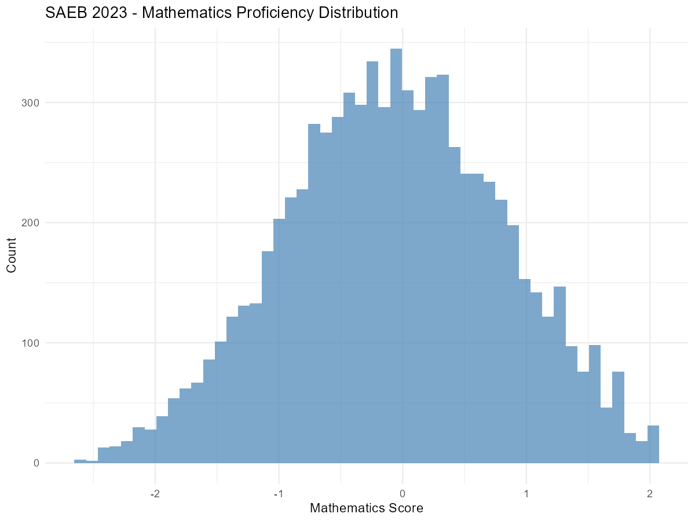
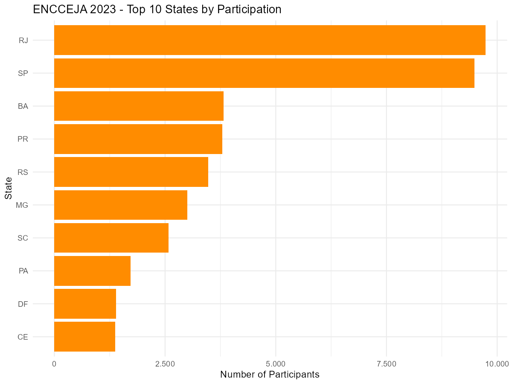
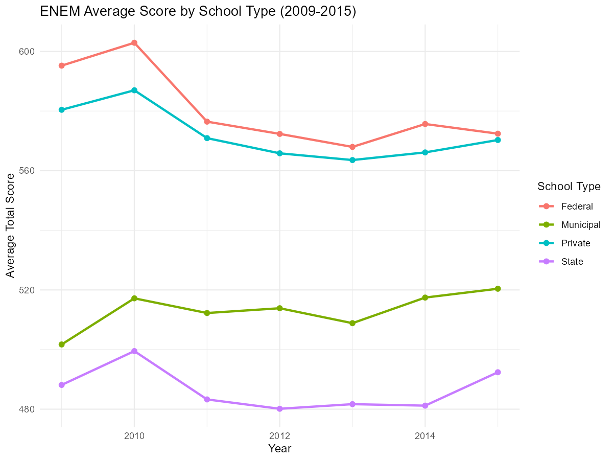

# Basic Education Assessments: SAEB, ENCCEJA, and ENEM by School

This vignette covers three basic education assessment datasets available
in educabR. For IDEB, ENEM, and the School Census, see
[`vignette("getting-started")`](https://sidneybissoli.github.io/educabR/articles/getting-started.md).

\
[`library`](https://rdrr.io/r/base/library.html)`(`[`educabR`](https://github.com/SidneyBissoli/educabR)`)`\
[`library`](https://rdrr.io/r/base/library.html)`(`[`dplyr`](https://dplyr.tidyverse.org)`)`\
[`library`](https://rdrr.io/r/base/library.html)`(`[`ggplot2`](https://ggplot2.tidyverse.org)`)`

## SAEB - Basic Education Assessment System

SAEB (Sistema de Avaliacao da Educacao Basica) is a biennial assessment
that measures student performance in Portuguese and Mathematics across
Brazilian basic education. It is one of the components used to calculate
IDEB.

### Available data types

SAEB microdata includes four perspectives:

| Type          | Description                               |
|---------------|-------------------------------------------|
| `"aluno"`     | Student-level results (scores, responses) |
| `"escola"`    | School questionnaire data                 |
| `"diretor"`   | Principal questionnaire data              |
| `"professor"` | Teacher questionnaire data                |

### Downloading SAEB data

Since 2013, INEP publishes one student file per grade, so
`type = "aluno"` needs a `serie`: `"5ef"` and `"9ef"` (5th and 9th
grades of elementary school), `"2ef"` (2nd grade, 2019 onwards),
`"34em"` (3rd/4th grades of high school, 2019 onwards), `"3em"` (2013,
2015) or `"3em_ag"`/`"3em_esc"` (2017). The numbers 2, 5 and 9 work as
shortcuts. Without `serie`,
[`get_saeb()`](https://sidneybissoli.github.io/educabR/reference/get_saeb.md)
stops and lists the grades available for that year.

\
`# Student performance data, 5th grade`\
`saeb_5ef`` ``<-`` `[`get_saeb`](https://sidneybissoli.github.io/educabR/reference/get_saeb.md)`(``year ``=`` ``2023``, type ``=`` ``"aluno"``, serie ``=`` ``"5ef"``)`\
\
`# School questionnaire`\
`saeb_schools`` ``<-`` `[`get_saeb`](https://sidneybissoli.github.io/educabR/reference/get_saeb.md)`(``year ``=`` ``2023``, type ``=`` ``"escola"``)`\
\
`# Use n_max for exploration`\
`saeb_sample`` ``<-`` `[`get_saeb`](https://sidneybissoli.github.io/educabR/reference/get_saeb.md)`(``year ``=`` ``2023``, serie ``=`` ``9``, n_max ``=`` ``5000``)`\
\
`# Several grades: one call per grade (columns differ between grades;`\
`# the 5th and 9th grade files are about 1 GB of CSV each)`\
`saeb_ef`` ``<-`` ``purrr``::`[`map`](https://purrr.tidyverse.org/reference/map.html)`(`[`c`](https://rdrr.io/r/base/c.html)`(``"5ef"``, ``"9ef"``)``, ``function``(``s``)`` ``{`\
`  `[`get_saeb`](https://sidneybissoli.github.io/educabR/reference/get_saeb.md)`(``year ``=`` ``2023``, serie ``=`` ``s``)`\
`}``)`

### Available years

SAEB is conducted every two years: 2011, 2013, 2015, 2017, 2019, 2021,
2023.

\
`# 2021 data is split by education level`\
`saeb_fund`` ``<-`` `[`get_saeb`](https://sidneybissoli.github.io/educabR/reference/get_saeb.md)`(`\
`  year  ``=`` ``2021``,`\
`  type  ``=`` ``"aluno"``,`\
`  level ``=`` ``"fundamental_medio"``,`\
`  serie ``=`` ``"9ef"`\
`)`\
\
`saeb_infantil`` ``<-`` `[`get_saeb`](https://sidneybissoli.github.io/educabR/reference/get_saeb.md)`(`\
`  year  ``=`` ``2021``,`\
`  type  ``=`` ``"aluno"``,`\
`  level ``=`` ``"educacao_infantil"`\
`)`

### Example analysis: Score distribution

\
`# Explore student scores (2nd grade of elementary school)`\
`saeb_sample`` ``<-`` `[`get_saeb`](https://sidneybissoli.github.io/educabR/reference/get_saeb.md)`(``2023``, type ``=`` ``"aluno"``, serie ``=`` ``"2ef"``, n_max ``=`` ``10000``)`\
\
`# Score distribution by subject`\
`saeb_sample`` ``|>`\
`  `[`filter`](https://dplyr.tidyverse.org/reference/filter.html)`(``!`[`is.na`](https://rdrr.io/r/base/NA.html)`(``proficiencia_mt``)``)`` ``|>`\
`  `[`ggplot`](https://ggplot2.tidyverse.org/reference/ggplot.html)`(`[`aes`](https://ggplot2.tidyverse.org/reference/aes.html)`(``x ``=`` ``proficiencia_mt``)``)`` ``+`\
`  `[`geom_histogram`](https://ggplot2.tidyverse.org/reference/geom_histogram.html)`(``bins ``=`` ``50``, fill ``=`` ``"steelblue"``, alpha ``=`` ``0.7``)`` ``+`\
`  `[`labs`](https://ggplot2.tidyverse.org/reference/labs.html)`(`\
`    title ``=`` ``"SAEB 2023 - Mathematics Proficiency Distribution (2nd grade)"``,`\
`    x     ``=`` ``"Mathematics Score"``,`\
`    y     ``=`` ``"Count"`\
`  ``)`` ``+`\
`  `[`theme_minimal`](https://ggplot2.tidyverse.org/reference/ggtheme.html)`(``)`

------------------------------------------------------------------------

## ENCCEJA - Youth and Adult Education Certification

ENCCEJA (Exame Nacional para Certificacao de Competencias de Jovens e
Adultos) provides certification for elementary and high school
equivalency. It covers four knowledge areas: Natural Sciences,
Mathematics, Portuguese, and Social Sciences.

### Downloading ENCCEJA data

\
`# Download ENCCEJA microdata`\
`encceja_2023`` ``<-`` `[`get_encceja`](https://sidneybissoli.github.io/educabR/reference/get_encceja.md)`(``year ``=`` ``2023``)`\
\
`# Sample for exploration`\
`encceja_sample`` ``<-`` `[`get_encceja`](https://sidneybissoli.github.io/educabR/reference/get_encceja.md)`(``year ``=`` ``2023``, n_max ``=`` ``5000``)`\
\
`# Participants deprived of liberty (PPL) come in a separate file`\
`encceja_ppl`` ``<-`` `[`get_encceja`](https://sidneybissoli.github.io/educabR/reference/get_encceja.md)`(``year ``=`` ``2023``, type ``=`` ``"ppl"``)`

By default
[`get_encceja()`](https://sidneybissoli.github.io/educabR/reference/get_encceja.md)
reads the national regular exam (`type = "regular"`); `type = "ppl"`
reads the exam applied to people deprived of liberty.

### Available years

ENCCEJA microdata is available for 2014, 2017-2020 and 2022-2025. INEP
published no microdata for 2015, 2016 and 2021.

\
`# Explore the data structure`\
[`glimpse`](https://pillar.r-lib.org/reference/glimpse.html)`(``encceja_sample``)`

### Example analysis: Participation by state

\
`encceja_2023`` ``<-`` `[`get_encceja`](https://sidneybissoli.github.io/educabR/reference/get_encceja.md)`(``2023``, n_max ``=`` ``50000``)`\
\
`# Count participants by state`\
`participants_by_state`` ``<-`` `\
`  ``encceja_2023`` ``|>`\
`  `[`count`](https://dplyr.tidyverse.org/reference/count.html)`(``sg_uf_prova``, sort ``=`` ``TRUE``)`` ``|>`\
`  `[`head`](https://rdrr.io/r/utils/head.html)`(``10``)`\
\
[`ggplot`](https://ggplot2.tidyverse.org/reference/ggplot.html)`(``participants_by_state``, `[`aes`](https://ggplot2.tidyverse.org/reference/aes.html)`(`\
`  x ``=`` `[`reorder`](https://rdrr.io/r/stats/reorder.factor.html)`(``sg_uf_prova``, ``n``)``,`\
`  y ``=`` ``n`\
`)``)`` ``+`\
`  `[`geom_col`](https://ggplot2.tidyverse.org/reference/geom_bar.html)`(``fill ``=`` ``"darkorange"``)`` ``+`\
`  `[`coord_flip`](https://ggplot2.tidyverse.org/reference/coord_flip.html)`(``)`` ``+`\
`  `[`labs`](https://ggplot2.tidyverse.org/reference/labs.html)`(`\
`    title ``=`` ``"ENCCEJA 2023 - Top 10 States by Participation"``,`\
`    x     ``=`` ``"State"``,`\
`    y     ``=`` ``"Number of Participants"`\
`  ``)`` ``+`\
`  `[`theme_minimal`](https://ggplot2.tidyverse.org/reference/ggtheme.html)`(``)`` ``+`\
`  `[`scale_y_continuous`](https://ggplot2.tidyverse.org/reference/scale_continuous.html)`(``label ``=`` ``scales``::`[`number_format`](https://scales.r-lib.org/reference/comma.html)`(``big.mark ``=`` ``"."``, decimal.mark ``=`` ``","``)``)`

------------------------------------------------------------------------

## ENEM by School (2005-2015)

ENEM by School (ENEM por Escola) provides ENEM results aggregated at the
school level. This dataset covers 2005 to 2015 in a single bundled file
and was **discontinued after 2015**.

### Downloading the data

Unlike other datasets, this function has no `year` parameter — it
downloads the entire 2005-2015 dataset at once.

\
`# Download all ENEM by School data (2005-2015)`\
`enem_escola`` ``<-`` `[`get_enem_escola`](https://sidneybissoli.github.io/educabR/reference/get_enem_escola.md)`(``)`\
\
`# Sample for exploration`\
`enem_escola_sample`` ``<-`` `[`get_enem_escola`](https://sidneybissoli.github.io/educabR/reference/get_enem_escola.md)`(``n_max ``=`` ``5000``)`

### Data structure

\
[`glimpse`](https://pillar.r-lib.org/reference/glimpse.html)`(``enem_escola_sample``)`

### Example analysis: School performance trends

\
`enem_escola`` ``<-`` `[`get_enem_escola`](https://sidneybissoli.github.io/educabR/reference/get_enem_escola.md)`(``)`\
\
`# Average scores over time (public vs private)`\
`trend`` ``<-`\
`  ``enem_escola`` ``|>`\
`  `[`mutate`](https://dplyr.tidyverse.org/reference/mutate.html)`(`\
`    media_geral ``=`` `[`rowMeans`](https://rdrr.io/r/base/colSums.html)`(`\
`      `[`across`](https://dplyr.tidyverse.org/reference/across.html)`(`[`c`](https://rdrr.io/r/base/c.html)`(``nu_media_cn``, ``nu_media_ch``, ``nu_media_lp``, ``nu_media_mt``, ``nu_media_red``)``)``,`\
`      na.rm ``=`` ``FALSE`\
`    ``)`\
`  ``)`` ``|>`\
`  `[`filter`](https://dplyr.tidyverse.org/reference/filter.html)`(``!`[`is.na`](https://rdrr.io/r/base/NA.html)`(``media_geral``)``)`` ``|>`\
`  `[`group_by`](https://dplyr.tidyverse.org/reference/group_by.html)`(``nu_ano``, ``tp_dependencia_adm_escola``)`` ``|>`\
`  `[`summarise`](https://dplyr.tidyverse.org/reference/summarise.html)`(`\
`    mean_score ``=`` `[`mean`](https://rdrr.io/r/base/mean.html)`(``media_geral``, na.rm ``=`` ``TRUE``)``,`\
`    .groups    ``=`` ``"drop"`\
`  ``)`` ``|>`\
`  `[`mutate`](https://dplyr.tidyverse.org/reference/mutate.html)`(`\
`    admin_type ``=`` `[`case_when`](https://dplyr.tidyverse.org/reference/case-and-replace-when.html)`(`\
`      ``tp_dependencia_adm_escola`` ``==`` ``1`` ``~`` ``"Federal"``,`\
`      ``tp_dependencia_adm_escola`` ``==`` ``2`` ``~`` ``"State"``,`\
`      ``tp_dependencia_adm_escola`` ``==`` ``3`` ``~`` ``"Municipal"``,`\
`      ``tp_dependencia_adm_escola`` ``==`` ``4`` ``~`` ``"Private"`\
`    ``)`\
`  ``)`\
\
[`ggplot`](https://ggplot2.tidyverse.org/reference/ggplot.html)`(``trend``, `[`aes`](https://ggplot2.tidyverse.org/reference/aes.html)`(``x ``=`` ``nu_ano``, y ``=`` ``mean_score``, color ``=`` ``admin_type``)``)`` ``+`\
`  `[`geom_line`](https://ggplot2.tidyverse.org/reference/geom_path.html)`(``linewidth ``=`` ``1``)`` ``+`\
`  `[`geom_point`](https://ggplot2.tidyverse.org/reference/geom_point.html)`(``size ``=`` ``2``)`` ``+`\
`  `[`labs`](https://ggplot2.tidyverse.org/reference/labs.html)`(`\
`    title ``=`` ``"ENEM Average Score by School Type (2009-2015)"``,`\
`    x     ``=`` ``"Year"``,`\
`    y     ``=`` ``"Average Total Score"``,`\
`    color ``=`` ``"School Type"`\
`  ``)`` ``+`\
`  `[`theme_minimal`](https://ggplot2.tidyverse.org/reference/ggtheme.html)`(``)`

