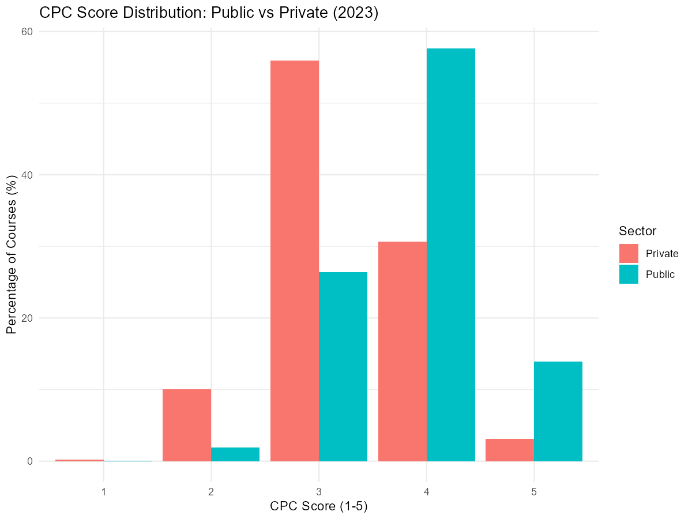
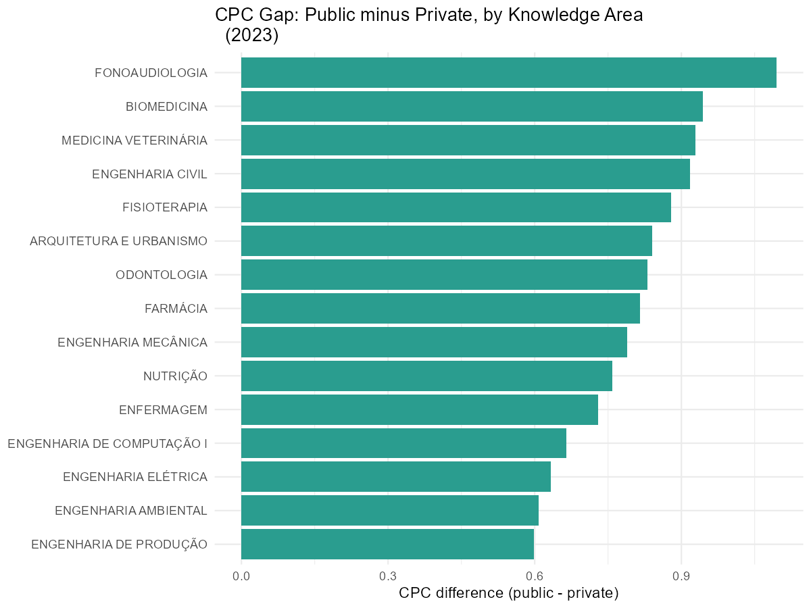
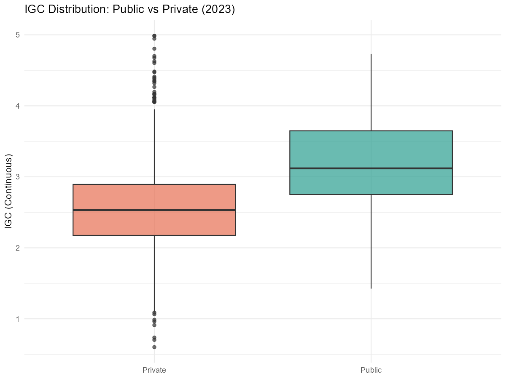

# How to compare CPC indicators between public and private institutions?

This vignette shows how to use educabR to compare course quality (CPC)
between public and private higher education institutions in Brazil.

\
[`library`](https://rdrr.io/r/base/library.html)`(`[`educabR`](https://github.com/SidneyBissoli/educabR)`)`\
[`library`](https://rdrr.io/r/base/library.html)`(`[`dplyr`](https://dplyr.tidyverse.org)`)`\
[`library`](https://rdrr.io/r/base/library.html)`(`[`tidyr`](https://tidyr.tidyverse.org)`)`\
[`library`](https://rdrr.io/r/base/library.html)`(`[`ggplot2`](https://ggplot2.tidyverse.org)`)`

## Downloading CPC data

CPC (Conceito Preliminar de Curso) is a quality indicator for
undergraduate courses, ranging from 1 (lowest) to 5 (highest). Courses
scoring 1 or 2 are flagged for on-site evaluation.

\
`cpc`` ``<-`` `[`get_cpc`](https://sidneybissoli.github.io/educabR/reference/get_cpc.md)`(``year ``=`` ``2023``)`\
[`glimpse`](https://pillar.r-lib.org/reference/glimpse.html)`(``cpc``)`

    #> Rows: 9,812
    #> Columns: 39
    #> $ ano                      <dbl> 2023, 2023, 2023, 2023, 2023, …
    #> $ codigo_da_ies            <dbl> 1, 1, 1, 1, 1, 1, 1, 1, 1, 2, …
    #> $ nome_da_ies              <chr> "UNIVERSIDADE FEDERAL DE MATO G…
    #> $ sigla_da_ies             <chr> "UFMT", "UFMT", "UFMT", "UFMT"…
    #> $ categoria_administrativa <chr> "Pública Federal", "Pública Fed…
    #> $ codigo_do_curso          <dbl> 3, 9, 10, 12, 16, 17, 20, 37, …
    #> $ area_de_avaliacao        <chr> "ENGENHARIA CIVIL", "AGRONOMIA"…
    #> $ sigla_da_uf              <chr> "MT", "MT", "MT", "MT", "MT", "…
    #> $ cpc_continuo             <dbl> 3.429, 3.482, 3.064, 2.792, 4.…
    #> $ cpc_faixa                <dbl> 4, 4, 4, 3, 5, 4, 4, 4, 4, 5, …
    #> # ℹ 29 more variables

## Identifying public vs private institutions

The `categoria_administrativa` column classifies institutions. The exact
column name and coding may vary by year – check `names(cpc)` after
downloading.

\
`cpc_classified`` ``<-`\
`  ``cpc`` ``|>`\
`  `[`mutate`](https://dplyr.tidyverse.org/reference/mutate.html)`(`\
`    sector ``=`` `[`case_when`](https://dplyr.tidyverse.org/reference/case-and-replace-when.html)`(`\
`      ``categoria_administrativa`` `[`%in%`](https://rdrr.io/r/base/match.html)` `[`c`](https://rdrr.io/r/base/c.html)`(`\
`        ``"Publica Federal"``, ``"Publica Estadual"``, ``"Publica Municipal"``,`\
`        ``"P\u00fablica Federal"``, ``"P\u00fablica Estadual"``, ``"P\u00fablica Municipal"`\
`      ``)`` ``~`` ``"Public"``,`\
`      .default ``=`` ``"Private"`\
`    ``)`\
`  ``)`

## CPC score distribution by sector

\
`cpc_classified`` ``|>`\
`  `[`filter`](https://dplyr.tidyverse.org/reference/filter.html)`(``!`[`is.na`](https://rdrr.io/r/base/NA.html)`(``cpc_faixa``)``)`` ``|>`\
`  `[`count`](https://dplyr.tidyverse.org/reference/count.html)`(``sector``, ``cpc_faixa``)`` ``|>`\
`  `[`mutate`](https://dplyr.tidyverse.org/reference/mutate.html)`(``pct ``=`` ``n`` ``/`` `[`sum`](https://rdrr.io/r/base/sum.html)`(``n``)`` ``*`` ``100``, .by ``=`` ``sector``)`` ``|>`\
`  `[`ggplot`](https://ggplot2.tidyverse.org/reference/ggplot.html)`(`[`aes`](https://ggplot2.tidyverse.org/reference/aes.html)`(``x ``=`` `[`factor`](https://rdrr.io/r/base/factor.html)`(``cpc_faixa``)``, y ``=`` ``pct``, fill ``=`` ``sector``)``)`` ``+`\
`  `[`geom_col`](https://ggplot2.tidyverse.org/reference/geom_bar.html)`(``position ``=`` ``"dodge"``)`` ``+`\
`  `[`labs`](https://ggplot2.tidyverse.org/reference/labs.html)`(`\
`    title ``=`` ``"CPC Score Distribution: Public vs Private (2023)"``,`\
`    x     ``=`` ``"CPC Score (1-5)"``,`\
`    y     ``=`` ``"Percentage of Courses (%)"``,`\
`    fill  ``=`` ``"Sector"`\
`  ``)`` ``+`\
`  `[`theme_minimal`](https://ggplot2.tidyverse.org/reference/ggtheme.html)`(``)`

## Average CPC by sector and knowledge area

\
`cpc_classified`` ``|>`\
`  `[`filter`](https://dplyr.tidyverse.org/reference/filter.html)`(``!`[`is.na`](https://rdrr.io/r/base/NA.html)`(``cpc_continuo``)``, ``!`[`is.na`](https://rdrr.io/r/base/NA.html)`(``area_de_avaliacao``)``)`` ``|>`\
`  `[`summarise`](https://dplyr.tidyverse.org/reference/summarise.html)`(`\
`    mean_cpc ``=`` `[`mean`](https://rdrr.io/r/base/mean.html)`(``cpc_continuo``, na.rm ``=`` ``TRUE``)``,`\
`    n ``=`` `[`n`](https://dplyr.tidyverse.org/reference/context.html)`(``)``,`\
`    .by ``=`` `[`c`](https://rdrr.io/r/base/c.html)`(``sector``, ``area_de_avaliacao``)`\
`  ``)`` ``|>`\
`  `[`filter`](https://dplyr.tidyverse.org/reference/filter.html)`(``n`` ``>=`` ``10``)`` ``|>`\
`  `[`pivot_wider`](https://tidyr.tidyverse.org/reference/pivot_wider.html)`(`\
`    names_from  ``=`` ``sector``,`\
`    values_from ``=`` `[`c`](https://rdrr.io/r/base/c.html)`(``mean_cpc``, ``n``)`\
`  ``)`` ``|>`\
`  `[`mutate`](https://dplyr.tidyverse.org/reference/mutate.html)`(``gap ``=`` ``mean_cpc_Public`` ``-`` ``mean_cpc_Private``)`` ``|>`\
`  `[`slice_max`](https://dplyr.tidyverse.org/reference/slice.html)`(`[`abs`](https://rdrr.io/r/base/MathFun.html)`(``gap``)``, n ``=`` ``15``)`` ``|>`\
`  `[`ggplot`](https://ggplot2.tidyverse.org/reference/ggplot.html)`(`[`aes`](https://ggplot2.tidyverse.org/reference/aes.html)`(``x ``=`` `[`reorder`](https://rdrr.io/r/stats/reorder.factor.html)`(``area_de_avaliacao``, ``gap``)``, y ``=`` ``gap``)``)`` ``+`\
`  `[`geom_col`](https://ggplot2.tidyverse.org/reference/geom_bar.html)`(`[`aes`](https://ggplot2.tidyverse.org/reference/aes.html)`(``fill ``=`` ``gap`` ``>`` ``0``)``)`` ``+`\
`  `[`coord_flip`](https://ggplot2.tidyverse.org/reference/coord_flip.html)`(``)`` ``+`\
`  `[`scale_fill_manual`](https://ggplot2.tidyverse.org/reference/scale_manual.html)`(`\
`    values ``=`` `[`c`](https://rdrr.io/r/base/c.html)`(``"TRUE"`` ``=`` ``"#2a9d8f"``, ``"FALSE"`` ``=`` ``"#e76f51"``)``,`\
`    labels ``=`` `[`c`](https://rdrr.io/r/base/c.html)`(``"TRUE"`` ``=`` ``"Public higher"``, ``"FALSE"`` ``=`` ``"Private higher"``)`\
`  ``)`` ``+`\
`  `[`labs`](https://ggplot2.tidyverse.org/reference/labs.html)`(`\
`    title ``=`` ``"CPC Gap: Public minus Private, by Knowledge Area (2023)"``,`\
`    x     ``=`` ``NULL``,`\
`    y     ``=`` ``"CPC difference (public - private)"``,`\
`    fill  ``=`` ``NULL`\
`  ``)`` ``+`\
`  `[`theme_minimal`](https://ggplot2.tidyverse.org/reference/ggtheme.html)`(``)`` ``+`\
`  `[`theme`](https://ggplot2.tidyverse.org/reference/theme.html)`(``legend.position ``=`` ``"none"``)`

## Combining with IGC for institutional view

IGC (Indice Geral de Cursos) provides an institution-level quality
score. Combining CPC and IGC gives a course-level and institution-level
perspective.

\
`igc`` ``<-`` `[`get_igc`](https://sidneybissoli.github.io/educabR/reference/get_igc.md)`(``year ``=`` ``2023``)`\
\
`igc`` ``|>`\
`  `[`mutate`](https://dplyr.tidyverse.org/reference/mutate.html)`(`\
`    sector ``=`` `[`case_when`](https://dplyr.tidyverse.org/reference/case-and-replace-when.html)`(`\
`      ``categoria_administrativa`` `[`%in%`](https://rdrr.io/r/base/match.html)` `[`c`](https://rdrr.io/r/base/c.html)`(`\
`        ``"Publica Federal"``, ``"Publica Estadual"``, ``"Publica Municipal"``,`\
`        ``"P\u00fablica Federal"``, ``"P\u00fablica Estadual"``, ``"P\u00fablica Municipal"`\
`      ``)`` ``~`` ``"Public"``,`\
`      .default ``=`` ``"Private"`\
`    ``)`\
`  ``)`` ``|>`\
`  `[`filter`](https://dplyr.tidyverse.org/reference/filter.html)`(``!`[`is.na`](https://rdrr.io/r/base/NA.html)`(``igc_continuo``)``)`` ``|>`\
`  `[`ggplot`](https://ggplot2.tidyverse.org/reference/ggplot.html)`(`[`aes`](https://ggplot2.tidyverse.org/reference/aes.html)`(``x ``=`` ``sector``, y ``=`` ``igc_continuo``, fill ``=`` ``sector``)``)`` ``+`\
`  `[`geom_boxplot`](https://ggplot2.tidyverse.org/reference/geom_boxplot.html)`(``alpha ``=`` ``0.7``)`` ``+`\
`  `[`scale_fill_manual`](https://ggplot2.tidyverse.org/reference/scale_manual.html)`(``values ``=`` `[`c`](https://rdrr.io/r/base/c.html)`(``"Public"`` ``=`` ``"#2a9d8f"``, ``"Private"`` ``=`` ``"#e76f51"``)``)`` ``+`\
`  `[`labs`](https://ggplot2.tidyverse.org/reference/labs.html)`(`\
`    title ``=`` ``"IGC Distribution: Public vs Private (2023)"``,`\
`    x     ``=`` ``NULL``,`\
`    y     ``=`` ``"IGC (Continuous)"`\
`  ``)`` ``+`\
`  `[`theme_minimal`](https://ggplot2.tidyverse.org/reference/ggtheme.html)`(``)`` ``+`\
`  `[`theme`](https://ggplot2.tidyverse.org/reference/theme.html)`(``legend.position ``=`` ``"none"``)`

