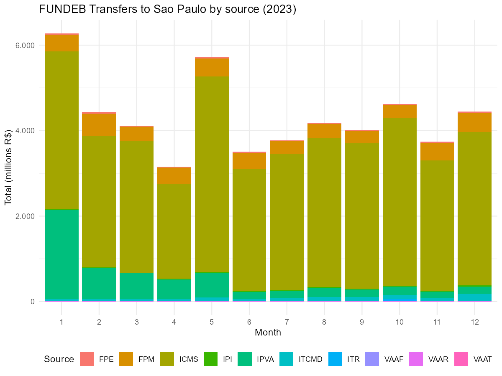
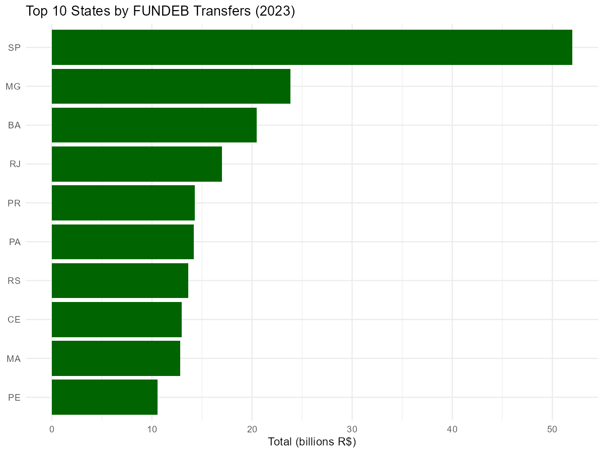
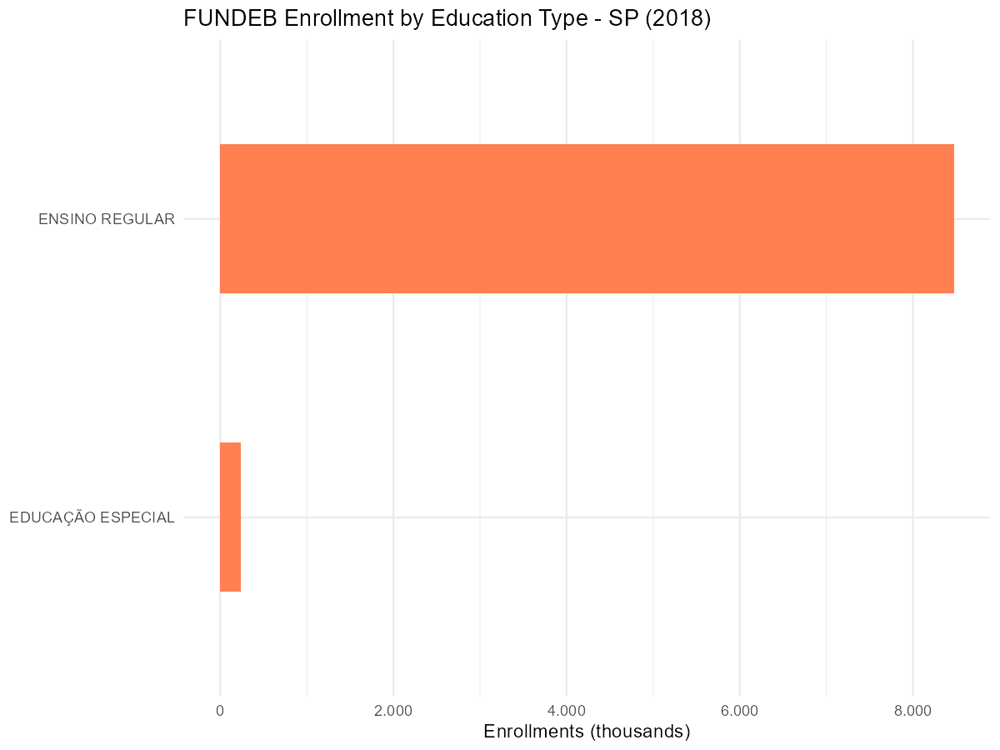
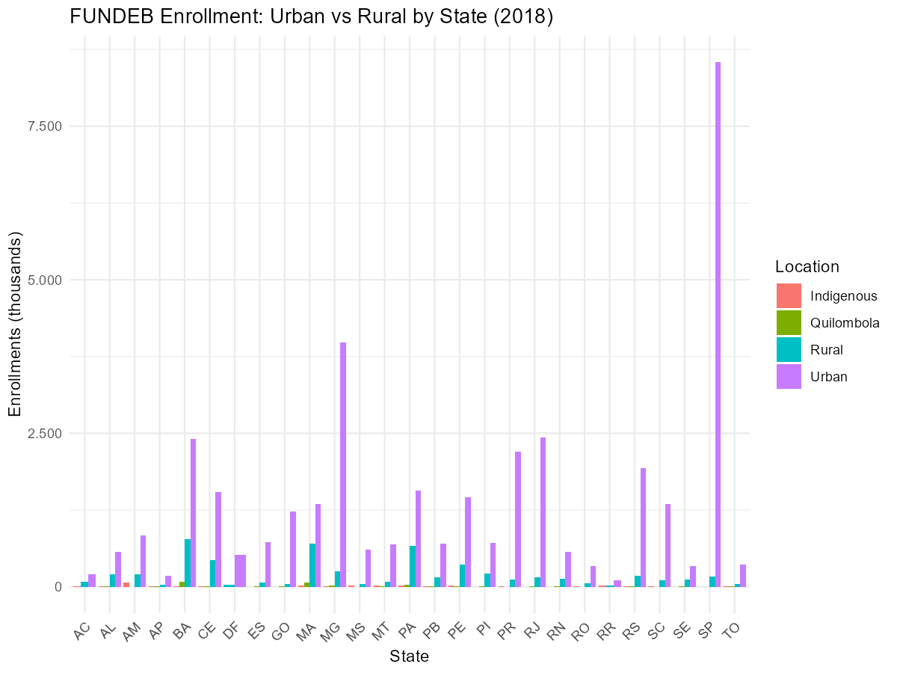
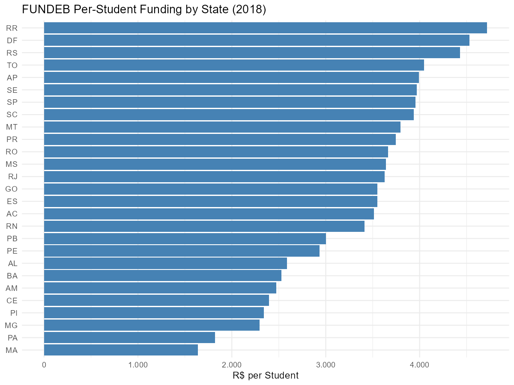

# Education Funding: FUNDEB

This vignette covers FUNDEB (Fundo de Manutencao e Desenvolvimento da
Educacao Basica), the main funding mechanism for basic education in
Brazil. educabR provides two functions to access FUNDEB data: resource
distribution and enrollment counts.

\
[`library`](https://rdrr.io/r/base/library.html)`(`[`educabR`](https://github.com/SidneyBissoli/educabR)`)`\
[`library`](https://rdrr.io/r/base/library.html)`(`[`dplyr`](https://dplyr.tidyverse.org)`)`\
[`library`](https://rdrr.io/r/base/library.html)`(`[`ggplot2`](https://ggplot2.tidyverse.org)`)`

## Overview

FUNDEB redistributes tax revenues to fund basic education across states
and municipalities. The data is split into two components:

| Function | Source | Description |
|----|----|----|
| [`get_fundeb_distribution()`](https://sidneybissoli.github.io/educabR/reference/get_fundeb_distribution.md) | STN (National Treasury) | Monthly transfers by state/municipality and funding source |
| [`get_fundeb_enrollment()`](https://sidneybissoli.github.io/educabR/reference/get_fundeb_enrollment.md) | FNDE (OData API) | Enrollment counts used for funding calculation |

------------------------------------------------------------------------

## FUNDEB Distribution

Resource distribution data shows how much money was transferred to each
state and municipality, broken down by funding source and month.

### Funding sources

FUNDEB aggregates revenue from multiple tax sources:

| Source | Description                        |
|--------|------------------------------------|
| FPE    | State Participation Fund           |
| FPM    | Municipal Participation Fund       |
| IPI    | Tax on Industrialized Products     |
| ITR    | Rural Property Tax                 |
| VAAF   | Fiscal Value-Added (state portion) |
| VAAT   | Total Value-Added                  |
| VAAR   | FUNDEB Complementation             |
| ICMS   | State Sales Tax                    |
| IPVA   | Vehicle Tax                        |
| ITCMD  | Inheritance and Donation Tax       |

### Downloading distribution data

\
`# All distribution data for 2023`\
`dist_2023`` ``<-`` `[`get_fundeb_distribution`](https://sidneybissoli.github.io/educabR/reference/get_fundeb_distribution.md)`(``year ``=`` ``2023``)`\
\
`# Filter by state`\
`dist_sp`` ``<-`` `[`get_fundeb_distribution`](https://sidneybissoli.github.io/educabR/reference/get_fundeb_distribution.md)`(``year ``=`` ``2023``, uf ``=`` ``"SP"``)`\
\
`# Filter by funding source`\
`dist_fpm`` ``<-`` `[`get_fundeb_distribution`](https://sidneybissoli.github.io/educabR/reference/get_fundeb_distribution.md)`(``year ``=`` ``2023``, source ``=`` ``"FPM"``)`\
\
`# Filter by destination (states or municipalities)`\
`dist_estados`` ``<-`` `[`get_fundeb_distribution`](https://sidneybissoli.github.io/educabR/reference/get_fundeb_distribution.md)`(`\
`  year        ``=`` ``2023``,`\
`  destination ``=`` ``"estados"`\
`)`

### Available years

Data is available from 2007 to 2026.

### Data structure

\
`dist`` ``<-`` `[`get_fundeb_distribution`](https://sidneybissoli.github.io/educabR/reference/get_fundeb_distribution.md)`(``2023``, uf ``=`` ``"SP"``)`\
[`glimpse`](https://pillar.r-lib.org/reference/glimpse.html)`(``dist``)`

### Example analysis: Monthly transfers by source

\
`dist`` ``<-`` `[`get_fundeb_distribution`](https://sidneybissoli.github.io/educabR/reference/get_fundeb_distribution.md)`(``2023``, uf ``=`` ``"SP"``)`\
\
`# Total monthly transfers by funding source`\
`monthly`` ``<-`\
`  ``dist`` ``|>`\
`  `[`mutate`](https://dplyr.tidyverse.org/reference/mutate.html)`(``mes ``=`` `[`as.integer`](https://rdrr.io/r/base/integer.html)`(`[`format`](https://rdrr.io/r/base/format.html)`(`[`as.Date`](https://rdrr.io/r/base/as.Date.html)`(``mes_ano``)``, ``"%m"``)``)``)`` ``|>`\
`  `[`group_by`](https://dplyr.tidyverse.org/reference/group_by.html)`(``origem``, ``mes``)`` ``|>`\
`  `[`summarise`](https://dplyr.tidyverse.org/reference/summarise.html)`(``total ``=`` `[`sum`](https://rdrr.io/r/base/sum.html)`(``valor``, na.rm ``=`` ``TRUE``)``, .groups ``=`` ``"drop"``)`\
\
[`ggplot`](https://ggplot2.tidyverse.org/reference/ggplot.html)`(``monthly``, `[`aes`](https://ggplot2.tidyverse.org/reference/aes.html)`(``x ``=`` `[`factor`](https://rdrr.io/r/base/factor.html)`(``mes``)``, y ``=`` ``total`` ``/`` ``1e6``, fill ``=`` ``origem``)``)`` ``+`\
`  `[`geom_col`](https://ggplot2.tidyverse.org/reference/geom_bar.html)`(``)`` ``+`\
`  `[`labs`](https://ggplot2.tidyverse.org/reference/labs.html)`(`\
`    title ``=`` ``"FUNDEB Transfers to Sao Paulo by source (2023)"``,`\
`    x     ``=`` ``"Month"``,`\
`    y     ``=`` ``"Total (millions R$)"``,`\
`    fill  ``=`` ``"Source"`\
`  ``)`` ``+`\
`  `[`theme_minimal`](https://ggplot2.tidyverse.org/reference/ggtheme.html)`(``)`` ``+`\
`  `[`theme`](https://ggplot2.tidyverse.org/reference/theme.html)`(``legend.position ``=`` ``"bottom"``)`` ``+`\
`  `[`scale_y_continuous`](https://ggplot2.tidyverse.org/reference/scale_continuous.html)`(``labels ``=`` ``scales``::`[`number_format`](https://scales.r-lib.org/reference/comma.html)`(``big.mark ``=`` ``"."``, decimal.mark ``=`` ``","``)``)`` ``+`\
`  `[`guides`](https://ggplot2.tidyverse.org/reference/guides.html)`(``fill ``=`` `[`guide_legend`](https://ggplot2.tidyverse.org/reference/guide_legend.html)`(``nrow ``=`` ``1``)``)`

### Example analysis: Comparing states

\
`dist`` ``<-`` `[`get_fundeb_distribution`](https://sidneybissoli.github.io/educabR/reference/get_fundeb_distribution.md)`(``2023``)`\
\
`# Total annual transfers by state`\
`by_state`` ``<-`` `\
`  ``dist`` ``|>`\
`  `[`group_by`](https://dplyr.tidyverse.org/reference/group_by.html)`(``uf``)`` ``|>`\
`  `[`summarise`](https://dplyr.tidyverse.org/reference/summarise.html)`(``total ``=`` `[`sum`](https://rdrr.io/r/base/sum.html)`(``valor``, na.rm ``=`` ``TRUE``)``, .groups ``=`` ``"drop"``)`` ``|>`\
`  `[`arrange`](https://dplyr.tidyverse.org/reference/arrange.html)`(`[`desc`](https://dplyr.tidyverse.org/reference/desc.html)`(``total``)``)`` ``|>`\
`  `[`head`](https://rdrr.io/r/utils/head.html)`(``10``)`\
\
[`ggplot`](https://ggplot2.tidyverse.org/reference/ggplot.html)`(``by_state``, `[`aes`](https://ggplot2.tidyverse.org/reference/aes.html)`(``x ``=`` `[`reorder`](https://rdrr.io/r/stats/reorder.factor.html)`(``uf``, ``total``)``, y ``=`` ``total`` ``/`` ``1e9``)``)`` ``+`\
`  `[`geom_col`](https://ggplot2.tidyverse.org/reference/geom_bar.html)`(``fill ``=`` ``"darkgreen"``)`` ``+`\
`  `[`coord_flip`](https://ggplot2.tidyverse.org/reference/coord_flip.html)`(``)`` ``+`\
`  `[`labs`](https://ggplot2.tidyverse.org/reference/labs.html)`(`\
`    title ``=`` ``"Top 10 States by FUNDEB Transfers (2023)"``,`\
`    x     ``=`` ``NULL``,`\
`    y     ``=`` ``"Total (billions R$)"`\
`  ``)`` ``+`\
`  `[`theme_minimal`](https://ggplot2.tidyverse.org/reference/ggtheme.html)`(``)`

------------------------------------------------------------------------

## FUNDEB Enrollment

Enrollment data shows the number of students considered for FUNDEB
funding calculation, broken down by municipality, education type, school
network, and location.

### Downloading enrollment data

\
`# All enrollment data for 2018`\
`mat_2018`` ``<-`` `[`get_fundeb_enrollment`](https://sidneybissoli.github.io/educabR/reference/get_fundeb_enrollment.md)`(``year ``=`` ``2018``)`\
\
`# Filter by state (filtered locally from cached complete dataset)`\
`mat_sp`` ``<-`` `[`get_fundeb_enrollment`](https://sidneybissoli.github.io/educabR/reference/get_fundeb_enrollment.md)`(``year ``=`` ``2018``, uf ``=`` ``"SP"``)`\
\
`# Limited rows for exploration`\
`mat_sample`` ``<-`` `[`get_fundeb_enrollment`](https://sidneybissoli.github.io/educabR/reference/get_fundeb_enrollment.md)`(``year ``=`` ``2018``, n_max ``=`` ``5000``)`

### Available years

Data is available for 2017-2018. Data is fetched from the FNDE OData API
with automatic pagination.

### Data structure

The enrollment data contains these columns:

| Column                         | Description                 |
|--------------------------------|-----------------------------|
| `ano_censo`                    | Census year                 |
| `uf`                           | State code                  |
| `municipio`                    | Municipality name           |
| `tipo_rede_educacao`           | Education network type      |
| `descricao_tipo_educacao`      | Education type description  |
| `descricao_tipo_ensino`        | Teaching type description   |
| `descricao_tipo_turma`         | Class type description      |
| `descricao_tipo_carga_horaria` | Class hours type            |
| `descricao_tipo_localizacao`   | Location type (urban/rural) |
| `qtd_matricula`                | Number of enrollments       |

\
`mat`` ``<-`` `[`get_fundeb_enrollment`](https://sidneybissoli.github.io/educabR/reference/get_fundeb_enrollment.md)`(``2018``, uf ``=`` ``"RJ"``)`\
[`glimpse`](https://pillar.r-lib.org/reference/glimpse.html)`(``mat``)`

### Example analysis: Enrollment by education type

\
`mat`` ``<-`` `[`get_fundeb_enrollment`](https://sidneybissoli.github.io/educabR/reference/get_fundeb_enrollment.md)`(``2018``, uf ``=`` ``"SP"``)`\
\
`# Total enrollment by education type`\
`by_type`` ``<-`` `\
`  ``mat`` ``|>`\
`  `[`group_by`](https://dplyr.tidyverse.org/reference/group_by.html)`(``descricao_tipo_educacao``)`` ``|>`\
`  `[`summarise`](https://dplyr.tidyverse.org/reference/summarise.html)`(``total ``=`` `[`sum`](https://rdrr.io/r/base/sum.html)`(``qtd_matricula``, na.rm ``=`` ``TRUE``)``, .groups ``=`` ``"drop"``)`` ``|>`\
`  `[`arrange`](https://dplyr.tidyverse.org/reference/arrange.html)`(`[`desc`](https://dplyr.tidyverse.org/reference/desc.html)`(``total``)``)`\
\
[`ggplot`](https://ggplot2.tidyverse.org/reference/ggplot.html)`(``by_type``, `[`aes`](https://ggplot2.tidyverse.org/reference/aes.html)`(``x ``=`` `[`reorder`](https://rdrr.io/r/stats/reorder.factor.html)`(``descricao_tipo_educacao``, ``total``)``, y ``=`` ``total`` ``/`` ``1e3``)``)`` ``+`\
`  `[`geom_col`](https://ggplot2.tidyverse.org/reference/geom_bar.html)`(``fill ``=`` ``"coral"``, width ``=`` ``.5``)`` ``+`\
`  `[`coord_flip`](https://ggplot2.tidyverse.org/reference/coord_flip.html)`(``)`` ``+`\
`  `[`labs`](https://ggplot2.tidyverse.org/reference/labs.html)`(`\
`    title ``=`` ``"FUNDEB Enrollment by Education Type - SP (2018)"``,`\
`    x     ``=`` ``NULL``,`\
`    y     ``=`` ``"Enrollments (thousands)"`\
`  ``)`` ``+`\
`  `[`theme_minimal`](https://ggplot2.tidyverse.org/reference/ggtheme.html)`(``)`` ``+`\
`  `[`scale_y_continuous`](https://ggplot2.tidyverse.org/reference/scale_continuous.html)`(``labels ``=`` ``scales``::`[`number_format`](https://scales.r-lib.org/reference/comma.html)`(``big.mark ``=`` ``"."``, decimal.mark ``=`` ``","``)``)`

### Example analysis: Urban vs rural enrollment

\
`mat`` ``<-`` `[`get_fundeb_enrollment`](https://sidneybissoli.github.io/educabR/reference/get_fundeb_enrollment.md)`(``2018``)`\
\
`# Compare urban vs rural`\
`by_location`` ``<-`\
`  ``mat`` ``|>`\
`  `[`mutate`](https://dplyr.tidyverse.org/reference/mutate.html)`(`\
`    location ``=`` `[`case_when`](https://dplyr.tidyverse.org/reference/case-and-replace-when.html)`(`\
`      ``descricao_tipo_localizacao`` ``==`` ``"URBANA"``     ``~`` ``"Urban"``,`\
`      ``descricao_tipo_localizacao`` ``==`` ``"RURAL"``      ``~`` ``"Rural"``,`\
`      ``descricao_tipo_localizacao`` ``==`` ``"QUILOMBOLA"`` ``~`` ``"Quilombola"``,`\
`      ``descricao_tipo_localizacao`` ``==`` ``"IND\u00cdGENA"`` ``~`` ``"Indigenous"``,`\
`      .default ``=`` ``descricao_tipo_localizacao`\
`    ``)`\
`  ``)`` ``|>`\
`  `[`group_by`](https://dplyr.tidyverse.org/reference/group_by.html)`(``uf``, ``location``)`` ``|>`\
`  `[`summarise`](https://dplyr.tidyverse.org/reference/summarise.html)`(``total ``=`` `[`sum`](https://rdrr.io/r/base/sum.html)`(``qtd_matricula``, na.rm ``=`` ``TRUE``)``, .groups ``=`` ``"drop"``)`\
\
[`ggplot`](https://ggplot2.tidyverse.org/reference/ggplot.html)`(``by_location``, `[`aes`](https://ggplot2.tidyverse.org/reference/aes.html)`(``x ``=`` ``uf``, y ``=`` ``total`` ``/`` ``1e3``, fill ``=`` ``location``)``)`` ``+`\
`  `[`geom_col`](https://ggplot2.tidyverse.org/reference/geom_bar.html)`(``position ``=`` ``"dodge"``)`` ``+`\
`  `[`labs`](https://ggplot2.tidyverse.org/reference/labs.html)`(`\
`    title ``=`` ``"FUNDEB Enrollment: Urban vs Rural by State (2018)"``,`\
`    x     ``=`` ``"State"``,`\
`    y     ``=`` ``"Enrollments (thousands)"``,`\
`    fill  ``=`` ``"Location"`\
`  ``)`` ``+`\
`  `[`theme_minimal`](https://ggplot2.tidyverse.org/reference/ggtheme.html)`(``)`` ``+`\
`  `[`theme`](https://ggplot2.tidyverse.org/reference/theme.html)`(``axis.text.x ``=`` `[`element_text`](https://ggplot2.tidyverse.org/reference/element.html)`(``angle ``=`` ``45``, hjust ``=`` ``1``)``)`` ``+`\
`  `[`scale_y_continuous`](https://ggplot2.tidyverse.org/reference/scale_continuous.html)`(``labels ``=`` ``scales``::`[`number_format`](https://scales.r-lib.org/reference/comma.html)`(``big.mark ``=`` ``"."``, decimal.mark ``=`` ``","``)``)`

------------------------------------------------------------------------

## Combining distribution and enrollment

You can combine both datasets to analyze per-student funding across
states.

\
`# Total transfers by state`\
`dist`` ``<-`` `[`get_fundeb_distribution`](https://sidneybissoli.github.io/educabR/reference/get_fundeb_distribution.md)`(``2018``)`\
`transfers`` ``<-`` `\
`  ``dist`` ``|>`\
`  `[`group_by`](https://dplyr.tidyverse.org/reference/group_by.html)`(``uf``)`` ``|>`\
`  `[`summarise`](https://dplyr.tidyverse.org/reference/summarise.html)`(``total_transfer ``=`` `[`sum`](https://rdrr.io/r/base/sum.html)`(``valor``, na.rm ``=`` ``TRUE``)``, .groups ``=`` ``"drop"``)`\
\
`# Total enrollment by state`\
`mat`` ``<-`` `[`get_fundeb_enrollment`](https://sidneybissoli.github.io/educabR/reference/get_fundeb_enrollment.md)`(``2018``)`\
`enrollment`` ``<-`` `\
`  ``mat`` ``|>`\
`  `[`group_by`](https://dplyr.tidyverse.org/reference/group_by.html)`(``uf``)`` ``|>`\
`  `[`summarise`](https://dplyr.tidyverse.org/reference/summarise.html)`(``total_students ``=`` `[`sum`](https://rdrr.io/r/base/sum.html)`(``qtd_matricula``, na.rm ``=`` ``TRUE``)``, .groups ``=`` ``"drop"``)`\
\
`# Per-student funding`\
`funding`` ``<-`` `\
`  `[`inner_join`](https://dplyr.tidyverse.org/reference/mutate-joins.html)`(``transfers``, ``enrollment``, by ``=`` ``"uf"``)`` ``|>`\
`  `[`mutate`](https://dplyr.tidyverse.org/reference/mutate.html)`(``per_student ``=`` ``total_transfer`` ``/`` ``total_students``)`` ``|>`\
`  `[`arrange`](https://dplyr.tidyverse.org/reference/arrange.html)`(`[`desc`](https://dplyr.tidyverse.org/reference/desc.html)`(``per_student``)``)`\
\
[`ggplot`](https://ggplot2.tidyverse.org/reference/ggplot.html)`(``funding``, `[`aes`](https://ggplot2.tidyverse.org/reference/aes.html)`(``x ``=`` `[`reorder`](https://rdrr.io/r/stats/reorder.factor.html)`(``uf``, ``per_student``)``, y ``=`` ``per_student``)``)`` ``+`\
`  `[`geom_col`](https://ggplot2.tidyverse.org/reference/geom_bar.html)`(``fill ``=`` ``"steelblue"``)`` ``+`\
`  `[`coord_flip`](https://ggplot2.tidyverse.org/reference/coord_flip.html)`(``)`` ``+`\
`  `[`labs`](https://ggplot2.tidyverse.org/reference/labs.html)`(`\
`    title ``=`` ``"FUNDEB Per-Student Funding by State (2018)"``,`\
`    x     ``=`` ``NULL``,`\
`    y     ``=`` ``"R$ per Student"`\
`  ``)`` ``+`\
`  `[`theme_minimal`](https://ggplot2.tidyverse.org/reference/ggtheme.html)`(``)`` ``+`\
`  `[`scale_y_continuous`](https://ggplot2.tidyverse.org/reference/scale_continuous.html)`(``labels ``=`` ``scales``::`[`number_format`](https://scales.r-lib.org/reference/comma.html)`(``big.mark ``=`` ``"."``, decimal.mark ``=`` ``","``)``)`

