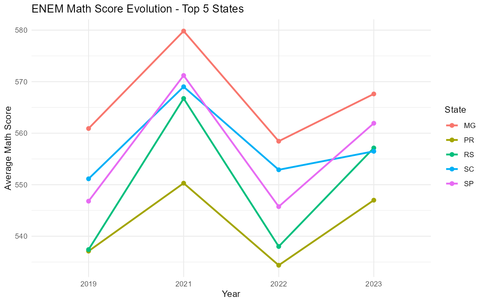
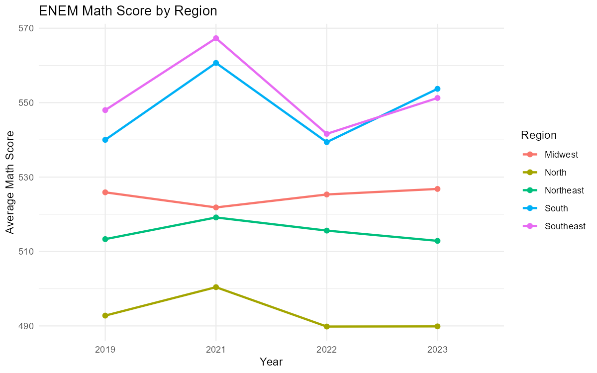
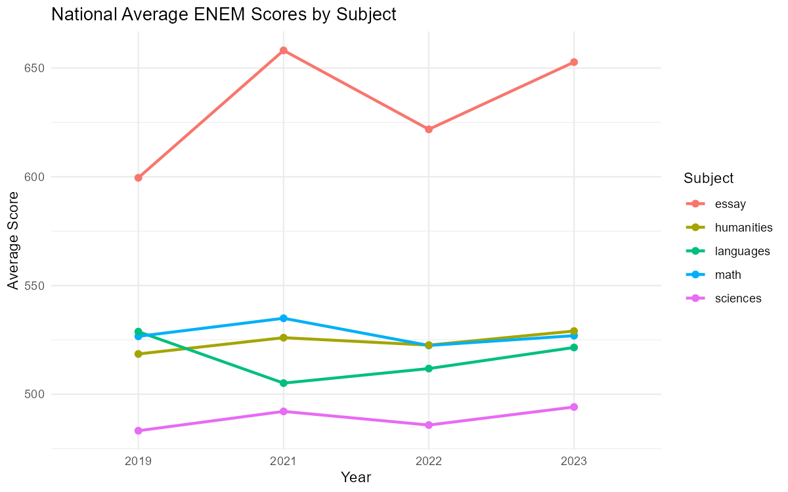

# How has ENEM performance evolved by state?

This vignette shows how to use educabR to analyze the evolution of ENEM
scores across Brazilian states over time.

\
[`library`](https://rdrr.io/r/base/library.html)`(`[`educabR`](https://github.com/SidneyBissoli/educabR)`)`\
[`library`](https://rdrr.io/r/base/library.html)`(`[`dplyr`](https://dplyr.tidyverse.org)`)`\
[`library`](https://rdrr.io/r/base/library.html)`(`[`tidyr`](https://tidyr.tidyverse.org)`)`\
[`library`](https://rdrr.io/r/base/library.html)`(`[`ggplot2`](https://ggplot2.tidyverse.org)`)`

## Downloading ENEM data for multiple years

ENEM microdata files are large (1-3 GB each), so we use `n_max` to work
with samples. For a full analysis, remove the `n_max` parameter.

\
`# WARNING: each year downloads ~600 MB from INEP. This may take several minutes.`\
`years`` ``<-`` `[`c`](https://rdrr.io/r/base/c.html)`(``2019``, ``2021``, ``2022``, ``2023``)`\
\
`enem`` ``<-`\
`  ``years`` ``|>`\
`  ``purrr``::`[`map`](https://purrr.tidyverse.org/reference/map.html)`(``\``(``y``)`` `[`get_enem`](https://sidneybissoli.github.io/educabR/reference/get_enem.md)`(``year ``=`` ``y``, n_max ``=`` ``50000``)`` ``|>`` `[`mutate`](https://dplyr.tidyverse.org/reference/mutate.html)`(``year ``=`` ``y``)``)`` ``|>`\
`  `[`bind_rows`](https://dplyr.tidyverse.org/reference/bind_rows.html)`(``)`

## Average math score by state and year

\
`scores_by_state`` ``<-`\
`  ``enem`` ``|>`\
`  `[`filter`](https://dplyr.tidyverse.org/reference/filter.html)`(``!`[`is.na`](https://rdrr.io/r/base/NA.html)`(``nu_nota_mt``)``, ``!`[`is.na`](https://rdrr.io/r/base/NA.html)`(``sg_uf_prova``)``)`` ``|>`\
`  `[`summarise`](https://dplyr.tidyverse.org/reference/summarise.html)`(`\
`    mean_math ``=`` `[`mean`](https://rdrr.io/r/base/mean.html)`(``nu_nota_mt``, na.rm ``=`` ``TRUE``)``,`\
`    n ``=`` `[`n`](https://dplyr.tidyverse.org/reference/context.html)`(``)``,`\
`    .by ``=`` `[`c`](https://rdrr.io/r/base/c.html)`(``sg_uf_prova``, ``year``)`\
`  ``)`\
\
`# Top 5 states in the most recent year`\
`top_states`` ``<-`\
`  ``scores_by_state`` ``|>`\
`  `[`filter`](https://dplyr.tidyverse.org/reference/filter.html)`(``year`` ``==`` `[`max`](https://rdrr.io/r/base/Extremes.html)`(``year``)``)`` ``|>`\
`  `[`slice_max`](https://dplyr.tidyverse.org/reference/slice.html)`(``mean_math``, n ``=`` ``5``)`` ``|>`\
`  `[`pull`](https://dplyr.tidyverse.org/reference/pull.html)`(``sg_uf_prova``)`\
\
`scores_by_state`` ``|>`\
`  `[`filter`](https://dplyr.tidyverse.org/reference/filter.html)`(``sg_uf_prova`` `[`%in%`](https://rdrr.io/r/base/match.html)` ``top_states``)`` ``|>`\
`  `[`ggplot`](https://ggplot2.tidyverse.org/reference/ggplot.html)`(`[`aes`](https://ggplot2.tidyverse.org/reference/aes.html)`(``x ``=`` `[`factor`](https://rdrr.io/r/base/factor.html)`(``year``)``, y ``=`` ``mean_math``, color ``=`` ``sg_uf_prova``, group ``=`` ``sg_uf_prova``)``)`` ``+`\
`  `[`geom_line`](https://ggplot2.tidyverse.org/reference/geom_path.html)`(``linewidth ``=`` ``1``)`` ``+`\
`  `[`geom_point`](https://ggplot2.tidyverse.org/reference/geom_point.html)`(``size ``=`` ``2``)`` ``+`\
`  `[`labs`](https://ggplot2.tidyverse.org/reference/labs.html)`(`\
`    title ``=`` ``"ENEM Math Score Evolution - Top 5 States"``,`\
`    x     ``=`` ``"Year"``,`\
`    y     ``=`` ``"Average Math Score"``,`\
`    color ``=`` ``"State"`\
`  ``)`` ``+`\
`  `[`theme_minimal`](https://ggplot2.tidyverse.org/reference/ggtheme.html)`(``)`

## Score gap between regions

\
`region_map`` ``<-`` `[`c`](https://rdrr.io/r/base/c.html)`(`\
`  AC ``=`` ``"North"``,     AP ``=`` ``"North"``,     AM ``=`` ``"North"``,     PA ``=`` ``"North"``,`\
`  RO ``=`` ``"North"``,     RR ``=`` ``"North"``,     TO ``=`` ``"North"``,`\
`  AL ``=`` ``"Northeast"``, BA ``=`` ``"Northeast"``, CE ``=`` ``"Northeast"``,`\
`  MA ``=`` ``"Northeast"``, PB ``=`` ``"Northeast"``, PE ``=`` ``"Northeast"``,`\
`  PI ``=`` ``"Northeast"``, RN ``=`` ``"Northeast"``, SE ``=`` ``"Northeast"``,`\
`  DF ``=`` ``"Midwest"``,   GO ``=`` ``"Midwest"``,   MT ``=`` ``"Midwest"``,   MS ``=`` ``"Midwest"``,`\
`  ES ``=`` ``"Southeast"``, MG ``=`` ``"Southeast"``, RJ ``=`` ``"Southeast"``, SP ``=`` ``"Southeast"``,`\
`  PR ``=`` ``"South"``,     RS ``=`` ``"South"``,     SC ``=`` ``"South"`\
`)`\
\
`enem`` ``|>`\
`  `[`filter`](https://dplyr.tidyverse.org/reference/filter.html)`(``!`[`is.na`](https://rdrr.io/r/base/NA.html)`(``nu_nota_mt``)``, ``!`[`is.na`](https://rdrr.io/r/base/NA.html)`(``sg_uf_prova``)``)`` ``|>`\
`  `[`mutate`](https://dplyr.tidyverse.org/reference/mutate.html)`(``region ``=`` ``region_map``[``sg_uf_prova``]``)`` ``|>`\
`  `[`summarise`](https://dplyr.tidyverse.org/reference/summarise.html)`(`\
`    mean_math ``=`` `[`mean`](https://rdrr.io/r/base/mean.html)`(``nu_nota_mt``, na.rm ``=`` ``TRUE``)``,`\
`    .by ``=`` `[`c`](https://rdrr.io/r/base/c.html)`(``region``, ``year``)`\
`  ``)`` ``|>`\
`  `[`ggplot`](https://ggplot2.tidyverse.org/reference/ggplot.html)`(`[`aes`](https://ggplot2.tidyverse.org/reference/aes.html)`(``x ``=`` `[`factor`](https://rdrr.io/r/base/factor.html)`(``year``)``, y ``=`` ``mean_math``, color ``=`` ``region``, group ``=`` ``region``)``)`` ``+`\
`  `[`geom_line`](https://ggplot2.tidyverse.org/reference/geom_path.html)`(``linewidth ``=`` ``1``)`` ``+`\
`  `[`geom_point`](https://ggplot2.tidyverse.org/reference/geom_point.html)`(``size ``=`` ``2``)`` ``+`\
`  `[`labs`](https://ggplot2.tidyverse.org/reference/labs.html)`(`\
`    title ``=`` ``"ENEM Math Score by Region"``,`\
`    x     ``=`` ``"Year"``,`\
`    y     ``=`` ``"Average Math Score"``,`\
`    color ``=`` ``"Region"`\
`  ``)`` ``+`\
`  `[`theme_minimal`](https://ggplot2.tidyverse.org/reference/ggtheme.html)`(``)`

## All five scores compared

\
`enem`` ``|>`\
`  `[`filter`](https://dplyr.tidyverse.org/reference/filter.html)`(``!`[`is.na`](https://rdrr.io/r/base/NA.html)`(``sg_uf_prova``)``)`` ``|>`\
`  `[`summarise`](https://dplyr.tidyverse.org/reference/summarise.html)`(`\
`    math       ``=`` `[`mean`](https://rdrr.io/r/base/mean.html)`(``nu_nota_mt``, na.rm ``=`` ``TRUE``)``,`\
`    languages  ``=`` `[`mean`](https://rdrr.io/r/base/mean.html)`(``nu_nota_lc``, na.rm ``=`` ``TRUE``)``,`\
`    humanities ``=`` `[`mean`](https://rdrr.io/r/base/mean.html)`(``nu_nota_ch``, na.rm ``=`` ``TRUE``)``,`\
`    sciences   ``=`` `[`mean`](https://rdrr.io/r/base/mean.html)`(``nu_nota_cn``, na.rm ``=`` ``TRUE``)``,`\
`    essay      ``=`` `[`mean`](https://rdrr.io/r/base/mean.html)`(``nu_nota_redacao``, na.rm ``=`` ``TRUE``)``,`\
`    .by ``=`` ``year`\
`  ``)`` ``|>`\
`  `[`pivot_longer`](https://tidyr.tidyverse.org/reference/pivot_longer.html)`(``-``year``, names_to ``=`` ``"subject"``, values_to ``=`` ``"mean_score"``)`` ``|>`\
`  `[`ggplot`](https://ggplot2.tidyverse.org/reference/ggplot.html)`(`[`aes`](https://ggplot2.tidyverse.org/reference/aes.html)`(``x ``=`` `[`factor`](https://rdrr.io/r/base/factor.html)`(``year``)``, y ``=`` ``mean_score``, color ``=`` ``subject``, group ``=`` ``subject``)``)`` ``+`\
`  `[`geom_line`](https://ggplot2.tidyverse.org/reference/geom_path.html)`(``linewidth ``=`` ``1``)`` ``+`\
`  `[`geom_point`](https://ggplot2.tidyverse.org/reference/geom_point.html)`(``size ``=`` ``2``)`` ``+`\
`  `[`labs`](https://ggplot2.tidyverse.org/reference/labs.html)`(`\
`    title ``=`` ``"National Average ENEM Scores by Subject"``,`\
`    x     ``=`` ``"Year"``,`\
`    y     ``=`` ``"Average Score"``,`\
`    color ``=`` ``"Subject"`\
`  ``)`` ``+`\
`  `[`theme_minimal`](https://ggplot2.tidyverse.org/reference/ggtheme.html)`(``)`

