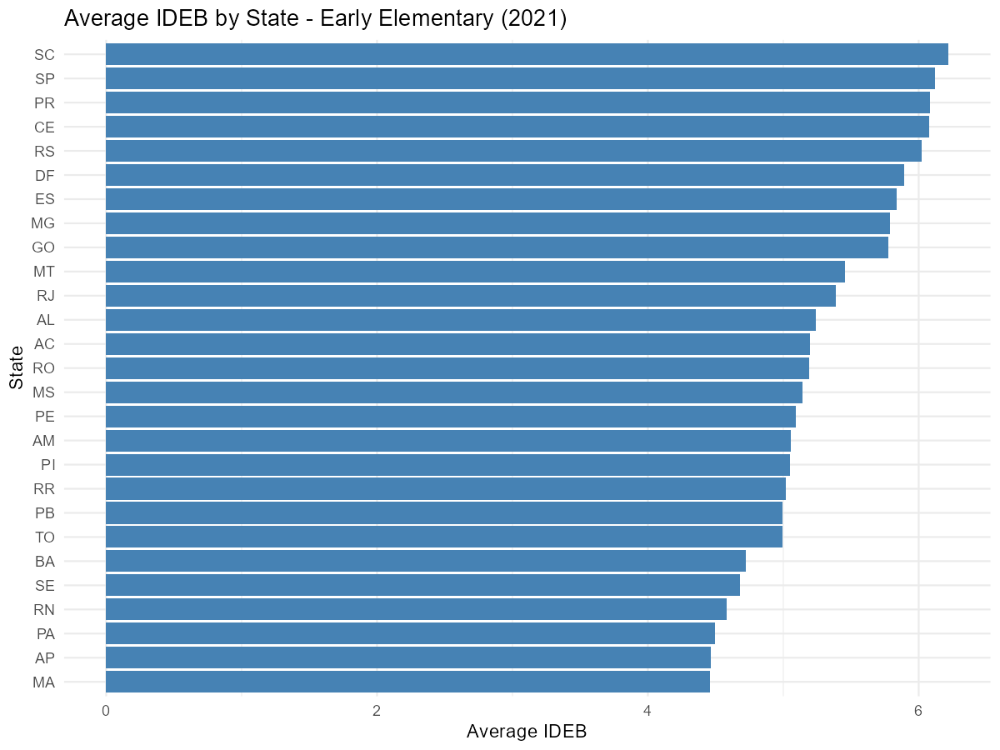
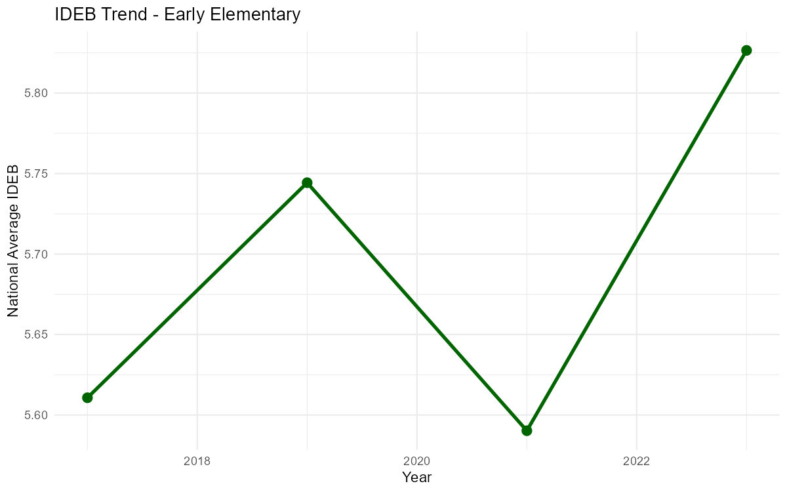
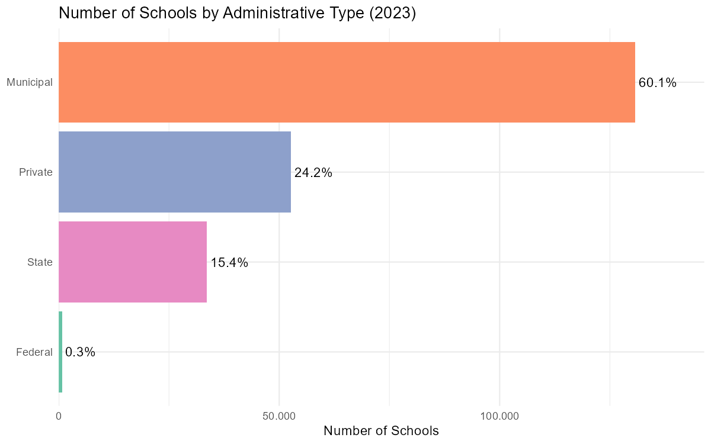

# Getting Started with educabR

The **educabR** package provides easy access to Brazilian public
education data from INEP, FNDE, and CAPES. With simple functions, you
can download and process data from 14 datasets:

**Basic Education:**\
\- **IDEB** - Basic Education Development Index\
\- **ENEM** - National High School Exam\
\- **School Census**\
\- **SAEB** - Basic Education Assessment System\
\- **ENCCEJA** - Youth and Adult Education Certification Exam\
\- **ENEM by School** - ENEM results aggregated by school (2005-2015)

**Higher Education:**\
\- **Higher Education Census**\
\- **ENADE** - National Student Performance Exam\
\- **IDD** - Value-Added Indicator\
\- **CPC** - Preliminary Course Concept\
\- **IGC** - General Courses Index

**Graduate Education:**\
\- **CAPES** - Graduate programs, students, faculty, courses, and theses

**Education Funding:**\
\- **FUNDEB** - Resource distribution and enrollment data

This vignette covers IDEB, ENEM, and the School Census. For other
datasets, see:\
\-
[`vignette("basic-education-assessments")`](https://sidneybissoli.github.io/educabR/articles/basic-education-assessments.md)
— SAEB, ENCCEJA, ENEM by School\
\-
[`vignette("higher-education")`](https://sidneybissoli.github.io/educabR/articles/higher-education.md)
— Higher Education Census, ENADE, IDD, CPC, IGC, CAPES\
\-
[`vignette("education-funding")`](https://sidneybissoli.github.io/educabR/articles/education-funding.md)
— FUNDEB

## Installation

\
`# Install from GitHub (development version)`\
`# install.packages("remotes")`\
`remotes``::`[`install_github`](https://remotes.r-lib.org/reference/install_github.html)`(``"SidneyBissoli/educabR"``)`

\
[`library`](https://rdrr.io/r/base/library.html)`(`[`educabR`](https://github.com/SidneyBissoli/educabR)`)`\
[`library`](https://rdrr.io/r/base/library.html)`(`[`dplyr`](https://dplyr.tidyverse.org)`)`\
[`library`](https://rdrr.io/r/base/library.html)`(`[`ggplot2`](https://ggplot2.tidyverse.org)`)`\
[`library`](https://rdrr.io/r/base/library.html)`(`[`kableExtra`](https://haozhu233.github.io/kableExtra/)`)`

## Configuring Cache

educabR caches downloaded files to avoid repeated downloads. By default,
it uses a temporary directory. To persist data across sessions:

\
`# Check current cache directory`\
[`get_cache_dir`](https://sidneybissoli.github.io/educabR/reference/get_cache_dir.md)`(``)`\
\
`# Set a permanent directory`\
[`set_cache_dir`](https://sidneybissoli.github.io/educabR/reference/set_cache_dir.md)`(``"~/educabR_data"``)`\
\
`# List cached files`\
[`list_cache`](https://sidneybissoli.github.io/educabR/reference/list_cache.md)`(``)`\
\
`# Clear cache (when needed)`\
[`clear_cache`](https://sidneybissoli.github.io/educabR/reference/clear_cache.md)`(``)`

## IDEB - Basic Education Development Index

IDEB is the main indicator of basic education quality in Brazil,
combining test performance (SAEB) with grade promotion rates.

### Available years and levels

\
`# See available combinations`\
[`list_ideb_available`](https://sidneybissoli.github.io/educabR/reference/list_ideb_available.md)`(``)`

| Level                                    | Stage         | Metric    |
|:-----------------------------------------|:--------------|:----------|
| brasil                                   | anos_finais   | aprovacao |
| brasil                                   | anos_finais   | indicador |
| brasil                                   | anos_finais   | meta      |
| brasil                                   | anos_finais   | nota      |
| brasil                                   | anos_iniciais | aprovacao |
| brasil                                   | anos_iniciais | indicador |
| brasil                                   | anos_iniciais | meta      |
| brasil                                   | anos_iniciais | nota      |
| brasil                                   | ensino_medio  | aprovacao |
| brasil                                   | ensino_medio  | indicador |
|  Showing 10 of 66 available combinations |               |           |

### Downloading IDEB data

\
`# IDEB by school - Early elementary (1st-5th grade)`\
`ideb_schools`` ``<-`` `[`get_ideb`](https://sidneybissoli.github.io/educabR/reference/get_ideb.md)`(`\
`  level  ``=`` ``"escola"``,`\
`  stage  ``=`` ``"anos_iniciais"``,`\
`  metric ``=`` ``"indicador"``,`\
`  year   ``=`` ``2021`\
`)`\
\
`# IDEB by municipality - High school (1st-4th grade)`\
`ideb_municipalities`` ``<-`` `[`get_ideb`](https://sidneybissoli.github.io/educabR/reference/get_ideb.md)`(`\
`  level  ``=`` ``"municipio"``,`\
`  stage  ``=`` ``"ensino_medio"``,`\
`  metric ``=`` ``"indicador"``,`\
`  year   ``=`` ``2023`\
`)`\
\
`# IDEB by state - High school including EPT integrada students`\
`# (cut first published with IDEB 2025; brasil/estado levels only, no "meta")`\
`ideb_emi`` ``<-`` `[`get_ideb`](https://sidneybissoli.github.io/educabR/reference/get_ideb.md)`(`\
`  level  ``=`` ``"estado"``,`\
`  stage  ``=`` ``"ensino_medio_integrado"``,`\
`  metric ``=`` ``"indicador"`\
`)`\
\
`# Filter by state after downloading`\
`ideb_sp`` ``<-`\
`  ``ideb_schools`` ``|>`\
`  ``dplyr``::`[`filter`](https://dplyr.tidyverse.org/reference/filter.html)`(``uf_sigla`` ``==`` ``"SP"``)`

### Data structure

\
`# View structure`\
[`glimpse`](https://pillar.r-lib.org/reference/glimpse.html)`(``ideb_schools``)`\
`#> Rows: 194,715`\
`#> Columns: 9`\
`#> $ uf_sigla         <chr> "RO", "RO", "RO", ...`\
`#> $ municipio_codigo <chr> "1100015", "1100015", ...`\
`#> $ municipio_nome   <chr> "Alta Floresta D'Oeste", ...`\
`#> $ escola_id        <chr> "11024372", "11024666", ...`\
`#> $ escola_nome      <chr> "EMEIEF ANA NERY", "EMEIEF BOA ESPERANCA", ...`\
`#> $ rede             <chr> "Municipal", "Municipal", ...`\
`#> $ ano              <int> 2021, 2021, ...`\
`#> $ indicador        <chr> "IDEB", "IDEB", ...`\
`#> $ valor            <dbl> NA, NA, 5.9, 4.1, ...`

### Example analysis: Average IDEB by state

\
`# Calculate average IDEB by state (observed indicator only)`\
`ideb_by_state`` ``<-`\
`  ``ideb_schools`` ``|>`\
`  `[`filter`](https://dplyr.tidyverse.org/reference/filter.html)`(``indicador`` ``==`` ``"IDEB"``, ``!`[`is.na`](https://rdrr.io/r/base/NA.html)`(``valor``)``)`` ``|>`\
`  `[`group_by`](https://dplyr.tidyverse.org/reference/group_by.html)`(``uf_sigla``)`` ``|>`\
`  `[`summarise`](https://dplyr.tidyverse.org/reference/summarise.html)`(`\
`    n_schools   ``=`` `[`n`](https://dplyr.tidyverse.org/reference/context.html)`(``)``,`\
`    mean_ideb   ``=`` `[`mean`](https://rdrr.io/r/base/mean.html)`(``valor``, na.rm ``=`` ``TRUE``)``,`\
`    median_ideb ``=`` `[`median`](https://rdrr.io/r/stats/median.html)`(``valor``, na.rm ``=`` ``TRUE``)`\
`  ``)`` ``|>`\
`  `[`arrange`](https://dplyr.tidyverse.org/reference/arrange.html)`(`[`desc`](https://dplyr.tidyverse.org/reference/desc.html)`(``mean_ideb``)``)`\
\
`# Plot`\
[`ggplot`](https://ggplot2.tidyverse.org/reference/ggplot.html)`(``ideb_by_state``, `[`aes`](https://ggplot2.tidyverse.org/reference/aes.html)`(``x ``=`` `[`reorder`](https://rdrr.io/r/stats/reorder.factor.html)`(``uf_sigla``, ``mean_ideb``)``, y ``=`` ``mean_ideb``)``)`` ``+`\
`  `[`geom_col`](https://ggplot2.tidyverse.org/reference/geom_bar.html)`(``fill ``=`` ``"steelblue"``)`` ``+`\
`  `[`coord_flip`](https://ggplot2.tidyverse.org/reference/coord_flip.html)`(``)`` ``+`\
`  `[`labs`](https://ggplot2.tidyverse.org/reference/labs.html)`(`\
`    title ``=`` ``"Average IDEB by State - Early Elementary (2021)"``,`\
`    x     ``=`` ``"State"``,`\
`    y     ``=`` ``"Average IDEB"`\
`  ``)`` ``+`\
`  `[`theme_minimal`](https://ggplot2.tidyverse.org/reference/ggtheme.html)`(``)`

### IDEB historical series

\
`# Download historical series (get_ideb() already returns long format)`\
`ideb_history`` ``<-`` `[`get_ideb`](https://sidneybissoli.github.io/educabR/reference/get_ideb.md)`(`\
`  level  ``=`` ``"municipio"``,`\
`  stage  ``=`` ``"anos_iniciais"``,`\
`  metric ``=`` ``"indicador"``,`\
`  year   ``=`` `[`c`](https://rdrr.io/r/base/c.html)`(``2017``, ``2019``, ``2021``, ``2023``)`\
`)`\
\
`# National trend`\
`trend`` ``<-`\
`  ``ideb_history`` ``|>`\
`  `[`filter`](https://dplyr.tidyverse.org/reference/filter.html)`(``indicador`` ``==`` ``"IDEB"``)`` ``|>`\
`  `[`group_by`](https://dplyr.tidyverse.org/reference/group_by.html)`(``ano``)`` ``|>`\
`  `[`summarise`](https://dplyr.tidyverse.org/reference/summarise.html)`(``mean_ideb ``=`` `[`mean`](https://rdrr.io/r/base/mean.html)`(``valor``, na.rm ``=`` ``TRUE``)``)`\
\
[`ggplot`](https://ggplot2.tidyverse.org/reference/ggplot.html)`(``trend``, `[`aes`](https://ggplot2.tidyverse.org/reference/aes.html)`(``x ``=`` `[`factor`](https://rdrr.io/r/base/factor.html)`(``ano``)``, y ``=`` ``mean_ideb``)``)`` ``+`\
`  `[`geom_col`](https://ggplot2.tidyverse.org/reference/geom_bar.html)`(``fill ``=`` ``"darkgreen"``, width ``=`` ``0.6``)`` ``+`\
`  `[`geom_text`](https://ggplot2.tidyverse.org/reference/geom_text.html)`(`\
`    `[`aes`](https://ggplot2.tidyverse.org/reference/aes.html)`(``label ``=`` `[`sprintf`](https://rdrr.io/r/base/sprintf.html)`(``"%.2f"``, ``mean_ideb``)``)``,`\
`    vjust ``=`` ``-``0.5``, size ``=`` ``3.5`\
`  ``)`` ``+`\
`  `[`labs`](https://ggplot2.tidyverse.org/reference/labs.html)`(`\
`    title ``=`` ``"IDEB Trend - Early Elementary"``,`\
`    x     ``=`` ``"Year"``,`\
`    y     ``=`` ``"National Average IDEB"`\
`  ``)`` ``+`\
`  `[`theme_minimal`](https://ggplot2.tidyverse.org/reference/ggtheme.html)`(``)`` ``+`\
`  `[`scale_y_continuous`](https://ggplot2.tidyverse.org/reference/scale_continuous.html)`(``expand ``=`` `[`expansion`](https://ggplot2.tidyverse.org/reference/expansion.html)`(``mult ``=`` `[`c`](https://rdrr.io/r/base/c.html)`(``0``, ``0.1``)``)``)`

## ENEM - National High School Exam

ENEM is Brazil’s largest exam, with millions of participants annually.
The microdata includes demographics, socioeconomic data, and scores.

### Downloading ENEM data

\
`# WARNING: Large files (1-3 GB)!`\
`# Use n_max for initial exploration`\
\
`# Sample for exploration`\
`enem_sample`` ``<-`` `[`get_enem`](https://sidneybissoli.github.io/educabR/reference/get_enem.md)`(``2023``, n_max ``=`` ``10000``)`\
\
`# Full data (takes a while!)`\
`# enem_full <- get_enem(2023)`

### Data structure

\
[`glimpse`](https://pillar.r-lib.org/reference/glimpse.html)`(``enem_sample``)`\
`#> Rows: 10,000`\
`#> Columns: 76`\
`#> $ nu_inscricao           <dbl> 210059085136, 210059527735, ...`\
`#> $ nu_ano                 <dbl> 2023, 2023, ...`\
`#> $ tp_faixa_etaria        <dbl> 14, 12, 6, ...`\
`#> $ tp_sexo                <chr> "M", "M", "F", ...`\
`#> $ tp_estado_civil        <dbl> 2, 2, 1, ...`\
`#> $ tp_cor_raca            <dbl> 1, 1, 1, ...`\
`#> $ sg_uf_prova            <chr> "DF", "DF", "RS", ...`\
`#> $ nu_nota_cn             <dbl> NA, NA, 502.0, ...`\
`#> $ nu_nota_ch             <dbl> NA, NA, 498.9, ...`\
`#> $ nu_nota_lc             <dbl> NA, NA, 475.6, ...`\
`#> $ nu_nota_mt             <dbl> NA, NA, 363.2, ...`\
`#> $ nu_nota_redacao        <dbl> NA, NA, 700, ...`\
`#> # ... 64 more variables`

### Performance analysis

\
`# Summary statistics for scores`\
[`enem_summary`](https://sidneybissoli.github.io/educabR/reference/enem_summary.md)`(``enem_sample``)`

| Variable | n | n_valid | Mean | SD | Min | Q25 | Median | Q75 | Max |
|:---|---:|---:|---:|---:|---:|---:|---:|---:|---:|
| nu_nota_cn | 10000 | 7281 | 492 | 79.8 | 0 | 440 | 489 | 541 | 817 |
| nu_nota_ch | 10000 | 7562 | 529 | 81.7 | 0 | 480 | 535 | 584 | 823 |
| nu_nota_lc | 10000 | 7562 | 520 | 70.4 | 0 | 476 | 524 | 568 | 731 |
| nu_nota_mt | 10000 | 7281 | 520 | 121.0 | 0 | 426 | 507 | 608 | 945 |
| nu_nota_comp1 | 10000 | 7562 | 126 | 32.1 | 0 | 120 | 120 | 160 | 200 |
| nu_nota_comp2 | 10000 | 7562 | 147 | 48.4 | 0 | 120 | 160 | 200 | 200 |
| nu_nota_comp3 | 10000 | 7562 | 124 | 41.0 | 0 | 100 | 120 | 160 | 200 |
| nu_nota_comp4 | 10000 | 7562 | 136 | 41.2 | 0 | 120 | 120 | 160 | 200 |
| nu_nota_comp5 | 10000 | 7562 | 117 | 60.0 | 0 | 80 | 120 | 160 | 200 |
| nu_nota_redacao | 10000 | 7562 | 649 | 201.0 | 0 | 520 | 640 | 820 | 980 |
|  Based on a random sample of 10,000 observations |  |  |  |  |  |  |  |  |  |

\
`# Summary by sex`\
[`enem_summary`](https://sidneybissoli.github.io/educabR/reference/enem_summary.md)`(``enem_sample``, by ``=`` ``"tp_sexo"``)`

| Sex | Variable | n | n_valid | Mean | SD | Min | Q25 | Median | Q75 | Max |
|:--:|:---|---:|---:|---:|---:|---:|---:|---:|---:|---:|
| F | nu_nota_cn | 7042 | 5130 | 485 | 76.5 | 0 | 435 | 481 | 532 | 817 |
| M | nu_nota_cn | 2958 | 2151 | 507 | 85.1 | 0 | 455 | 508 | 560 | 804 |
| F | nu_nota_ch | 7042 | 5328 | 527 | 78.6 | 0 | 480 | 532 | 579 | 784 |
| M | nu_nota_ch | 2958 | 2234 | 535 | 88.2 | 0 | 483 | 542 | 596 | 823 |
| F | nu_nota_lc | 7042 | 5328 | 520 | 68.2 | 0 | 476 | 523 | 566 | 731 |
| M | nu_nota_lc | 2958 | 2234 | 522 | 75.5 | 0 | 478 | 527 | 574 | 729 |
| F | nu_nota_mt | 7042 | 5130 | 509 | 116.0 | 0 | 420 | 494 | 589 | 944 |
| M | nu_nota_mt | 2958 | 2151 | 547 | 129.0 | 0 | 447 | 540 | 643 | 945 |
| F | nu_nota_comp1 | 7042 | 5328 | 128 | 30.8 | 0 | 120 | 120 | 160 | 200 |
| M | nu_nota_comp1 | 2958 | 2234 | 121 | 34.6 | 0 | 100 | 120 | 140 | 200 |
|  Showing 10 of 20 rows |  |  |  |  |  |  |  |  |  |  |

\
`# Average scores by race/ethnicity`\
`scores_by_race`` ``<-`` `\
`  ``enem_sample`` ``|>`\
`  `[`filter`](https://dplyr.tidyverse.org/reference/filter.html)`(``!`[`is.na`](https://rdrr.io/r/base/NA.html)`(``nu_nota_mt``)``)`` ``|>`\
`  `[`mutate`](https://dplyr.tidyverse.org/reference/mutate.html)`(`\
`    race ``=`` `[`case_when`](https://dplyr.tidyverse.org/reference/case-and-replace-when.html)`(`\
`      ``tp_cor_raca`` ``==`` ``0`` ``~`` ``"Not declared"``,`\
`      ``tp_cor_raca`` ``==`` ``1`` ``~`` ``"White"``,`\
`      ``tp_cor_raca`` ``==`` ``2`` ``~`` ``"Black"``,`\
`      ``tp_cor_raca`` ``==`` ``3`` ``~`` ``"Mixed race"``,`\
`      ``tp_cor_raca`` ``==`` ``4`` ``~`` ``"Asian"``,`\
`      ``tp_cor_raca`` ``==`` ``5`` ``~`` ``"Indigenous"`\
`    ``)`\
`  ``)`` ``|>`\
`  `[`group_by`](https://dplyr.tidyverse.org/reference/group_by.html)`(``race``)`` ``|>`\
`  `[`summarise`](https://dplyr.tidyverse.org/reference/summarise.html)`(`\
`    n          ``=`` `[`n`](https://dplyr.tidyverse.org/reference/context.html)`(``)``,`\
`    mean_math  ``=`` `[`mean`](https://rdrr.io/r/base/mean.html)`(``nu_nota_mt``, na.rm ``=`` ``TRUE``)``,`\
`    mean_essay ``=`` `[`mean`](https://rdrr.io/r/base/mean.html)`(``nu_nota_redacao``, na.rm ``=`` ``TRUE``)`\
`  ``)`

| Race                                             |    n | Mean Math | Mean Essay |
|:-------------------------------------------------|-----:|----------:|-----------:|
| Asian                                            |  116 |       511 |        660 |
| Black                                            | 1066 |       491 |        619 |
| Indigenous                                       |   30 |       479 |        550 |
| Mixed race                                       | 3383 |       507 |        643 |
| Not declared                                     |   74 |       533 |        643 |
| White                                            | 2612 |       550 |        690 |
|  Based on a random sample of 10,000 observations |      |           |            |

### Item response data

\
`# Data about exam questions`\
`items`` ``<-`` `[`get_enem_itens`](https://sidneybissoli.github.io/educabR/reference/get_enem_itens.md)`(``2023``)`\
\
[`glimpse`](https://pillar.r-lib.org/reference/glimpse.html)`(``items``)`\
`#> Rows: 5,550`\
`#> Columns: 14`\
`#> $ co_posicao       <chr> "21", "20", "11", ...`\
`#> $ sg_area          <chr> "LC", "LC", "LC", ...`\
`#> $ co_item          <chr> "141283", "118144", ...`\
`#> $ tx_gabarito      <chr> "B", "C", "D", ...`\
`#> $ co_habilidade    <chr> "14", "23", "26", ...`\
`#> $ in_item_aban     <dbl> 0, 0, 0, ...`\
`#> $ nu_param_a       <dbl> 2.20, 2.43, 1.95, ...`\
`#> $ nu_param_b       <dbl> 0.83, 0.90, -0.13, ...`\
`#> $ nu_param_c       <dbl> 0.21, 0.13, 0.20, ...`\
`#> $ tx_cor           <chr> "AMARELA", "AMARELA", ...`\
`#> $ co_prova         <chr> "1286", "1286", ...`\
`#> # ... 3 more variables`

## School Census

The School Census is Brazil’s main statistical survey on basic
education, covering all public and private schools.

### Downloading Census data

\
`# School data`\
`schools_2023`` ``<-`` `[`get_censo_escolar`](https://sidneybissoli.github.io/educabR/reference/get_censo_escolar.md)`(``2023``)`\
\
`# Filter by state (faster)`\
`schools_sp`` ``<-`` `[`get_censo_escolar`](https://sidneybissoli.github.io/educabR/reference/get_censo_escolar.md)`(``2023``, uf ``=`` ``"SP"``)`\
\
`# Sample for exploration`\
`schools_sample`` ``<-`` `[`get_censo_escolar`](https://sidneybissoli.github.io/educabR/reference/get_censo_escolar.md)`(``2023``, n_max ``=`` ``1000``)`

### Data structure

\
`# The census contains over 400 variables per school!`\
[`glimpse`](https://pillar.r-lib.org/reference/glimpse.html)`(``schools_2023``)`\
`#> Rows: 217,625`\
`#> Columns: 408`\
`#> $ nu_ano_censo              <dbl> 2023, 2023, ...`\
`#> $ no_regiao                 <chr> "Norte", "Norte", ...`\
`#> $ co_regiao                 <chr> "1", "1", ...`\
`#> $ no_uf                     <chr> "Rondônia", "Rondônia", ...`\
`#> $ sg_uf                     <chr> "RO", "RO", ...`\
`#> $ co_uf                     <chr> "11", "11", ...`\
`#> $ no_municipio              <chr> "Porto Velho", "Porto Velho", ...`\
`#> $ co_municipio              <chr> "1100205", "1100205", ...`\
`#> $ no_regiao_geog_interm     <chr> "Porto Velho", "Porto Velho", ...`\
`#> $ co_regiao_geog_interm     <chr> "1101", "1101", ...`\
`#> # ... 398 more variables`

### Analysis: Schools by administrative type

\
`# Count by administrative type`\
`schools_by_type`` ``<-`` `\
`  ``schools_2023`` ``|>`\
`  `[`mutate`](https://dplyr.tidyverse.org/reference/mutate.html)`(`\
`    admin_type ``=`` `[`case_when`](https://dplyr.tidyverse.org/reference/case-and-replace-when.html)`(`\
`      ``tp_dependencia`` ``==`` ``1`` ``~`` ``"Federal"``,`\
`      ``tp_dependencia`` ``==`` ``2`` ``~`` ``"State"``,`\
`      ``tp_dependencia`` ``==`` ``3`` ``~`` ``"Municipal"``,`\
`      ``tp_dependencia`` ``==`` ``4`` ``~`` ``"Private"`\
`    ``)`\
`  ``)`` ``|>`\
`  `[`count`](https://dplyr.tidyverse.org/reference/count.html)`(``admin_type``)`` ``|>`\
`  `[`mutate`](https://dplyr.tidyverse.org/reference/mutate.html)`(``pct ``=`` ``n`` ``/`` `[`sum`](https://rdrr.io/r/base/sum.html)`(``n``)`` ``*`` ``100``)`\
\
[`ggplot`](https://ggplot2.tidyverse.org/reference/ggplot.html)`(``schools_by_type``, `[`aes`](https://ggplot2.tidyverse.org/reference/aes.html)`(``x ``=`` `[`reorder`](https://rdrr.io/r/stats/reorder.factor.html)`(``admin_type``, ``n``)``, y ``=`` ``n``, fill ``=`` ``admin_type``)``)`` ``+`\
`  `[`geom_col`](https://ggplot2.tidyverse.org/reference/geom_bar.html)`(``)`` ``+`\
`  `[`geom_text`](https://ggplot2.tidyverse.org/reference/geom_text.html)`(`[`aes`](https://ggplot2.tidyverse.org/reference/aes.html)`(``label ``=`` `[`sprintf`](https://rdrr.io/r/base/sprintf.html)`(``"%.1f%%"``, ``pct``)``)``, hjust ``=`` ``-``0.1``)`` ``+`\
`  `[`coord_flip`](https://ggplot2.tidyverse.org/reference/coord_flip.html)`(``)`` ``+`\
`  `[`scale_fill_brewer`](https://ggplot2.tidyverse.org/reference/scale_brewer.html)`(``palette ``=`` ``"Set2"``)`` ``+`\
`  `[`labs`](https://ggplot2.tidyverse.org/reference/labs.html)`(`\
`    title ``=`` ``"Number of Schools by Administrative Type (2023)"``,`\
`    x     ``=`` ``NULL``,`\
`    y     ``=`` ``"Number of Schools"`\
`  ``)`` ``+`\
`  `[`theme_minimal`](https://ggplot2.tidyverse.org/reference/ggtheme.html)`(``)`` ``+`\
`  `[`theme`](https://ggplot2.tidyverse.org/reference/theme.html)`(``legend.position ``=`` ``"none"``)`` ``+`\
`  `[`scale_y_continuous`](https://ggplot2.tidyverse.org/reference/scale_continuous.html)`(`\
`    labels ``=`` ``scales``::`[`label_number`](https://scales.r-lib.org/reference/label_number.html)`(``big.mark ``=`` ``"."``, decimal.mark ``=`` ``","``)``,`\
`    expand ``=`` `[`expansion`](https://ggplot2.tidyverse.org/reference/expansion.html)`(``mult ``=`` `[`c`](https://rdrr.io/r/base/c.html)`(``0``, ``0.12``)``)`\
`  ``)`

### Analysis: School infrastructure

\
`# Check infrastructure availability in public schools`\
`infra`` ``<-`` `\
`  ``schools_2023`` ``|>`\
`  `[`filter`](https://dplyr.tidyverse.org/reference/filter.html)`(``tp_dependencia`` `[`%in%`](https://rdrr.io/r/base/match.html)` `[`c`](https://rdrr.io/r/base/c.html)`(``2``, ``3``)``)`` ``|>``  ``# Public schools only`\
`  `[`summarise`](https://dplyr.tidyverse.org/reference/summarise.html)`(`\
`    pct_internet      ``=`` `[`mean`](https://rdrr.io/r/base/mean.html)`(``in_internet`` ``==`` ``1``, na.rm ``=`` ``TRUE``)`` ``*`` ``100``,`\
`    pct_library       ``=`` `[`mean`](https://rdrr.io/r/base/mean.html)`(``in_biblioteca`` ``==`` ``1``, na.rm ``=`` ``TRUE``)`` ``*`` ``100``,`\
`    pct_computer_lab  ``=`` `[`mean`](https://rdrr.io/r/base/mean.html)`(``in_laboratorio_informatica`` ``==`` ``1``, na.rm ``=`` ``TRUE``)`` ``*`` ``100``,`\
`    pct_sports_court  ``=`` `[`mean`](https://rdrr.io/r/base/mean.html)`(``in_quadra_esportes`` ``==`` ``1``, na.rm ``=`` ``TRUE``)`` ``*`` ``100``,`\
`    pct_ramps         ``=`` `[`mean`](https://rdrr.io/r/base/mean.html)`(``in_acessibilidade_rampas`` ``==`` ``1``, na.rm ``=`` ``TRUE``)`` ``*`` ``100`\
`  ``)`\
\
[`print`](https://rdrr.io/r/base/print.html)`(``infra``)`

| Internet | Library | Computer Lab | Sports Court | Ramps |
|:--------:|:-------:|:------------:|:------------:|:-----:|
|   88.5   |  31.2   |     29.3     |      36      | 53.5  |

Infrastructure availability in public schools (%) {.table .table
.table-striped .table-hover .table-condensed
style="width: auto !important; margin-left: auto; margin-right: auto;"}

## Best practices

### 1. Set a permanent cache

\
`# At the start of each project`\
[`set_cache_dir`](https://sidneybissoli.github.io/educabR/reference/set_cache_dir.md)`(``"~/educabR_data"``)`

### 2. Use samples for exploration

\
`# Explore with a small sample first`\
`test_data`` ``<-`` `[`get_enem`](https://sidneybissoli.github.io/educabR/reference/get_enem.md)`(``2023``, n_max ``=`` ``1000``)`\
\
`# Then download the full data`\
`# full_data <- get_enem(2023)`

### 3. Filter by state after downloading

\
`# Download once, then filter`\
`ideb`` ``<-`` `[`get_ideb`](https://sidneybissoli.github.io/educabR/reference/get_ideb.md)`(``level ``=`` ``"escola"``, stage ``=`` ``"anos_iniciais"``, metric ``=`` ``"indicador"``, year ``=`` ``2021``)`\
`ideb_sp`` ``<-`` ``ideb`` ``|>`` ``dplyr``::`[`filter`](https://dplyr.tidyverse.org/reference/filter.html)`(``uf_sigla`` ``==`` ``"SP"``)`

### 4. Monitor memory usage

\
`# Large files can consume a lot of RAM`\
`# Use n_max or filter data after loading`\
`data`` ``<-`` `[`get_censo_escolar`](https://sidneybissoli.github.io/educabR/reference/get_censo_escolar.md)`(``2023``)`\
`data_filtered`` ``<-`` `\
`  ``data`` ``|>`\
`  `[`select`](https://dplyr.tidyverse.org/reference/select.html)`(``co_entidade``, ``no_entidade``, ``sg_uf``, ``tp_dependencia``)`\
[`rm`](https://rdrr.io/r/base/rm.html)`(``data``)``  ``# Free memory`\
[`gc`](https://rdrr.io/r/base/gc.html)`(``)`

## Data dictionary

For detailed information about variables, see the official
documentation:

- **IDEB**:
  <https://www.gov.br/inep/pt-br/areas-de-atuacao/pesquisas-estatisticas-e-indicadores/ideb>
- **ENEM**:
  <https://www.gov.br/inep/pt-br/acesso-a-informacao/dados-abertos/microdados/enem>
- **School Census**:
  <https://www.gov.br/inep/pt-br/acesso-a-informacao/dados-abertos/microdados/censo-escolar>
- **SAEB**:
  <https://www.gov.br/inep/pt-br/acesso-a-informacao/dados-abertos/microdados/saeb>
- **ENADE**:
  <https://www.gov.br/inep/pt-br/acesso-a-informacao/dados-abertos/microdados/enade>
- **CAPES**: <https://dadosabertos.capes.gov.br>
- **FUNDEB/FNDE**: `https://www.fnde.gov.br`

## Known issues

1.  **Slow downloads**: INEP servers can be slow. The package retries
    automatically up to 3 times.
2.  **Large files**: ENEM and School Census files can be several GB. Use
    `n_max` for testing.
3.  **Encoding**: Some files have encoding issues. The package handles
    this automatically.

## Contributing

Found a bug or want to suggest improvements? Open an issue on GitHub:
<https://github.com/SidneyBissoli/educabR/issues>
