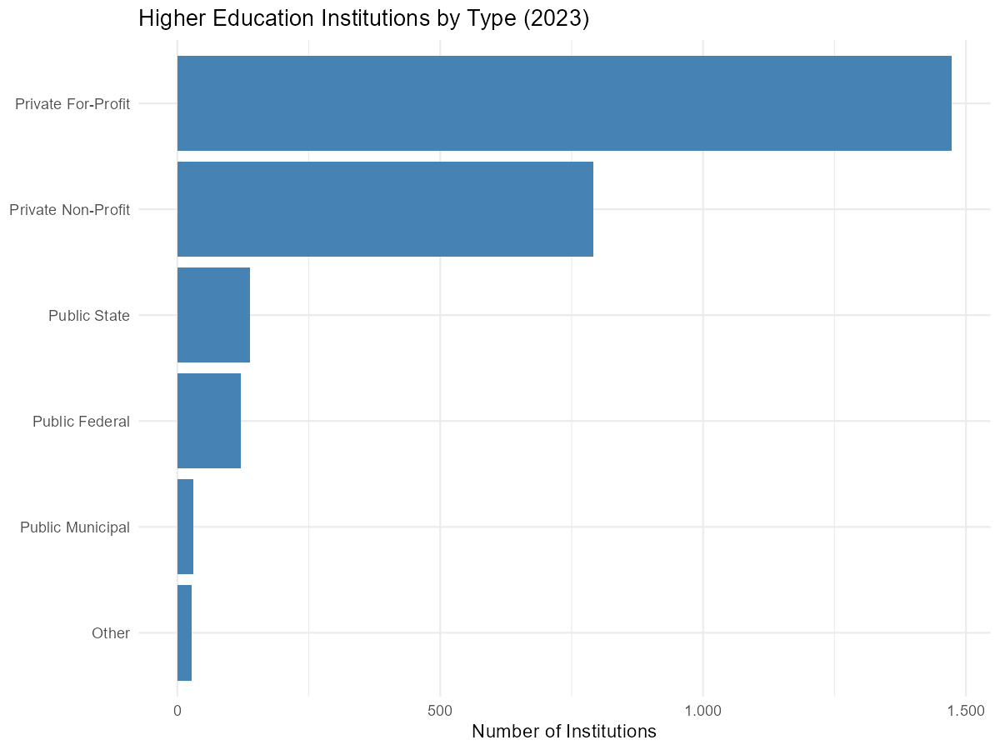
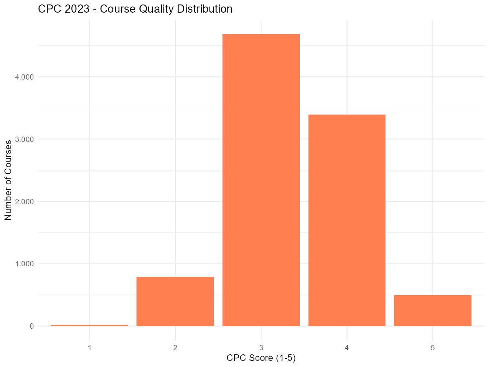
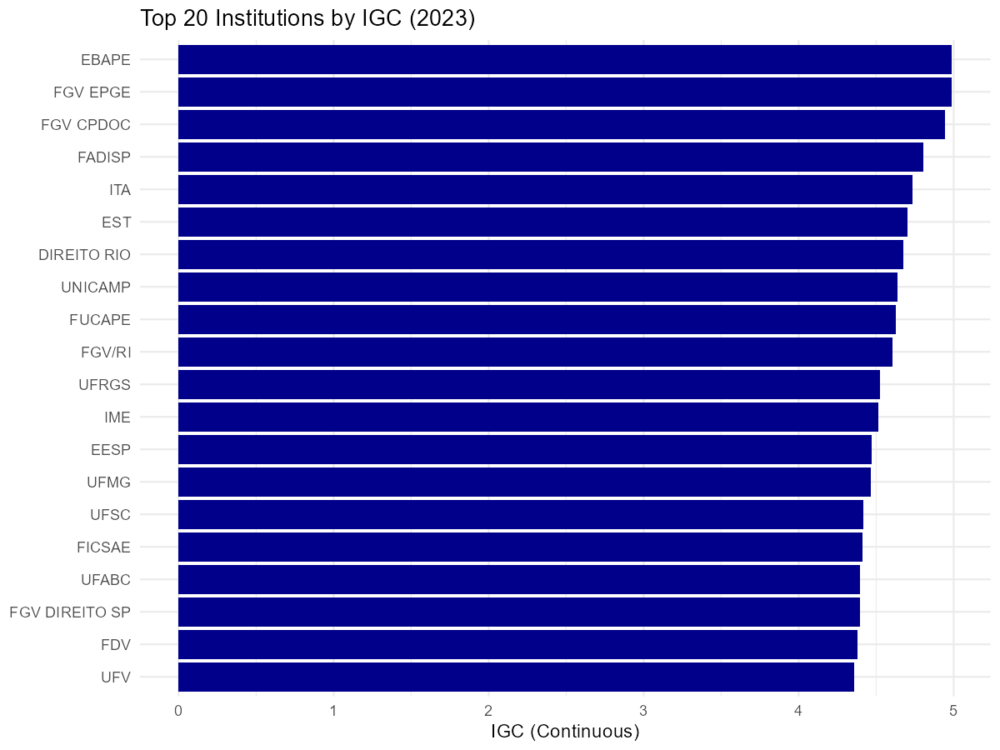
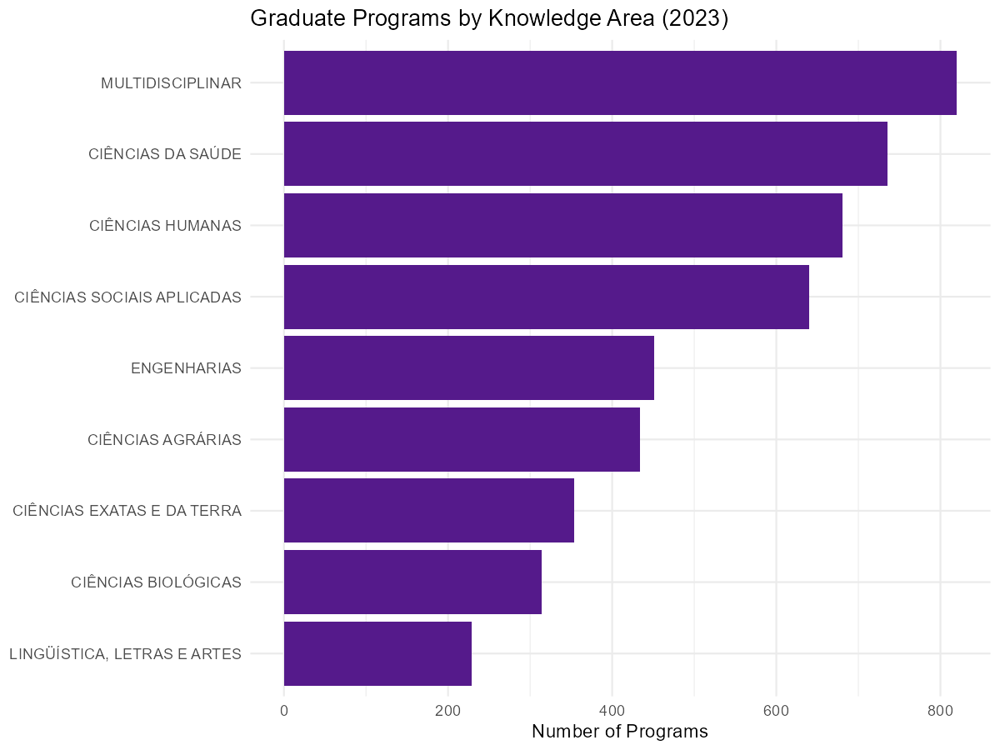
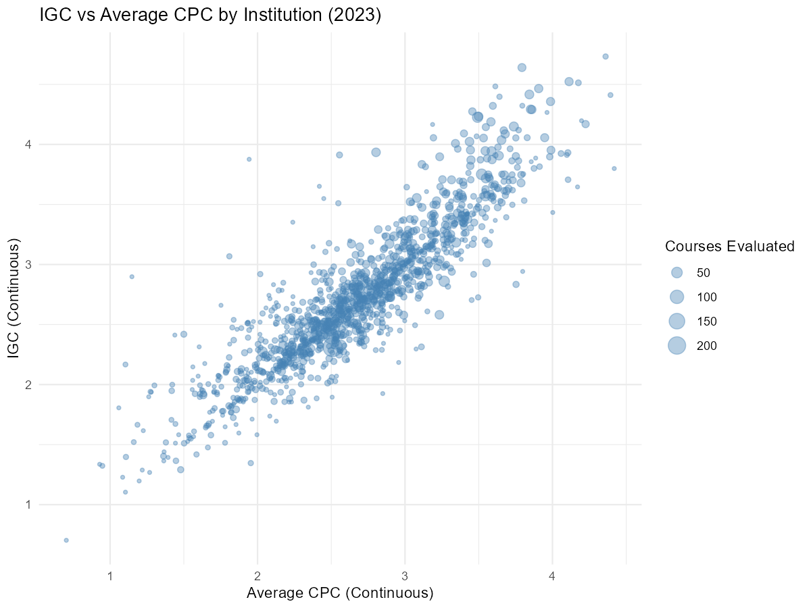

# Higher and Graduate Education: Census, ENADE, IDD, CPC, IGC, and CAPES

This vignette covers higher education and graduate education datasets
available in educabR. These datasets allow you to analyze institutions,
courses, student performance, and quality indicators across Brazilian
higher education.

\
[`library`](https://rdrr.io/r/base/library.html)`(`[`educabR`](https://github.com/SidneyBissoli/educabR)`)`\
[`library`](https://rdrr.io/r/base/library.html)`(`[`dplyr`](https://dplyr.tidyverse.org)`)`\
[`library`](https://rdrr.io/r/base/library.html)`(`[`ggplot2`](https://ggplot2.tidyverse.org)`)`

## Higher Education Census

The Higher Education Census is an annual survey covering all Brazilian
higher education institutions (IES), including data on institutions,
courses, student enrollment, and faculty.

### Available data types

| Type         | Description                                                 |
|--------------|-------------------------------------------------------------|
| `"ies"`      | Institutions (location, administrative type, accreditation) |
| `"cursos"`   | Undergraduate courses (area, modality, enrollment)          |
| `"alunos"`   | Student enrollment (demographics, enrollment status)        |
| `"docentes"` | Faculty (qualifications, employment type)                   |

### Downloading data

\
`# Institution data`\
`ies_2023`` ``<-`` `[`get_censo_superior`](https://sidneybissoli.github.io/educabR/reference/get_censo_superior.md)`(``year ``=`` ``2023``, type ``=`` ``"ies"``)`\
\
`# Course data filtered by state`\
`cursos_sp`` ``<-`` `[`get_censo_superior`](https://sidneybissoli.github.io/educabR/reference/get_censo_superior.md)`(``year ``=`` ``2023``, type ``=`` ``"cursos"``, uf ``=`` ``"SP"``)`\
\
`# Faculty data with limited rows`\
`docentes_sample`` ``<-`` `[`get_censo_superior`](https://sidneybissoli.github.io/educabR/reference/get_censo_superior.md)`(`\
`  year  ``=`` ``2023``,`\
`  type  ``=`` ``"docentes"``,`\
`  n_max ``=`` ``10000`\
`)`

### Available years

Data is available from 2009 to 2024.

### Exploring ZIP contents

\
`# See what files are inside the downloaded ZIP`\
[`list_censo_superior_files`](https://sidneybissoli.github.io/educabR/reference/list_censo_superior_files.md)`(``2023``)`

### Example analysis: Institutions by administrative type

\
`ies`` ``<-`` `[`get_censo_superior`](https://sidneybissoli.github.io/educabR/reference/get_censo_superior.md)`(``2023``, type ``=`` ``"ies"``)`\
\
`ies_summary`` ``<-`` `\
`  ``ies`` ``|>`\
`  `[`mutate`](https://dplyr.tidyverse.org/reference/mutate.html)`(`\
`    admin_type ``=`` `[`case_when`](https://dplyr.tidyverse.org/reference/case-and-replace-when.html)`(`\
`      ``tp_categoria_administrativa`` ``==`` ``1`` ``~`` ``"Public Federal"``,`\
`      ``tp_categoria_administrativa`` ``==`` ``2`` ``~`` ``"Public State"``,`\
`      ``tp_categoria_administrativa`` ``==`` ``3`` ``~`` ``"Public Municipal"``,`\
`      ``tp_categoria_administrativa`` ``==`` ``4`` ``~`` ``"Private For-Profit"``,`\
`      ``tp_categoria_administrativa`` ``==`` ``5`` ``~`` ``"Private Non-Profit"``,`\
`      ``TRUE`` ``~`` ``"Other"`\
`    ``)`\
`  ``)`` ``|>`\
`  `[`count`](https://dplyr.tidyverse.org/reference/count.html)`(``admin_type``, sort ``=`` ``TRUE``)`\
\
[`ggplot`](https://ggplot2.tidyverse.org/reference/ggplot.html)`(``ies_summary``, `[`aes`](https://ggplot2.tidyverse.org/reference/aes.html)`(``x ``=`` `[`reorder`](https://rdrr.io/r/stats/reorder.factor.html)`(``admin_type``, ``n``)``, y ``=`` ``n``)``)`` ``+`\
`  `[`geom_col`](https://ggplot2.tidyverse.org/reference/geom_bar.html)`(``fill ``=`` ``"steelblue"``)`` ``+`\
`  `[`coord_flip`](https://ggplot2.tidyverse.org/reference/coord_flip.html)`(``)`` ``+`\
`  `[`labs`](https://ggplot2.tidyverse.org/reference/labs.html)`(`\
`    title ``=`` ``"Higher Education Institutions by Type (2023)"``,`\
`    x     ``=`` ``NULL``,`\
`    y     ``=`` ``"Number of Institutions"`\
`  ``)`` ``+`\
`  `[`theme_minimal`](https://ggplot2.tidyverse.org/reference/ggtheme.html)`(``)`` ``+`\
`  `[`scale_y_continuous`](https://ggplot2.tidyverse.org/reference/scale_continuous.html)`(``label ``=`` ``scales``::`[`number_format`](https://scales.r-lib.org/reference/comma.html)`(``big.mark ``=`` ``"."``, decimal.mark ``=`` ``","``)``)`

------------------------------------------------------------------------

## ENADE - National Student Performance Exam

ENADE (Exame Nacional de Desempenho dos Estudantes) is an annual exam
assessing undergraduate student performance. It follows a rotating cycle
where different course areas are evaluated each year.

### Downloading ENADE data

\
`# Download ENADE microdata`\
`enade_2023`` ``<-`` `[`get_enade`](https://sidneybissoli.github.io/educabR/reference/get_enade.md)`(``year ``=`` ``2023``)`\
\
`# Sample for exploration`\
`enade_sample`` ``<-`` `[`get_enade`](https://sidneybissoli.github.io/educabR/reference/get_enade.md)`(``year ``=`` ``2023``, n_max ``=`` ``5000``)`

### Available years

Data is available from 2004 to 2024.

### Data structure

\
`enade`` ``<-`` `[`get_enade`](https://sidneybissoli.github.io/educabR/reference/get_enade.md)`(``2023``, n_max ``=`` ``5000``)`\
[`glimpse`](https://pillar.r-lib.org/reference/glimpse.html)`(``enade``)`

### Example analysis: Score distribution

\
`enade`` ``<-`` `[`get_enade`](https://sidneybissoli.github.io/educabR/reference/get_enade.md)`(``2023``)`\
\
`enade`` ``|>`\
`  `[`filter`](https://dplyr.tidyverse.org/reference/filter.html)`(``!`[`is.na`](https://rdrr.io/r/base/NA.html)`(``nt_ger``)``)`` ``|>`\
`  `[`ggplot`](https://ggplot2.tidyverse.org/reference/ggplot.html)`(`[`aes`](https://ggplot2.tidyverse.org/reference/aes.html)`(``x ``=`` ``nt_ger``)``)`` ``+`\
`  `[`geom_histogram`](https://ggplot2.tidyverse.org/reference/geom_histogram.html)`(``binwidth ``=`` ``5``, fill ``=`` ``"darkorange"``, color ``=`` ``"white"``)`` ``+`\
`  `[`labs`](https://ggplot2.tidyverse.org/reference/labs.html)`(`\
`    title ``=`` ``"ENADE 2023 - General Score Distribution"``,`\
`    x     ``=`` ``"General Score (nt_ger)"``,`\
`    y     ``=`` ``"Number of Students"`\
`  ``)`` ``+`\
`  `[`theme_minimal`](https://ggplot2.tidyverse.org/reference/ggtheme.html)`(``)`` ``+`\
`  `[`scale_y_continuous`](https://ggplot2.tidyverse.org/reference/scale_continuous.html)`(``label ``=`` ``scales``::`[`number_format`](https://scales.r-lib.org/reference/comma.html)`(``big.mark ``=`` ``"."``, decimal.mark ``=`` ``","``)``)`

------------------------------------------------------------------------

## IDD - Value-Added Indicator

IDD (Indicador de Diferenca entre os Desempenhos Observado e Esperado)
measures the value added by an undergraduate course. It compares ENADE
scores with the expected performance based on students’ ENEM admission
scores.

### Downloading IDD data

\
`# Download IDD data`\
`idd_2023`` ``<-`` `[`get_idd`](https://sidneybissoli.github.io/educabR/reference/get_idd.md)`(``year ``=`` ``2023``)`\
\
`# Sample for exploration`\
`idd_sample`` ``<-`` `[`get_idd`](https://sidneybissoli.github.io/educabR/reference/get_idd.md)`(``year ``=`` ``2023``, n_max ``=`` ``5000``)`

### Available years

Data is available for 2014-2019 and 2021-2023 (no 2020 edition due to
COVID).

### Example analysis: Value-added by institution type

\
`idd`` ``<-`` `[`get_idd`](https://sidneybissoli.github.io/educabR/reference/get_idd.md)`(``2023``)`\
\
[`glimpse`](https://pillar.r-lib.org/reference/glimpse.html)`(``idd``)`

------------------------------------------------------------------------

## CPC - Preliminary Course Concept

CPC (Conceito Preliminar de Curso) is a quality indicator for
undergraduate courses. It combines ENADE scores, IDD, faculty
qualifications, pedagogical resources, and student perceptions.

CPC scores range from 1 to 5, where courses scoring 1 or 2 are
considered unsatisfactory.

### Downloading CPC data

\
`# Download CPC data (Excel format, requires readxl)`\
`cpc_2023`` ``<-`` `[`get_cpc`](https://sidneybissoli.github.io/educabR/reference/get_cpc.md)`(``year ``=`` ``2023``)`\
\
`# Sample for exploration`\
`cpc_sample`` ``<-`` `[`get_cpc`](https://sidneybissoli.github.io/educabR/reference/get_cpc.md)`(``year ``=`` ``2023``, n_max ``=`` ``5000``)`

### Available years

Data is available for 2007-2019 and 2021-2023 (no 2020 edition).

### Example analysis: Course quality distribution

\
`cpc`` ``<-`` `[`get_cpc`](https://sidneybissoli.github.io/educabR/reference/get_cpc.md)`(``2023``)`\
\
`# Distribution of CPC scores`\
`cpc`` ``|>`\
`  `[`filter`](https://dplyr.tidyverse.org/reference/filter.html)`(``!`[`is.na`](https://rdrr.io/r/base/NA.html)`(``cpc_faixa``)``)`` ``|>`\
`  `[`count`](https://dplyr.tidyverse.org/reference/count.html)`(``cpc_faixa``)`` ``|>`\
`  `[`ggplot`](https://ggplot2.tidyverse.org/reference/ggplot.html)`(`[`aes`](https://ggplot2.tidyverse.org/reference/aes.html)`(``x ``=`` `[`factor`](https://rdrr.io/r/base/factor.html)`(``cpc_faixa``)``, y ``=`` ``n``)``)`` ``+`\
`  `[`geom_col`](https://ggplot2.tidyverse.org/reference/geom_bar.html)`(``fill ``=`` ``"coral"``)`` ``+`\
`  `[`labs`](https://ggplot2.tidyverse.org/reference/labs.html)`(`\
`    title ``=`` ``"CPC 2023 - Course Quality Distribution"``,`\
`    x     ``=`` ``"CPC Score (1-5)"``,`\
`    y     ``=`` ``"Number of Courses"`\
`  ``)`` ``+`\
`  `[`theme_minimal`](https://ggplot2.tidyverse.org/reference/ggtheme.html)`(``)`` ``+`\
`  `[`scale_y_continuous`](https://ggplot2.tidyverse.org/reference/scale_continuous.html)`(``label ``=`` ``scales``::`[`number_format`](https://scales.r-lib.org/reference/comma.html)`(``big.mark ``=`` ``"."``, decimal.mark ``=`` ``","``)``)`

------------------------------------------------------------------------

## IGC - General Courses Index

IGC (Indice Geral de Cursos) is a quality indicator for higher education
institutions. It is calculated as a weighted average of CPC scores for
undergraduate courses plus CAPES scores for graduate programs.

IGC scores range from 1 to 5, providing an overall quality measure for
each institution.

### Downloading IGC data

\
`# Download IGC data (Excel format, requires readxl)`\
`igc_2023`` ``<-`` `[`get_igc`](https://sidneybissoli.github.io/educabR/reference/get_igc.md)`(``year ``=`` ``2023``)`\
\
`# Sample for exploration`\
`igc_sample`` ``<-`` `[`get_igc`](https://sidneybissoli.github.io/educabR/reference/get_igc.md)`(``year ``=`` ``2023``, n_max ``=`` ``1000``)`

### Available years

Data is available for 2007-2019 and 2021-2023 (no 2020 edition). Note:
IGC 2007 comes as a 7z archive containing an Excel file.

### Example analysis: Institution quality

\
`igc`` ``<-`` `[`get_igc`](https://sidneybissoli.github.io/educabR/reference/get_igc.md)`(``2023``)`\
\
`# Top institutions by continuous IGC`\
`igc`` ``|>`\
`  `[`filter`](https://dplyr.tidyverse.org/reference/filter.html)`(``!`[`is.na`](https://rdrr.io/r/base/NA.html)`(``igc_continuo``)``)`` ``|>`\
`  `[`filter`](https://dplyr.tidyverse.org/reference/filter.html)`(``!`[`is.na`](https://rdrr.io/r/base/NA.html)`(``sigla_da_ies``)``)`` ``|>`\
`  `[`arrange`](https://dplyr.tidyverse.org/reference/arrange.html)`(`[`desc`](https://dplyr.tidyverse.org/reference/desc.html)`(``igc_continuo``)``)`` ``|>`\
`  `[`head`](https://rdrr.io/r/utils/head.html)`(``20``)`` ``|>`\
`  `[`ggplot`](https://ggplot2.tidyverse.org/reference/ggplot.html)`(`[`aes`](https://ggplot2.tidyverse.org/reference/aes.html)`(``x ``=`` `[`reorder`](https://rdrr.io/r/stats/reorder.factor.html)`(``sigla_da_ies``, ``igc_continuo``)``, y ``=`` ``igc_continuo``)``)`` ``+`\
`  `[`geom_col`](https://ggplot2.tidyverse.org/reference/geom_bar.html)`(``fill ``=`` ``"darkblue"``)`` ``+`\
`  `[`coord_flip`](https://ggplot2.tidyverse.org/reference/coord_flip.html)`(``)`` ``+`\
`  `[`labs`](https://ggplot2.tidyverse.org/reference/labs.html)`(`\
`    title ``=`` ``"Top 20 Institutions by IGC (2023)"``,`\
`    x     ``=`` ``NULL``,`\
`    y     ``=`` ``"IGC (Continuous)"`\
`  ``)`` ``+`\
`  `[`theme_minimal`](https://ggplot2.tidyverse.org/reference/ggtheme.html)`(``)`

------------------------------------------------------------------------

## CAPES - Graduate Education Data

CAPES (Coordenacao de Aperfeicoamento de Pessoal de Nivel Superior)
provides open data on Brazilian graduate programs (stricto sensu:
masters and doctoral programs).

### Available data types

| Type          | Description                                        |
|---------------|----------------------------------------------------|
| `"programas"` | Graduate programs (area, institution, CAPES score) |
| `"discentes"` | Students (enrollment, demographics, funding)       |
| `"docentes"`  | Faculty (qualifications, research output)          |
| `"cursos"`    | Graduate courses within programs                   |
| `"catalogo"`  | Theses and dissertations catalog                   |

### Downloading CAPES data

\
`# Graduate programs`\
`programas_2023`` ``<-`` `[`get_capes`](https://sidneybissoli.github.io/educabR/reference/get_capes.md)`(``year ``=`` ``2023``, type ``=`` ``"programas"``)`\
\
`# Students (large dataset!)`\
`discentes_sample`` ``<-`` `[`get_capes`](https://sidneybissoli.github.io/educabR/reference/get_capes.md)`(``year ``=`` ``2023``, type ``=`` ``"discentes"``, n_max ``=`` ``10000``)`\
\
`# Theses and dissertations catalog`\
`catalogo_2023`` ``<-`` `[`get_capes`](https://sidneybissoli.github.io/educabR/reference/get_capes.md)`(``year ``=`` ``2023``, type ``=`` ``"catalogo"``)`

### Available years

Data is available from 2013 to 2024. Data is retrieved from the CAPES
Open Data Portal via CKAN API.

### Example analysis: Graduate programs by knowledge area

\
`programas`` ``<-`` `[`get_capes`](https://sidneybissoli.github.io/educabR/reference/get_capes.md)`(``2023``, type ``=`` ``"programas"``)`\
\
`# Count programs by broad knowledge area`\
`programas`` ``|>`\
`  `[`count`](https://dplyr.tidyverse.org/reference/count.html)`(``nm_grande_area_conhecimento``, sort ``=`` ``TRUE``)`` ``|>`\
`  `[`head`](https://rdrr.io/r/utils/head.html)`(``10``)`` ``|>`\
`  `[`ggplot`](https://ggplot2.tidyverse.org/reference/ggplot.html)`(`[`aes`](https://ggplot2.tidyverse.org/reference/aes.html)`(`\
`    x ``=`` `[`reorder`](https://rdrr.io/r/stats/reorder.factor.html)`(``nm_grande_area_conhecimento``, ``n``)``,`\
`    y ``=`` ``n`\
`  ``)``)`` ``+`\
`  `[`geom_col`](https://ggplot2.tidyverse.org/reference/geom_bar.html)`(``fill ``=`` ``"purple4"``)`` ``+`\
`  `[`coord_flip`](https://ggplot2.tidyverse.org/reference/coord_flip.html)`(``)`` ``+`\
`  `[`labs`](https://ggplot2.tidyverse.org/reference/labs.html)`(`\
`    title ``=`` ``"Graduate Programs by Knowledge Area (2023)"``,`\
`    x     ``=`` ``NULL``,`\
`    y     ``=`` ``"Number of Programs"`\
`  ``)`` ``+`\
`  `[`theme_minimal`](https://ggplot2.tidyverse.org/reference/ggtheme.html)`(``)`

------------------------------------------------------------------------

## Combining quality indicators

CPC, IGC, IDD, and ENADE are closely related. Here is an example of how
to combine them for a comprehensive view.

\
`# Load CPC and IGC for the same year`\
`cpc`` ``<-`` `[`get_cpc`](https://sidneybissoli.github.io/educabR/reference/get_cpc.md)`(``2023``)`\
`igc`` ``<-`` `[`get_igc`](https://sidneybissoli.github.io/educabR/reference/get_igc.md)`(``2023``)`\
\
`# Compare institution-level quality`\
`# IGC gives the overall institution score`\
`# CPC gives individual course scores within each institution`\
`igc_summary`` ``<-`` `\
`  ``igc`` ``|>`\
`  `[`filter`](https://dplyr.tidyverse.org/reference/filter.html)`(``!`[`is.na`](https://rdrr.io/r/base/NA.html)`(``igc_faixa``)``)`` ``|>`\
`  `[`select`](https://dplyr.tidyverse.org/reference/select.html)`(``codigo_da_ies``, ``sigla_da_ies``, ``igc_continuo``, ``igc_faixa``)`\
\
`cpc_summary`` ``<-`` `\
`  ``cpc`` ``|>`\
`  `[`filter`](https://dplyr.tidyverse.org/reference/filter.html)`(``!`[`is.na`](https://rdrr.io/r/base/NA.html)`(``cpc_continuo``)``)`` ``|>`\
`  `[`group_by`](https://dplyr.tidyverse.org/reference/group_by.html)`(``codigo_da_ies``)`` ``|>`\
`  `[`summarise`](https://dplyr.tidyverse.org/reference/summarise.html)`(`\
`    n_courses ``=`` `[`n`](https://dplyr.tidyverse.org/reference/context.html)`(``)``,`\
`    mean_cpc  ``=`` `[`mean`](https://rdrr.io/r/base/mean.html)`(``cpc_continuo``, na.rm ``=`` ``TRUE``)``,`\
`    .groups   ``=`` ``"drop"`\
`  ``)`\
\
`combined`` ``<-`` `[`inner_join`](https://dplyr.tidyverse.org/reference/mutate-joins.html)`(``igc_summary``, ``cpc_summary``, by ``=`` ``"codigo_da_ies"``)`\
\
[`ggplot`](https://ggplot2.tidyverse.org/reference/ggplot.html)`(``combined``, `[`aes`](https://ggplot2.tidyverse.org/reference/aes.html)`(``x ``=`` ``mean_cpc``, y ``=`` ``igc_continuo``, size ``=`` ``n_courses``)``)`` ``+`\
`  `[`geom_point`](https://ggplot2.tidyverse.org/reference/geom_point.html)`(``alpha ``=`` ``0.4``, color ``=`` ``"steelblue"``)`` ``+`\
`  `[`labs`](https://ggplot2.tidyverse.org/reference/labs.html)`(`\
`    title ``=`` ``"IGC vs Average CPC by Institution (2023)"``,`\
`    x     ``=`` ``"Average CPC (Continuous)"``,`\
`    y     ``=`` ``"IGC (Continuous)"``,`\
`    size  ``=`` ``"Courses Evaluated"`\
`  ``)`` ``+`\
`  `[`theme_minimal`](https://ggplot2.tidyverse.org/reference/ggtheme.html)`(``)`

