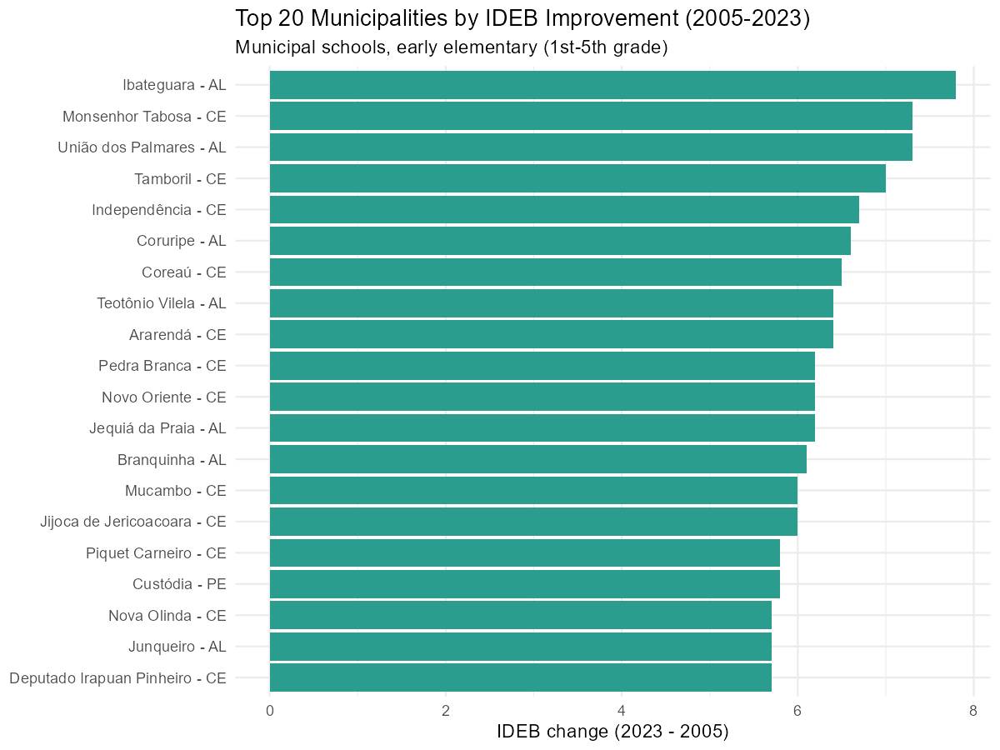
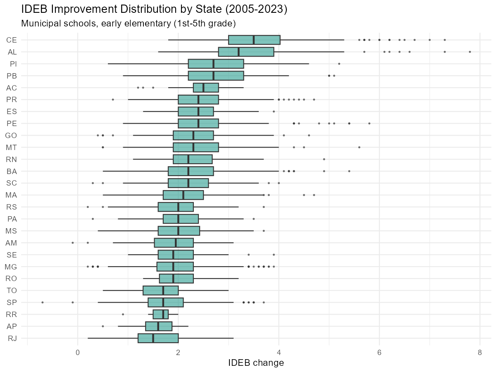
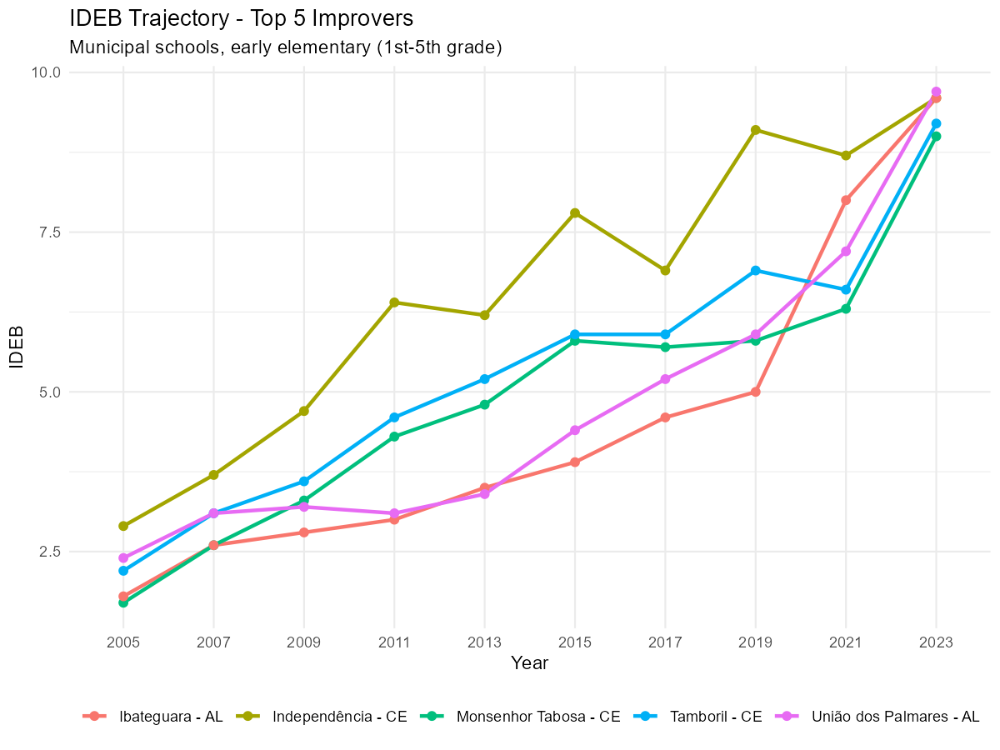
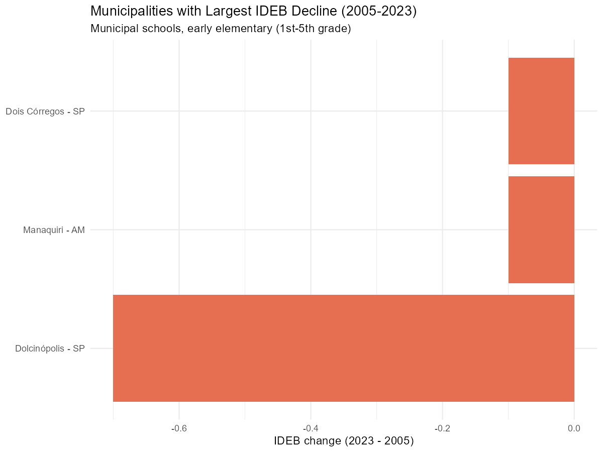

# Which municipalities improved the most in IDEB?

This vignette shows how to use educabR to identify which municipalities
had the largest IDEB improvement over time, using the historical series
available via
[`get_ideb()`](https://sidneybissoli.github.io/educabR/reference/get_ideb.md).

\
[`library`](https://rdrr.io/r/base/library.html)`(`[`educabR`](https://github.com/SidneyBissoli/educabR)`)`\
[`library`](https://rdrr.io/r/base/library.html)`(`[`dplyr`](https://dplyr.tidyverse.org)`)`\
[`library`](https://rdrr.io/r/base/library.html)`(`[`tidyr`](https://tidyr.tidyverse.org)`)`\
[`library`](https://rdrr.io/r/base/library.html)`(`[`ggplot2`](https://ggplot2.tidyverse.org)`)`

## Downloading IDEB data

[`get_ideb()`](https://sidneybissoli.github.io/educabR/reference/get_ideb.md)
returns data in long format with all available editions. A single call
with `year = c(2005, 2023)` gives us the two endpoints we need for
comparison.

\
`ideb`` ``<-`` `[`get_ideb`](https://sidneybissoli.github.io/educabR/reference/get_ideb.md)`(`\
`  level  ``=`` ``"municipio"``,`\
`  stage  ``=`` ``"anos_iniciais"``,`\
`  metric ``=`` ``"indicador"``,`\
`  year   ``=`` `[`c`](https://rdrr.io/r/base/c.html)`(``2005``, ``2023``)`\
`)`\
[`glimpse`](https://pillar.r-lib.org/reference/glimpse.html)`(``ideb``)`

    #> Rows: 86,982
    #> Columns: 7
    #> $ uf_sigla         <chr> "RO", "RO", "RO", "RO", "RO", "RO", …
    #> $ municipio_codigo <chr> "1100015", "1100015", "1100015", "1100…
    #> $ municipio_nome   <chr> "Alta Floresta D'Oeste", "Alta Florest…
    #> $ rede             <chr> "Estadual", "Municipal", "Pública", "E…
    #> $ ano              <int> 2005, 2005, 2005, 2005, 2005, 2005, 20…
    #> $ indicador        <chr> "IDEB", "IDEB", "IDEB", "IDEB", "IDEB…
    #> $ valor            <dbl> 3.5, NA, 3.7, 4.0, 3.5, 3.7, 4.1, 3.4…

## Calculating IDEB improvement

We filter to the IDEB indicator for municipal schools, pivot to wide
format to get one column per year, then compute the change.

\
`ideb_change`` ``<-`\
`  ``ideb`` ``|>`\
`  `[`filter`](https://dplyr.tidyverse.org/reference/filter.html)`(``indicador`` ``==`` ``"IDEB"``)`` ``|>`\
`  `[`filter`](https://dplyr.tidyverse.org/reference/filter.html)`(``rede`` ``==`` ``"Municipal"``)`` ``|>`\
`  `[`select`](https://dplyr.tidyverse.org/reference/select.html)`(``uf_sigla``, ``municipio_codigo``, ``municipio_nome``, ``ano``, ``valor``)`` ``|>`\
`  `[`pivot_wider`](https://tidyr.tidyverse.org/reference/pivot_wider.html)`(``names_from ``=`` ``ano``, values_from ``=`` ``valor``, names_prefix ``=`` ``"ideb_"``)`` ``|>`\
`  `[`filter`](https://dplyr.tidyverse.org/reference/filter.html)`(``!`[`is.na`](https://rdrr.io/r/base/NA.html)`(``ideb_2005``)``, ``!`[`is.na`](https://rdrr.io/r/base/NA.html)`(``ideb_2023``)``)`` ``|>`\
`  `[`mutate`](https://dplyr.tidyverse.org/reference/mutate.html)`(`\
`    change     ``=`` ``ideb_2023`` ``-`` ``ideb_2005``,`\
`    pct_change ``=`` ``change`` ``/`` ``ideb_2005`` ``*`` ``100`\
`  ``)`

## Top 20 municipalities by absolute improvement

\
`ideb_change`` ``|>`\
`  `[`slice_max`](https://dplyr.tidyverse.org/reference/slice.html)`(``change``, n ``=`` ``20``)`` ``|>`\
`  `[`ggplot`](https://ggplot2.tidyverse.org/reference/ggplot.html)`(`[`aes`](https://ggplot2.tidyverse.org/reference/aes.html)`(`\
`    x ``=`` `[`reorder`](https://rdrr.io/r/stats/reorder.factor.html)`(`[`paste`](https://rdrr.io/r/base/paste.html)`(``municipio_nome``, ``uf_sigla``, sep ``=`` ``" - "``)``, ``change``)``,`\
`    y ``=`` ``change`\
`  ``)``)`` ``+`\
`  `[`geom_col`](https://ggplot2.tidyverse.org/reference/geom_bar.html)`(``fill ``=`` ``"#2a9d8f"``)`` ``+`\
`  `[`coord_flip`](https://ggplot2.tidyverse.org/reference/coord_flip.html)`(``)`` ``+`\
`  `[`labs`](https://ggplot2.tidyverse.org/reference/labs.html)`(`\
`    title    ``=`` ``"Top 20 Municipalities by IDEB Improvement (2005-2023)"``,`\
`    subtitle ``=`` ``"Municipal schools, early elementary (1st-5th grade)"``,`\
`    x        ``=`` ``NULL``,`\
`    y        ``=`` ``"IDEB change (2023 - 2005)"`\
`  ``)`` ``+`\
`  `[`theme_minimal`](https://ggplot2.tidyverse.org/reference/ggtheme.html)`(``)`

## Distribution of improvement by state

\
`ideb_change`` ``|>`\
`  `[`ggplot`](https://ggplot2.tidyverse.org/reference/ggplot.html)`(`[`aes`](https://ggplot2.tidyverse.org/reference/aes.html)`(``x ``=`` `[`reorder`](https://rdrr.io/r/stats/reorder.factor.html)`(``uf_sigla``, ``change``, FUN ``=`` ``median``)``, y ``=`` ``change``)``)`` ``+`\
`  `[`geom_boxplot`](https://ggplot2.tidyverse.org/reference/geom_boxplot.html)`(``fill ``=`` ``"#2a9d8f"``, alpha ``=`` ``0.6``, outlier.size ``=`` ``0.5``)`` ``+`\
`  `[`coord_flip`](https://ggplot2.tidyverse.org/reference/coord_flip.html)`(``)`` ``+`\
`  `[`labs`](https://ggplot2.tidyverse.org/reference/labs.html)`(`\
`    title    ``=`` ``"IDEB Improvement Distribution by State (2005-2023)"``,`\
`    subtitle ``=`` ``"Municipal schools, early elementary (1st-5th grade)"``,`\
`    x        ``=`` ``NULL``,`\
`    y        ``=`` ``"IDEB change"`\
`  ``)`` ``+`\
`  `[`theme_minimal`](https://ggplot2.tidyverse.org/reference/ggtheme.html)`(``)`

## IDEB trajectory for selected municipalities

\
`# Pick the top 5 improvers`\
`top5`` ``<-`\
`  ``ideb_change`` ``|>`\
`  `[`filter`](https://dplyr.tidyverse.org/reference/filter.html)`(``rede`` ``==`` ``"Municipal"``)`` ``|>`\
`  `[`slice_max`](https://dplyr.tidyverse.org/reference/slice.html)`(``change``, n ``=`` ``5``)`` ``|>`\
`  `[`pull`](https://dplyr.tidyverse.org/reference/pull.html)`(``municipio_codigo``)`\
\
`# Get full history for these municipalities`\
`ideb_full`` ``<-`\
`  `[`get_ideb`](https://sidneybissoli.github.io/educabR/reference/get_ideb.md)`(`\
`    level  ``=`` ``"municipio"``,`\
`    stage  ``=`` ``"anos_iniciais"``,`\
`    metric ``=`` ``"indicador"`\
`  ``)`` ``|>`\
`  `[`filter`](https://dplyr.tidyverse.org/reference/filter.html)`(``rede`` ``==`` ``"Municipal"``)`\
\
`ideb_full`` ``|>`\
`  `[`filter`](https://dplyr.tidyverse.org/reference/filter.html)`(``municipio_codigo`` `[`%in%`](https://rdrr.io/r/base/match.html)` ``top5``, ``indicador`` ``==`` ``"IDEB"``)`` ``|>`\
`  `[`mutate`](https://dplyr.tidyverse.org/reference/mutate.html)`(``label ``=`` `[`paste`](https://rdrr.io/r/base/paste.html)`(``municipio_nome``, ``uf_sigla``, sep ``=`` ``" - "``)``)`` ``|>`\
`  `[`ggplot`](https://ggplot2.tidyverse.org/reference/ggplot.html)`(`[`aes`](https://ggplot2.tidyverse.org/reference/aes.html)`(``x ``=`` `[`factor`](https://rdrr.io/r/base/factor.html)`(``ano``)``, y ``=`` ``valor``, color ``=`` ``label``, group ``=`` ``label``)``)`` ``+`\
`  `[`geom_line`](https://ggplot2.tidyverse.org/reference/geom_path.html)`(``linewidth ``=`` ``1``)`` ``+`\
`  `[`geom_point`](https://ggplot2.tidyverse.org/reference/geom_point.html)`(``size ``=`` ``2``)`` ``+`\
`  `[`labs`](https://ggplot2.tidyverse.org/reference/labs.html)`(`\
`    title    ``=`` ``"IDEB Trajectory - Top 5 Improvers"``,`\
`    subtitle ``=`` ``"Municipal schools, early elementary (1st-5th grade)"``,`\
`    x        ``=`` ``"Year"``,`\
`    y     ``=`` ``"IDEB"``,`\
`    color ``=`` ``NULL`\
`  ``)`` ``+`\
`  `[`theme_minimal`](https://ggplot2.tidyverse.org/reference/ggtheme.html)`(``)`` ``+`\
`  `[`theme`](https://ggplot2.tidyverse.org/reference/theme.html)`(``legend.position ``=`` ``"bottom"``)`

## Municipalities that declined

\
`ideb_change`` ``|>`\
`  `[`filter`](https://dplyr.tidyverse.org/reference/filter.html)`(``change`` ``<`` ``0``)`` ``|>`\
`  `[`slice_min`](https://dplyr.tidyverse.org/reference/slice.html)`(``change``, n ``=`` ``15``)`` ``|>`\
`  `[`ggplot`](https://ggplot2.tidyverse.org/reference/ggplot.html)`(`[`aes`](https://ggplot2.tidyverse.org/reference/aes.html)`(`\
`    x ``=`` `[`reorder`](https://rdrr.io/r/stats/reorder.factor.html)`(`[`paste`](https://rdrr.io/r/base/paste.html)`(``municipio_nome``, ``uf_sigla``, sep ``=`` ``" - "``)``, ``change``)``,`\
`    y ``=`` ``change`\
`  ``)``)`` ``+`\
`  `[`geom_col`](https://ggplot2.tidyverse.org/reference/geom_bar.html)`(``fill ``=`` ``"#e76f51"``)`` ``+`\
`  `[`coord_flip`](https://ggplot2.tidyverse.org/reference/coord_flip.html)`(``)`` ``+`\
`  `[`labs`](https://ggplot2.tidyverse.org/reference/labs.html)`(`\
`    title    ``=`` ``"Municipalities with Largest IDEB Decline (2005-2023)"``,`\
`    subtitle ``=`` ``"Municipal schools, early elementary (1st-5th grade)"``,`\
`    x        ``=`` ``NULL``,`\
`    y        ``=`` ``"IDEB change (2023 - 2005)"`\
`  ``)`` ``+`\
`  `[`theme_minimal`](https://ggplot2.tidyverse.org/reference/ggtheme.html)`(``)`

