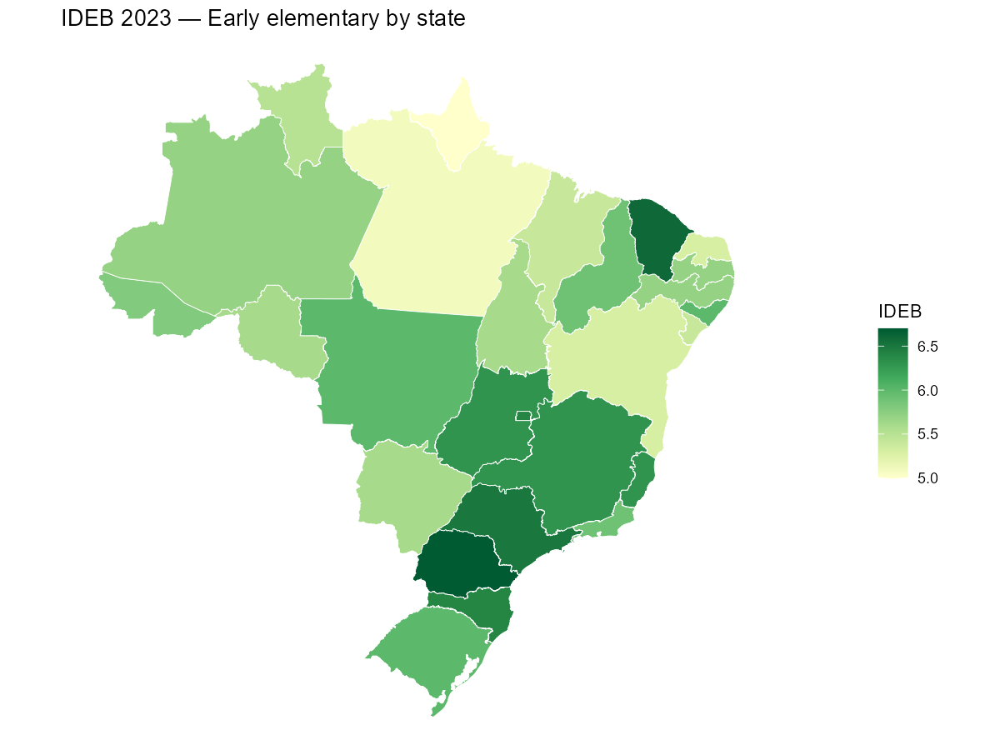
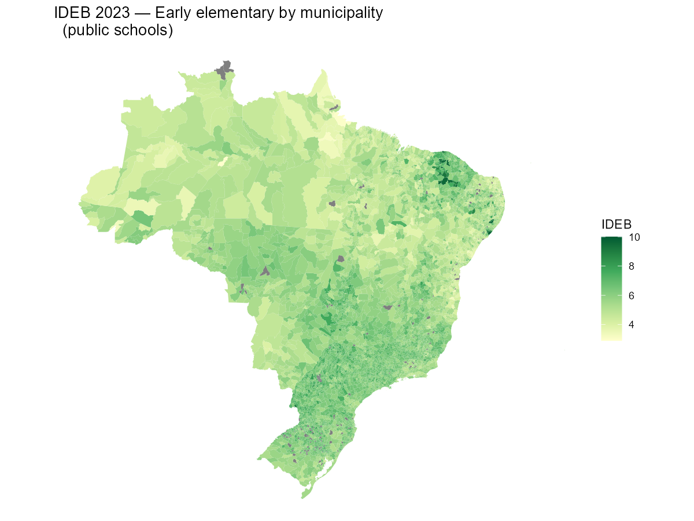
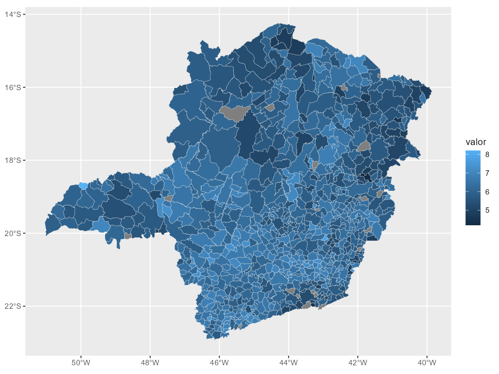
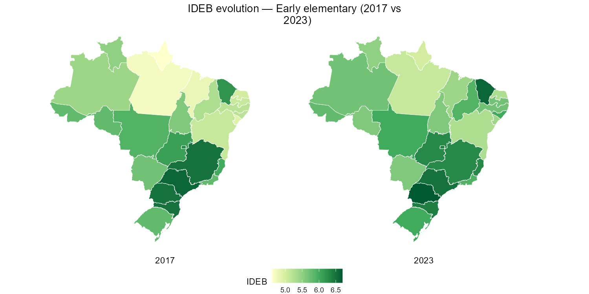

# Mapping education indicators with geobr

This vignette shows how to combine educabR with
[geobr](https://github.com/ipea/geobr) to create choropleth maps of
education indicators across Brazilian municipalities and states.

\
[`library`](https://rdrr.io/r/base/library.html)`(`[`educabR`](https://github.com/SidneyBissoli/educabR)`)`\
[`library`](https://rdrr.io/r/base/library.html)`(`[`geobr`](https://ipea.github.io/geobr/)`)`\
[`library`](https://rdrr.io/r/base/library.html)`(`[`dplyr`](https://dplyr.tidyverse.org)`)`\
[`library`](https://rdrr.io/r/base/library.html)`(`[`ggplot2`](https://ggplot2.tidyverse.org)`)`

## IDEB by state

The simplest map uses state-level data. We download IDEB scores and join
them with state geometries from geobr.

\
`ideb_uf`` ``<-`\
`  `[`get_ideb`](https://sidneybissoli.github.io/educabR/reference/get_ideb.md)`(``level ``=`` ``"estado"``, stage ``=`` ``"anos_iniciais"``, metric ``=`` ``"indicador"``, year ``=`` ``2023``)`` ``|>`\
`  `[`filter`](https://dplyr.tidyverse.org/reference/filter.html)`(``rede`` ``==`` ``"Total"``, ``indicador`` ``==`` ``"IDEB"``)`\
\
`states`` ``<-`` ``read_state``(``year ``=`` ``2020``, showProgress ``=`` ``FALSE``)`\
\
`states`` ``|>`\
`  `[`left_join`](https://dplyr.tidyverse.org/reference/mutate-joins.html)`(``ideb_uf``, by ``=`` `[`c`](https://rdrr.io/r/base/c.html)`(``"abbrev_state"`` ``=`` ``"uf_sigla"``)``)`` ``|>`\
`  `[`ggplot`](https://ggplot2.tidyverse.org/reference/ggplot.html)`(``)`` ``+`\
`  `[`geom_sf`](https://ggplot2.tidyverse.org/reference/ggsf.html)`(`[`aes`](https://ggplot2.tidyverse.org/reference/aes.html)`(``fill ``=`` ``valor``)``, color ``=`` ``"white"``, linewidth ``=`` ``.2``)`` ``+`\
`  `[`scale_fill_distiller`](https://ggplot2.tidyverse.org/reference/scale_brewer.html)`(``palette ``=`` ``"YlGn"``, direction ``=`` ``1``, name ``=`` ``"IDEB"``)`` ``+`\
`  `[`labs`](https://ggplot2.tidyverse.org/reference/labs.html)`(``title ``=`` ``"IDEB 2023 — Early elementary by state"``)`` ``+`\
`  `[`theme_void`](https://ggplot2.tidyverse.org/reference/ggtheme.html)`(``)`

## IDEB by municipality

Municipality-level maps reveal within-state inequality that state
averages hide. The `municipio_codigo` column in educabR uses the 7-digit
IBGE code, which matches `code_muni` in geobr.

\
`ideb_muni`` ``<-`` `[`get_ideb`](https://sidneybissoli.github.io/educabR/reference/get_ideb.md)`(`\
`  level  ``=`` ``"municipio"``,`\
`  stage  ``=`` ``"anos_iniciais"``,`\
`  metric ``=`` ``"indicador"``,`\
`  year   ``=`` ``2023`\
`)`\
\
`# Keep only public schools and the IDEB indicator`\
`ideb_muni`` ``<-`\
`  ``ideb_muni`` ``|>`\
`  `[`filter`](https://dplyr.tidyverse.org/reference/filter.html)`(``rede`` ``==`` ``"P\u00fablica"``, ``indicador`` ``==`` ``"IDEB"``)`\
\
`municipalities`` ``<-`` ``read_municipality``(``year ``=`` ``2020``, showProgress ``=`` ``FALSE``)`

\
`municipalities`` ``|>`\
`  `[`mutate`](https://dplyr.tidyverse.org/reference/mutate.html)`(``code_muni ``=`` `[`as.character`](https://rdrr.io/r/base/character.html)`(``code_muni``)``)`` ``|>`\
`  `[`left_join`](https://dplyr.tidyverse.org/reference/mutate-joins.html)`(``ideb_muni``, by ``=`` `[`c`](https://rdrr.io/r/base/c.html)`(``"code_muni"`` ``=`` ``"municipio_codigo"``)``)`` ``|>`\
`  `[`ggplot`](https://ggplot2.tidyverse.org/reference/ggplot.html)`(``)`` ``+`\
`  `[`geom_sf`](https://ggplot2.tidyverse.org/reference/ggsf.html)`(`[`aes`](https://ggplot2.tidyverse.org/reference/aes.html)`(``fill ``=`` ``valor``)``, color ``=`` ``NA``)`` ``+`\
`  `[`scale_fill_distiller`](https://ggplot2.tidyverse.org/reference/scale_brewer.html)`(``palette ``=`` ``"YlGn"``, direction ``=`` ``1``, name ``=`` ``"IDEB"``)`` ``+`\
`  `[`labs`](https://ggplot2.tidyverse.org/reference/labs.html)`(``title ``=`` ``"IDEB 2023 — Early elementary by municipality (public schools)"``)`` ``+`\
`  `[`theme_void`](https://ggplot2.tidyverse.org/reference/ggtheme.html)`(``)`

## Zooming into a single state

For a closer look, filter both datasets to a single state. Here we map
IDEB across municipalities in Minas Gerais.

\
`ideb_mg`` ``<-`\
`  ``ideb_muni`` ``|>`\
`  `[`filter`](https://dplyr.tidyverse.org/reference/filter.html)`(``uf_sigla`` ``==`` ``"MG"``)`\
\
`munis_mg`` ``<-`` ``read_municipality``(``code_muni ``=`` ``"MG"``, year ``=`` ``2020``, showProgress ``=`` ``FALSE``)`\
\
`munis_mg`` ``|>`\
`  `[`mutate`](https://dplyr.tidyverse.org/reference/mutate.html)`(``code_muni ``=`` `[`as.character`](https://rdrr.io/r/base/character.html)`(``code_muni``)``)`` ``|>`\
`  `[`left_join`](https://dplyr.tidyverse.org/reference/mutate-joins.html)`(``ideb_mg``, by ``=`` `[`c`](https://rdrr.io/r/base/c.html)`(``"code_muni"`` ``=`` ``"municipio_codigo"``)``)`` ``|>`\
`  `[`ggplot`](https://ggplot2.tidyverse.org/reference/ggplot.html)`(``)`` ``+`\
`  `[`geom_sf`](https://ggplot2.tidyverse.org/reference/ggsf.html)`(`[`aes`](https://ggplot2.tidyverse.org/reference/aes.html)`(``fill ``=`` ``valor``)``, color ``=`` ``"grey90"``, linewidth ``=`` ``.1``)`` ``+`\
`  `[`scale_fill_distiller`](https://ggplot2.tidyverse.org/reference/scale_brewer.html)`(``palette ``=`` ``"YlGn"``, direction ``=`` ``1``, name ``=`` ``"IDEB"``)`` ``+`\
`  `[`labs`](https://ggplot2.tidyverse.org/reference/labs.html)`(``title ``=`` ``"IDEB 2023 — Early elementary in Minas Gerais"``)`` ``+`\
`  `[`theme_void`](https://ggplot2.tidyverse.org/reference/ggtheme.html)`(``)`

## Comparing IDEB editions over time

Side-by-side maps make it easy to visualize regional progress. We
download two editions and use facets.

\
`ideb_time`` ``<-`\
`  `[`get_ideb`](https://sidneybissoli.github.io/educabR/reference/get_ideb.md)`(`\
`    level  ``=`` ``"estado"``,`\
`    stage  ``=`` ``"anos_iniciais"``,`\
`    metric ``=`` ``"indicador"``,`\
`    year   ``=`` `[`c`](https://rdrr.io/r/base/c.html)`(``2017``, ``2023``)`\
`  ``)`` ``|>`\
`  `[`filter`](https://dplyr.tidyverse.org/reference/filter.html)`(``rede`` ``==`` ``"Total"``, ``indicador`` ``==`` ``"IDEB"``)`\
\
`states`` ``|>`\
`  `[`left_join`](https://dplyr.tidyverse.org/reference/mutate-joins.html)`(``ideb_time``, by ``=`` `[`c`](https://rdrr.io/r/base/c.html)`(``"abbrev_state"`` ``=`` ``"uf_sigla"``)``)`` ``|>`\
`  `[`ggplot`](https://ggplot2.tidyverse.org/reference/ggplot.html)`(``)`` ``+`\
`  `[`geom_sf`](https://ggplot2.tidyverse.org/reference/ggsf.html)`(`[`aes`](https://ggplot2.tidyverse.org/reference/aes.html)`(``fill ``=`` ``valor``)``, color ``=`` ``"white"``, linewidth ``=`` ``.2``)`` ``+`\
`  `[`scale_fill_distiller`](https://ggplot2.tidyverse.org/reference/scale_brewer.html)`(``palette ``=`` ``"YlGn"``, direction ``=`` ``1``, name ``=`` ``"IDEB"``)`` ``+`\
`  `[`facet_wrap`](https://ggplot2.tidyverse.org/reference/facet_wrap.html)`(``~``ano``, strip.position ``=`` ``"bottom"``)`` ``+`\
`  `[`labs`](https://ggplot2.tidyverse.org/reference/labs.html)`(``title ``=`` ``"IDEB evolution — Early elementary (2017 vs 2023)"``)`` ``+`\
`  `[`theme_void`](https://ggplot2.tidyverse.org/reference/ggtheme.html)`(``)`` ``+`\
`  `[`theme`](https://ggplot2.tidyverse.org/reference/theme.html)`(`\
`    legend.position ``=`` ``"bottom"``,`\
`    plot.title ``=`` `[`element_text`](https://ggplot2.tidyverse.org/reference/element.html)`(``hjust ``=`` ``0.5``)``,`\
`    strip.text ``=`` `[`element_text`](https://ggplot2.tidyverse.org/reference/element.html)`(``size ``=`` ``11``, margin ``=`` `[`margin`](https://ggplot2.tidyverse.org/reference/element.html)`(``t ``=`` ``5``)``)`\
`  ``)`

## Next steps

- Swap `"anos_iniciais"` for `"anos_finais"` or `"ensino_medio"` to map
  other stages.
- Use `metric = "nota"` to map SAEB proficiency scores instead of the
  composite IDEB.
- Combine with other educabR datasets (ENEM, School Census) using the
  same municipality codes.
- See the [geobr documentation](https://github.com/ipea/geobr) for
  additional geographic layers (regions, micro/mesoregions, etc.).
