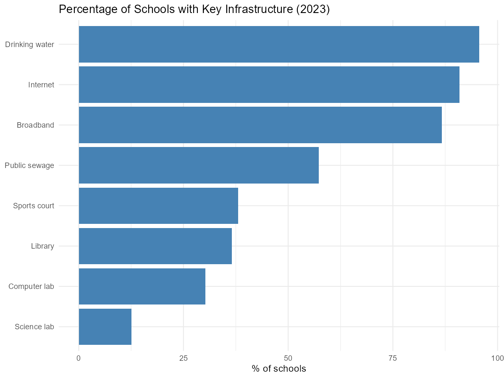
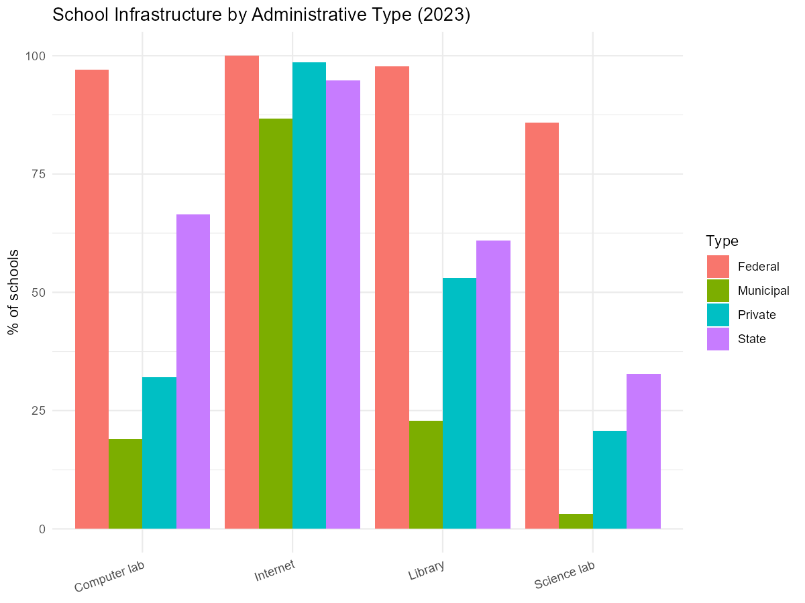
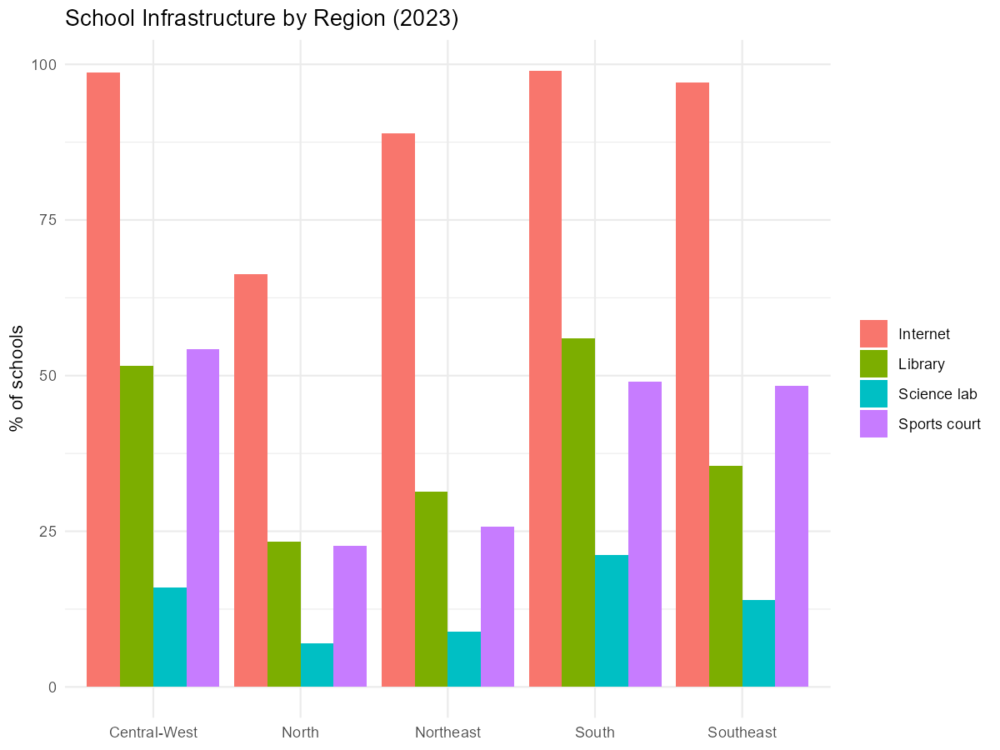
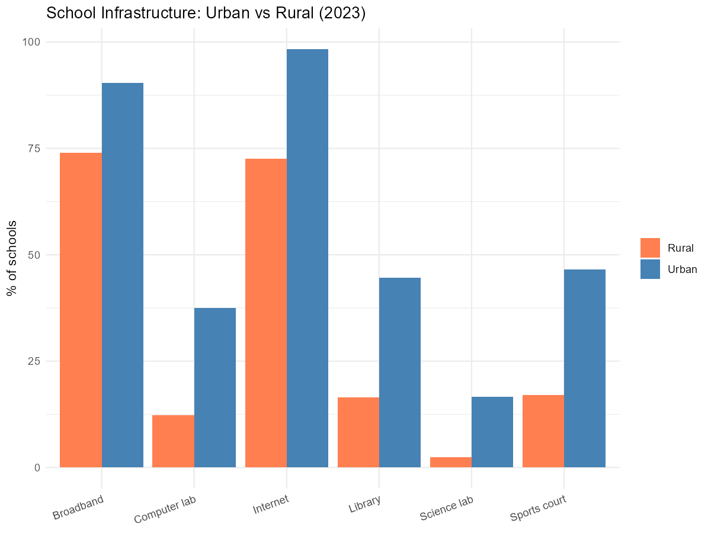
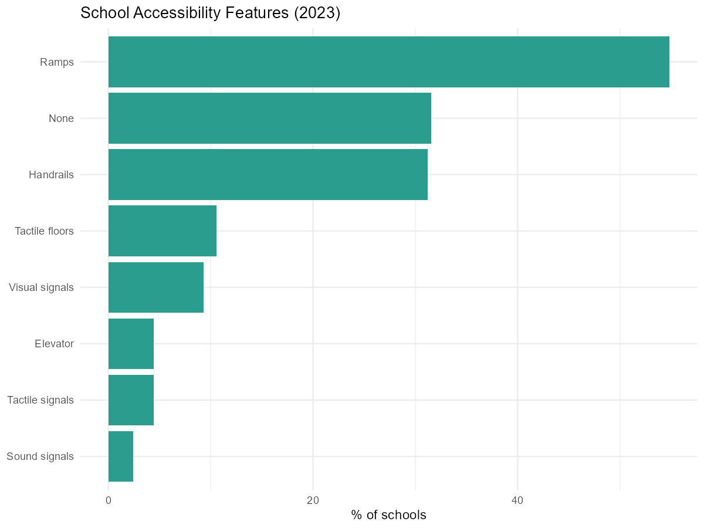
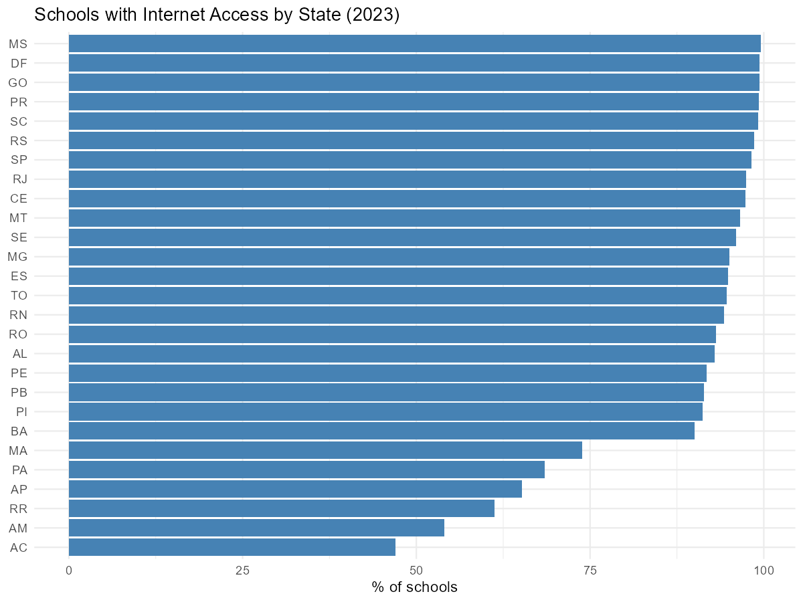

# What does school infrastructure look like across Brazil?

This vignette shows how to use educabR to explore school infrastructure
across Brazil using the School Census. We look at internet access,
libraries, science labs, sports courts, and accessibility features – and
how they vary by region, administrative type, and location.

\
[`library`](https://rdrr.io/r/base/library.html)`(`[`educabR`](https://github.com/SidneyBissoli/educabR)`)`\
[`library`](https://rdrr.io/r/base/library.html)`(`[`dplyr`](https://dplyr.tidyverse.org)`)`\
[`library`](https://rdrr.io/r/base/library.html)`(`[`tidyr`](https://tidyr.tidyverse.org)`)`\
[`library`](https://rdrr.io/r/base/library.html)`(`[`ggplot2`](https://ggplot2.tidyverse.org)`)`

## Downloading School Census data

The School Census contains one row per school (~217,000 schools in 2023)
with over 400 variables covering infrastructure, staffing, and programs.

\
`# Download all schools for 2023`\
`escolas`` ``<-`` `[`get_censo_escolar`](https://sidneybissoli.github.io/educabR/reference/get_censo_escolar.md)`(``year ``=`` ``2023``)`\
\
`# Or filter by state for faster exploration`\
`escolas_sp`` ``<-`` `[`get_censo_escolar`](https://sidneybissoli.github.io/educabR/reference/get_censo_escolar.md)`(``year ``=`` ``2023``, uf ``=`` ``"SP"``)`

> **Note:** the full national file is about 30 MB compressed. When
> filtering by state, all rows are read before filtering, so the first
> call may take a moment.

## Overview: key infrastructure indicators

The School Census uses binary columns (`1` = yes, `0` = no) for each
infrastructure item. Let us compute the percentage of schools that have
each resource nationwide.

\
`indicators`` ``<-`` `[`c`](https://rdrr.io/r/base/c.html)`(`\
`  ``"in_internet"``,`\
`  ``"in_banda_larga"``,`\
`  ``"in_biblioteca"``,`\
`  ``"in_laboratorio_informatica"``,`\
`  ``"in_laboratorio_ciencias"``,`\
`  ``"in_quadra_esportes"``,`\
`  ``"in_agua_potavel"``,`\
`  ``"in_esgoto_rede_publica"`\
`)`\
\
`infra_summary`` ``<-`\
`  ``escolas`` ``|>`\
`  `[`summarise`](https://dplyr.tidyverse.org/reference/summarise.html)`(`[`across`](https://dplyr.tidyverse.org/reference/across.html)`(`[`all_of`](https://tidyselect.r-lib.org/reference/all_of.html)`(``indicators``)``, ``~`` `[`mean`](https://rdrr.io/r/base/mean.html)`(``.`` ``==`` ``1``, na.rm ``=`` ``TRUE``)`` ``*`` ``100``)``)`` ``|>`\
`  `[`pivot_longer`](https://tidyr.tidyverse.org/reference/pivot_longer.html)`(`[`everything`](https://tidyselect.r-lib.org/reference/everything.html)`(``)``, names_to ``=`` ``"indicator"``, values_to ``=`` ``"pct"``)`` ``|>`\
`  `[`mutate`](https://dplyr.tidyverse.org/reference/mutate.html)`(`\
`    label ``=`` `[`c`](https://rdrr.io/r/base/c.html)`(`\
`      ``"Internet"``, ``"Broadband"``, ``"Library"``, ``"Computer lab"``,`\
`      ``"Science lab"``, ``"Sports court"``, ``"Drinking water"``, ``"Public sewage"`\
`    ``)`\
`  ``)`\
\
[`ggplot`](https://ggplot2.tidyverse.org/reference/ggplot.html)`(``infra_summary``, `[`aes`](https://ggplot2.tidyverse.org/reference/aes.html)`(``x ``=`` `[`reorder`](https://rdrr.io/r/stats/reorder.factor.html)`(``label``, ``pct``)``, y ``=`` ``pct``)``)`` ``+`\
`  `[`geom_col`](https://ggplot2.tidyverse.org/reference/geom_bar.html)`(``fill ``=`` ``"steelblue"``)`` ``+`\
`  `[`coord_flip`](https://ggplot2.tidyverse.org/reference/coord_flip.html)`(``)`` ``+`\
`  `[`labs`](https://ggplot2.tidyverse.org/reference/labs.html)`(`\
`    title ``=`` ``"Percentage of Schools with Key Infrastructure (2023)"``,`\
`    x     ``=`` ``NULL``,`\
`    y     ``=`` ``"% of schools"`\
`  ``)`` ``+`\
`  `[`theme_minimal`](https://ggplot2.tidyverse.org/reference/ggtheme.html)`(``)`



## Infrastructure by administrative type

Federal, state, municipal, and private schools have very different
resource levels. The `tp_dependencia` column encodes the administrative
type.

\
`admin_labels`` ``<-`` `[`c`](https://rdrr.io/r/base/c.html)`(`\
`  ``"1"`` ``=`` ``"Federal"``,`\
`  ``"2"`` ``=`` ``"State"``,`\
`  ``"3"`` ``=`` ``"Municipal"``,`\
`  ``"4"`` ``=`` ``"Private"`\
`)`\
\
`infra_admin`` ``<-`\
`  ``escolas`` ``|>`\
`  `[`mutate`](https://dplyr.tidyverse.org/reference/mutate.html)`(``admin ``=`` ``admin_labels``[`[`as.character`](https://rdrr.io/r/base/character.html)`(``tp_dependencia``)``]``)`` ``|>`\
`  `[`group_by`](https://dplyr.tidyverse.org/reference/group_by.html)`(``admin``)`` ``|>`\
`  `[`summarise`](https://dplyr.tidyverse.org/reference/summarise.html)`(`\
`    Internet       ``=`` `[`mean`](https://rdrr.io/r/base/mean.html)`(``in_internet`` ``==`` ``1``, na.rm ``=`` ``TRUE``)`` ``*`` ``100``,`\
`    Library        ``=`` `[`mean`](https://rdrr.io/r/base/mean.html)`(``in_biblioteca`` ``==`` ``1``, na.rm ``=`` ``TRUE``)`` ``*`` ``100``,`\
``     `Computer lab`  ```=`` `[`mean`](https://rdrr.io/r/base/mean.html)`(``in_laboratorio_informatica`` ``==`` ``1``, na.rm ``=`` ``TRUE``)`` ``*`` ``100``,`\
``     `Science lab`   ```=`` `[`mean`](https://rdrr.io/r/base/mean.html)`(``in_laboratorio_ciencias`` ``==`` ``1``, na.rm ``=`` ``TRUE``)`` ``*`` ``100``,`\
`    .groups ``=`` ``"drop"`\
`  ``)`` ``|>`\
`  `[`pivot_longer`](https://tidyr.tidyverse.org/reference/pivot_longer.html)`(``-``admin``, names_to ``=`` ``"resource"``, values_to ``=`` ``"pct"``)`\
\
[`ggplot`](https://ggplot2.tidyverse.org/reference/ggplot.html)`(``infra_admin``, `[`aes`](https://ggplot2.tidyverse.org/reference/aes.html)`(``x ``=`` ``resource``, y ``=`` ``pct``, fill ``=`` ``admin``)``)`` ``+`\
`  `[`geom_col`](https://ggplot2.tidyverse.org/reference/geom_bar.html)`(``position ``=`` ``"dodge"``)`` ``+`\
`  `[`labs`](https://ggplot2.tidyverse.org/reference/labs.html)`(`\
`    title ``=`` ``"School Infrastructure by Administrative Type (2023)"``,`\
`    x     ``=`` ``NULL``,`\
`    y     ``=`` ``"% of schools"``,`\
`    fill  ``=`` ``"Type"`\
`  ``)`` ``+`\
`  `[`theme_minimal`](https://ggplot2.tidyverse.org/reference/ggtheme.html)`(``)`` ``+`\
`  `[`theme`](https://ggplot2.tidyverse.org/reference/theme.html)`(``axis.text.x ``=`` `[`element_text`](https://ggplot2.tidyverse.org/reference/element.html)`(``angle ``=`` ``20``, hjust ``=`` ``1``)``)`



## Regional inequality

Northern and Northeastern states typically have fewer resources than the
South and Southeast. Grouping by region reveals the gap.

\
`region_labels`` ``<-`` `[`c`](https://rdrr.io/r/base/c.html)`(`\
`  ``"Norte"``        ``=`` ``"North"``,`\
`  ``"Nordeste"``     ``=`` ``"Northeast"``,`\
`  ``"Sudeste"``      ``=`` ``"Southeast"``,`\
`  ``"Sul"``          ``=`` ``"South"``,`\
`  ``"Centro-Oeste"`` ``=`` ``"Central-West"`\
`)`\
\
`infra_region`` ``<-`\
`  ``escolas`` ``|>`\
`  `[`mutate`](https://dplyr.tidyverse.org/reference/mutate.html)`(``region ``=`` ``region_labels``[``no_regiao``]``)`` ``|>`\
`  `[`group_by`](https://dplyr.tidyverse.org/reference/group_by.html)`(``region``)`` ``|>`\
`  `[`summarise`](https://dplyr.tidyverse.org/reference/summarise.html)`(`\
`    Internet       ``=`` `[`mean`](https://rdrr.io/r/base/mean.html)`(``in_internet`` ``==`` ``1``, na.rm ``=`` ``TRUE``)`` ``*`` ``100``,`\
`    Library        ``=`` `[`mean`](https://rdrr.io/r/base/mean.html)`(``in_biblioteca`` ``==`` ``1``, na.rm ``=`` ``TRUE``)`` ``*`` ``100``,`\
``     `Science lab`   ```=`` `[`mean`](https://rdrr.io/r/base/mean.html)`(``in_laboratorio_ciencias`` ``==`` ``1``, na.rm ``=`` ``TRUE``)`` ``*`` ``100``,`\
``     `Sports court`  ```=`` `[`mean`](https://rdrr.io/r/base/mean.html)`(``in_quadra_esportes`` ``==`` ``1``, na.rm ``=`` ``TRUE``)`` ``*`` ``100``,`\
`    .groups ``=`` ``"drop"`\
`  ``)`` ``|>`\
`  `[`pivot_longer`](https://tidyr.tidyverse.org/reference/pivot_longer.html)`(``-``region``, names_to ``=`` ``"resource"``, values_to ``=`` ``"pct"``)`\
\
[`ggplot`](https://ggplot2.tidyverse.org/reference/ggplot.html)`(``infra_region``, `[`aes`](https://ggplot2.tidyverse.org/reference/aes.html)`(``x ``=`` ``region``, y ``=`` ``pct``, fill ``=`` ``resource``)``)`` ``+`\
`  `[`geom_col`](https://ggplot2.tidyverse.org/reference/geom_bar.html)`(``position ``=`` ``"dodge"``)`` ``+`\
`  `[`labs`](https://ggplot2.tidyverse.org/reference/labs.html)`(`\
`    title ``=`` ``"School Infrastructure by Region (2023)"``,`\
`    x     ``=`` ``NULL``,`\
`    y     ``=`` ``"% of schools"``,`\
`    fill  ``=`` ``NULL`\
`  ``)`` ``+`\
`  `[`theme_minimal`](https://ggplot2.tidyverse.org/reference/ggtheme.html)`(``)`



## Urban vs rural schools

The `tp_localizacao` column distinguishes urban (1) from rural (2)
schools. The infrastructure gap between them is one of the starkest in
Brazilian education.

\
`infra_location`` ``<-`\
`  ``escolas`` ``|>`\
`  `[`mutate`](https://dplyr.tidyverse.org/reference/mutate.html)`(`\
`    location ``=`` `[`ifelse`](https://rdrr.io/r/base/ifelse.html)`(``tp_localizacao`` ``==`` ``1``, ``"Urban"``, ``"Rural"``)`\
`  ``)`` ``|>`\
`  `[`group_by`](https://dplyr.tidyverse.org/reference/group_by.html)`(``location``)`` ``|>`\
`  `[`summarise`](https://dplyr.tidyverse.org/reference/summarise.html)`(`\
`    Internet       ``=`` `[`mean`](https://rdrr.io/r/base/mean.html)`(``in_internet`` ``==`` ``1``, na.rm ``=`` ``TRUE``)`` ``*`` ``100``,`\
`    Broadband      ``=`` `[`mean`](https://rdrr.io/r/base/mean.html)`(``in_banda_larga`` ``==`` ``1``, na.rm ``=`` ``TRUE``)`` ``*`` ``100``,`\
`    Library        ``=`` `[`mean`](https://rdrr.io/r/base/mean.html)`(``in_biblioteca`` ``==`` ``1``, na.rm ``=`` ``TRUE``)`` ``*`` ``100``,`\
``     `Computer lab`  ```=`` `[`mean`](https://rdrr.io/r/base/mean.html)`(``in_laboratorio_informatica`` ``==`` ``1``, na.rm ``=`` ``TRUE``)`` ``*`` ``100``,`\
``     `Science lab`   ```=`` `[`mean`](https://rdrr.io/r/base/mean.html)`(``in_laboratorio_ciencias`` ``==`` ``1``, na.rm ``=`` ``TRUE``)`` ``*`` ``100``,`\
``     `Sports court`  ```=`` `[`mean`](https://rdrr.io/r/base/mean.html)`(``in_quadra_esportes`` ``==`` ``1``, na.rm ``=`` ``TRUE``)`` ``*`` ``100``,`\
`    .groups ``=`` ``"drop"`\
`  ``)`` ``|>`\
`  `[`pivot_longer`](https://tidyr.tidyverse.org/reference/pivot_longer.html)`(``-``location``, names_to ``=`` ``"resource"``, values_to ``=`` ``"pct"``)`\
\
[`ggplot`](https://ggplot2.tidyverse.org/reference/ggplot.html)`(``infra_location``, `[`aes`](https://ggplot2.tidyverse.org/reference/aes.html)`(``x ``=`` ``resource``, y ``=`` ``pct``, fill ``=`` ``location``)``)`` ``+`\
`  `[`geom_col`](https://ggplot2.tidyverse.org/reference/geom_bar.html)`(``position ``=`` ``"dodge"``)`` ``+`\
`  `[`scale_fill_manual`](https://ggplot2.tidyverse.org/reference/scale_manual.html)`(``values ``=`` `[`c`](https://rdrr.io/r/base/c.html)`(``"Urban"`` ``=`` ``"steelblue"``, ``"Rural"`` ``=`` ``"coral"``)``)`` ``+`\
`  `[`labs`](https://ggplot2.tidyverse.org/reference/labs.html)`(`\
`    title ``=`` ``"School Infrastructure: Urban vs Rural (2023)"``,`\
`    x     ``=`` ``NULL``,`\
`    y     ``=`` ``"% of schools"``,`\
`    fill  ``=`` ``NULL`\
`  ``)`` ``+`\
`  `[`theme_minimal`](https://ggplot2.tidyverse.org/reference/ggtheme.html)`(``)`` ``+`\
`  `[`theme`](https://ggplot2.tidyverse.org/reference/theme.html)`(``axis.text.x ``=`` `[`element_text`](https://ggplot2.tidyverse.org/reference/element.html)`(``angle ``=`` ``20``, hjust ``=`` ``1``)``)`



## Accessibility features

The School Census tracks specific accessibility features. The
`in_acessibilidade_inexistente` flag marks schools with no accessibility
at all.

\
`access_cols`` ``<-`` `[`c`](https://rdrr.io/r/base/c.html)`(`\
`  ``"in_acessibilidade_rampas"``,`\
`  ``"in_acessibilidade_corrimao"``,`\
`  ``"in_acessibilidade_elevador"``,`\
`  ``"in_acessibilidade_pisos_tateis"``,`\
`  ``"in_acessibilidade_sinal_sonoro"``,`\
`  ``"in_acessibilidade_sinal_tatil"``,`\
`  ``"in_acessibilidade_sinal_visual"``,`\
`  ``"in_acessibilidade_inexistente"`\
`)`\
\
`access_labels`` ``<-`` `[`c`](https://rdrr.io/r/base/c.html)`(`\
`  ``"Ramps"``, ``"Handrails"``, ``"Elevator"``, ``"Tactile floors"``,`\
`  ``"Sound signals"``, ``"Tactile signals"``, ``"Visual signals"``, ``"None"`\
`)`\
\
`access_summary`` ``<-`\
`  ``escolas`` ``|>`\
`  `[`summarise`](https://dplyr.tidyverse.org/reference/summarise.html)`(`[`across`](https://dplyr.tidyverse.org/reference/across.html)`(`[`all_of`](https://tidyselect.r-lib.org/reference/all_of.html)`(``access_cols``)``, ``~`` `[`mean`](https://rdrr.io/r/base/mean.html)`(``.`` ``==`` ``1``, na.rm ``=`` ``TRUE``)`` ``*`` ``100``)``)`` ``|>`\
`  `[`pivot_longer`](https://tidyr.tidyverse.org/reference/pivot_longer.html)`(`[`everything`](https://tidyselect.r-lib.org/reference/everything.html)`(``)``, names_to ``=`` ``"feature"``, values_to ``=`` ``"pct"``)`` ``|>`\
`  `[`mutate`](https://dplyr.tidyverse.org/reference/mutate.html)`(``label ``=`` ``access_labels``)`\
\
[`ggplot`](https://ggplot2.tidyverse.org/reference/ggplot.html)`(``access_summary``, `[`aes`](https://ggplot2.tidyverse.org/reference/aes.html)`(``x ``=`` `[`reorder`](https://rdrr.io/r/stats/reorder.factor.html)`(``label``, ``pct``)``, y ``=`` ``pct``)``)`` ``+`\
`  `[`geom_col`](https://ggplot2.tidyverse.org/reference/geom_bar.html)`(``fill ``=`` ``"#2a9d8f"``)`` ``+`\
`  `[`coord_flip`](https://ggplot2.tidyverse.org/reference/coord_flip.html)`(``)`` ``+`\
`  `[`labs`](https://ggplot2.tidyverse.org/reference/labs.html)`(`\
`    title ``=`` ``"School Accessibility Features (2023)"``,`\
`    x     ``=`` ``NULL``,`\
`    y     ``=`` ``"% of schools"`\
`  ``)`` ``+`\
`  `[`theme_minimal`](https://ggplot2.tidyverse.org/reference/ggtheme.html)`(``)`



## Internet access by state

A per-state view highlights which states are lagging behind in digital
connectivity.

\
`internet_uf`` ``<-`\
`  ``escolas`` ``|>`\
`  `[`group_by`](https://dplyr.tidyverse.org/reference/group_by.html)`(``sg_uf``)`` ``|>`\
`  `[`summarise`](https://dplyr.tidyverse.org/reference/summarise.html)`(`\
`    pct_internet ``=`` `[`mean`](https://rdrr.io/r/base/mean.html)`(``in_internet`` ``==`` ``1``, na.rm ``=`` ``TRUE``)`` ``*`` ``100``,`\
`    .groups ``=`` ``"drop"`\
`  ``)`` ``|>`\
`  `[`arrange`](https://dplyr.tidyverse.org/reference/arrange.html)`(``pct_internet``)`\
\
[`ggplot`](https://ggplot2.tidyverse.org/reference/ggplot.html)`(``internet_uf``, `[`aes`](https://ggplot2.tidyverse.org/reference/aes.html)`(``x ``=`` `[`reorder`](https://rdrr.io/r/stats/reorder.factor.html)`(``sg_uf``, ``pct_internet``)``, y ``=`` ``pct_internet``)``)`` ``+`\
`  `[`geom_col`](https://ggplot2.tidyverse.org/reference/geom_bar.html)`(``fill ``=`` ``"steelblue"``)`` ``+`\
`  `[`coord_flip`](https://ggplot2.tidyverse.org/reference/coord_flip.html)`(``)`` ``+`\
`  `[`labs`](https://ggplot2.tidyverse.org/reference/labs.html)`(`\
`    title ``=`` ``"Schools with Internet Access by State (2023)"``,`\
`    x     ``=`` ``NULL``,`\
`    y     ``=`` ``"% of schools"`\
`  ``)`` ``+`\
`  `[`theme_minimal`](https://ggplot2.tidyverse.org/reference/ggtheme.html)`(``)`


