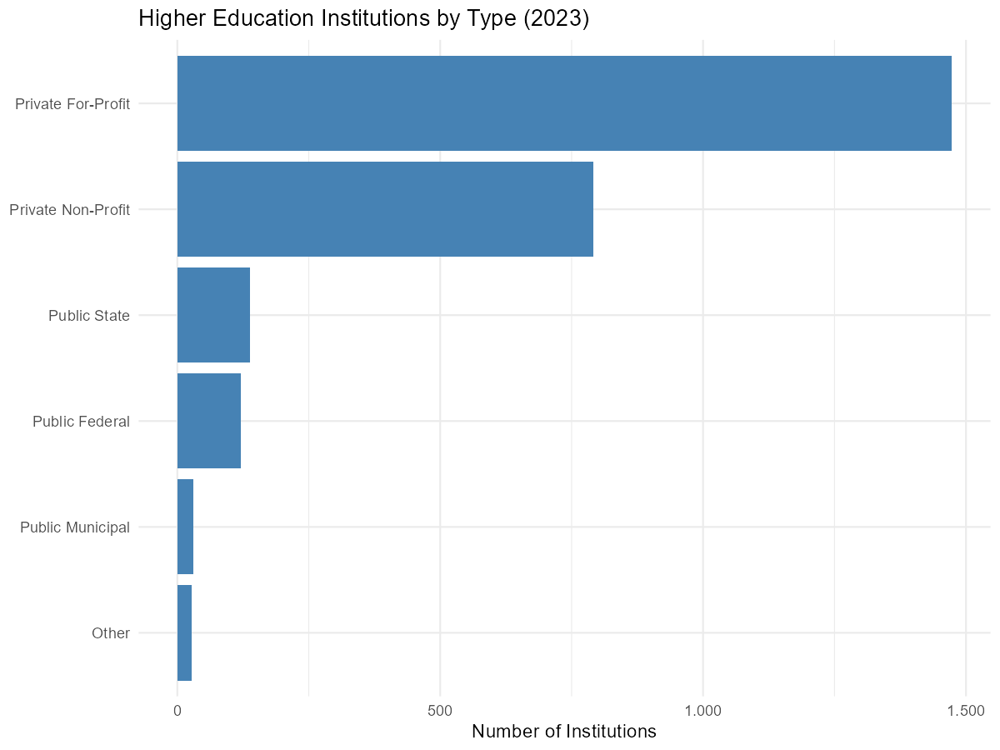
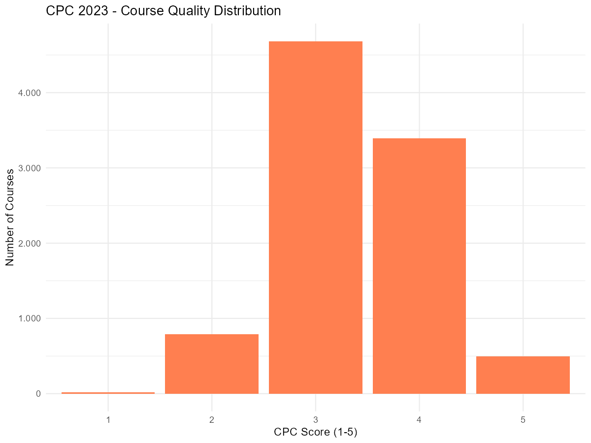
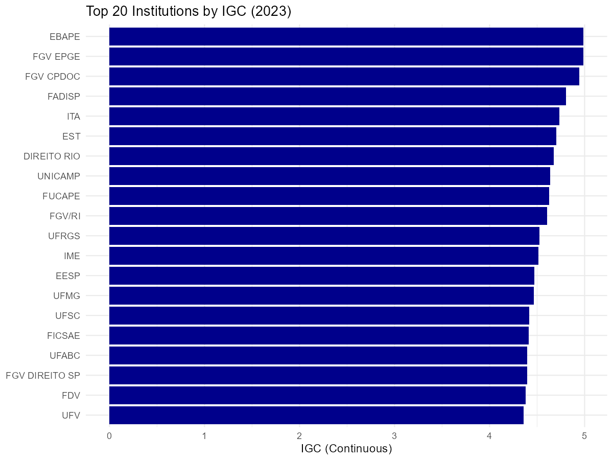
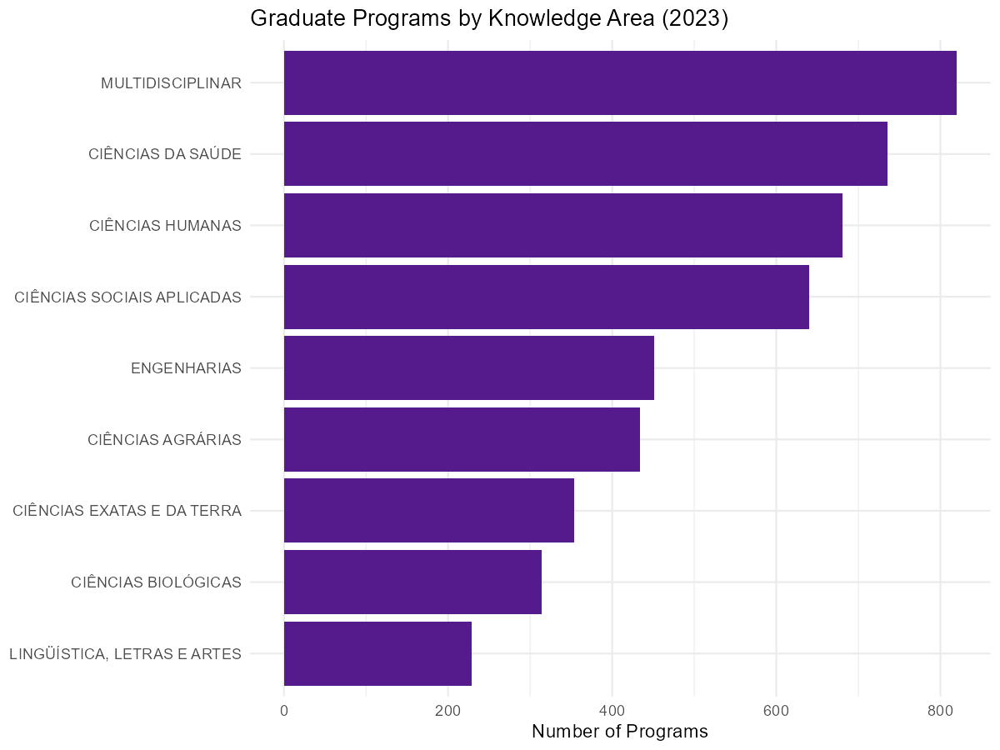
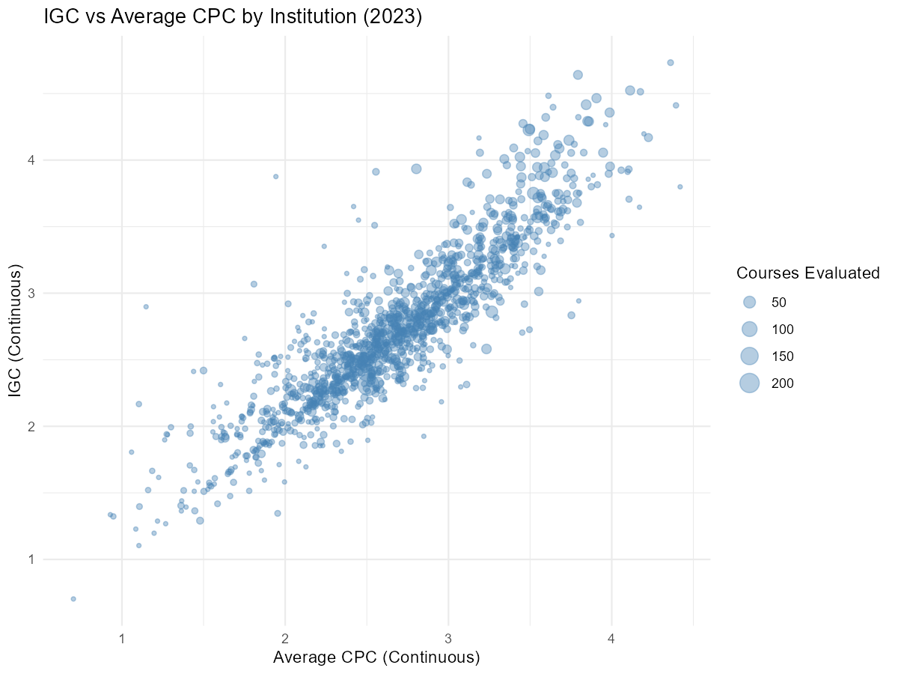

```{r, include = FALSE}
knitr::opts_chunk$set(
  collapse = TRUE,
  comment  = "#>",
  eval     = FALSE,
  message  = FALSE,
  warning  = FALSE
)
suppressPackageStartupMessages(library(systemfonts))
suppressPackageStartupMessages(library(textshaping))
```

This vignette covers higher education and graduate education datasets available
in educabR. These datasets allow you to analyze institutions, courses, student
performance, and quality indicators across Brazilian higher education.

```{r setup}
library(educabR)
library(dplyr)
library(ggplot2)
```

## Higher Education Census

The Higher Education Census is an annual survey covering all Brazilian higher
education institutions (IES), including data on institutions, courses, student
enrollment, and faculty.

### Available data types

| Type | Description |
|------|-------------|
| `"ies"` | Institutions (location, administrative type, accreditation) |
| `"cursos"` | Undergraduate courses (area, modality, enrollment) |
| `"alunos"` | Student enrollment (demographics, enrollment status) |
| `"docentes"` | Faculty (qualifications, employment type) |

### Downloading data

```{r censo-superior-download}
# Institution data
ies_2023 <- get_censo_superior(year = 2023, type = "ies")

# Course data filtered by state
cursos_sp <- get_censo_superior(year = 2023, type = "cursos", uf = "SP")

# Faculty data with limited rows
docentes_sample <- get_censo_superior(
  year  = 2023,
  type  = "docentes",
  n_max = 10000
)
```

### Available years

Data is available from 2009 to 2024.

### Exploring ZIP contents

```{r censo-superior-files}
# See what files are inside the downloaded ZIP
list_censo_superior_files(2023)
```

### Example analysis: Institutions by administrative type

```{r censo-superior-analysis}
ies <- get_censo_superior(2023, type = "ies")

ies_summary <- 
  ies |>
  mutate(
    admin_type = case_when(
      tp_categoria_administrativa == 1 ~ "Public Federal",
      tp_categoria_administrativa == 2 ~ "Public State",
      tp_categoria_administrativa == 3 ~ "Public Municipal",
      tp_categoria_administrativa == 4 ~ "Private For-Profit",
      tp_categoria_administrativa == 5 ~ "Private Non-Profit",
      TRUE ~ "Other"
    )
  ) |>
  count(admin_type, sort = TRUE)

ggplot(ies_summary, aes(x = reorder(admin_type, n), y = n)) +
  geom_col(fill = "steelblue") +
  coord_flip() +
  labs(
    title = "Higher Education Institutions by Type (2023)",
    x     = NULL,
    y     = "Number of Institutions"
  ) +
  theme_minimal() +
  scale_y_continuous(label = scales::number_format(big.mark = ".", decimal.mark = ","))
```



---

## ENADE - National Student Performance Exam

ENADE (Exame Nacional de Desempenho dos Estudantes) is an annual exam assessing
undergraduate student performance. It follows a rotating cycle where different
course areas are evaluated each year.

### One file per call

INEP publishes each ENADE edition as several files (`arq1`, `arq2`, ...), each
with one group of variables. To comply with the LGPD, each file is sorted by
different variables, so **the files cannot be joined student by student**: the
first row of one file is not the same student as the first row of another.
`get_enade()` reads one file per call, and `list_enade_files()` shows which
variables each file holds.

```{r enade-files}
# which file holds which variables?
files <- list_enade_files(2023)
files[grepl("nt_ger", files$variaveis), ]

# scores are in file 3 in 2023
scores <- get_enade(2023, arquivo = 3)

# sample for exploration
scores_sample <- get_enade(2023, arquivo = 3, n_max = 5000)
```

Files can be combined at the course level (`co_curso`), for example by
averaging scores per course, as INEP's user manual recommends.

### Available years

Data is available for 2004-2019 and 2021-2023 (there was no ENADE in 2020).

### Example analysis: Score distribution

```{r enade-analysis}
enade <- get_enade(2023, arquivo = 3)

enade |>
  filter(!is.na(nt_ger)) |>
  ggplot(aes(x = nt_ger)) +
  geom_histogram(binwidth = 5, fill = "darkorange", color = "white") +
  labs(
    title = "ENADE 2023 - General Score Distribution",
    x     = "General Score (nt_ger)",
    y     = "Number of Students"
  ) +
  theme_minimal() +
  scale_y_continuous(label = scales::number_format(big.mark = ".", decimal.mark = ","))
```


---

## IDD - Value-Added Indicator

IDD (Indicador de Diferenca entre os Desempenhos Observado e Esperado) measures
the value added by an undergraduate course. It compares ENADE scores with the
expected performance based on students' ENEM admission scores.

### Downloading IDD data

```{r idd-download}
# Download IDD data
idd_2023 <- get_idd(year = 2023)

# Sample for exploration
idd_sample <- get_idd(year = 2023, n_max = 5000)
```

### Available years

Data is available for 2014-2019 and 2021-2023 (no 2020 edition due to COVID).

### Example analysis: Value-added by institution type

```{r idd-analysis}
idd <- get_idd(2023)

glimpse(idd)
```

---

## Conceito Enade

The Conceito Enade is the course-level indicator derived from ENADE: the
performance of graduating students, on a continuous scale and in five levels
(faixas 1 to 5). `get_enade()` returns the student microdata;
`get_conceito_enade()` returns the official indicator, one row per course.

```{r conceito-enade-download}
# Conceito Enade 2023
ce_2023 <- get_conceito_enade(2023)

# 2025 is published as two files with their own methodology
ce_lic <- get_conceito_enade(2025, type = "licenciaturas")
ce_med <- get_conceito_enade(2025, type = "medicina")
```

Up to 2014 a row is a course *unit* (all courses of the same institution,
municipality and area); from 2015 on, a row is a course with its e-MEC code
(`codigo_do_curso`). For 2007-2011, INEP publishes the Conceito Enade inside
the Enade/CPC table, which `get_conceito_enade()` returns as is. Column names
change across editions, so map them to a common set before stacking years.

---

## CPC - Preliminary Course Concept

CPC (Conceito Preliminar de Curso) is a quality indicator for undergraduate
courses. It combines ENADE scores, IDD, faculty qualifications, pedagogical
resources, and student perceptions.

CPC scores range from 1 to 5, where courses scoring 1 or 2 are considered
unsatisfactory.

### Downloading CPC data

```{r cpc-download}
# Download CPC data (Excel format, requires readxl)
cpc_2023 <- get_cpc(year = 2023)

# Sample for exploration
cpc_sample <- get_cpc(year = 2023, n_max = 5000)
```

### Available years

Data is available for 2007-2019 and 2021-2023 (no 2020 edition).

### Example analysis: Course quality distribution

```{r cpc-analysis}
cpc <- get_cpc(2023)

# Distribution of CPC scores
cpc |>
  filter(!is.na(cpc_faixa)) |>
  count(cpc_faixa) |>
  ggplot(aes(x = factor(cpc_faixa), y = n)) +
  geom_col(fill = "coral") +
  labs(
    title = "CPC 2023 - Course Quality Distribution",
    x     = "CPC Score (1-5)",
    y     = "Number of Courses"
  ) +
  theme_minimal() +
  scale_y_continuous(label = scales::number_format(big.mark = ".", decimal.mark = ","))
```



---

## IGC - General Courses Index

IGC (Indice Geral de Cursos) is a quality indicator for higher education
institutions. It is calculated as a weighted average of CPC scores for
undergraduate courses plus CAPES scores for graduate programs.

IGC scores range from 1 to 5, providing an overall quality measure for each
institution.

### Downloading IGC data

```{r igc-download}
# Download IGC data (Excel format, requires readxl)
igc_2023 <- get_igc(year = 2023)

# Sample for exploration
igc_sample <- get_igc(year = 2023, n_max = 1000)
```

### Available years

Data is available for 2007-2019 and 2021-2023 (no 2020 edition). Note: IGC
2007 comes as a 7z archive containing an Excel file.

### Example analysis: Institution quality

```{r igc-analysis}
igc <- get_igc(2023)

# Top institutions by continuous IGC
igc |>
  filter(!is.na(igc_continuo)) |>
  filter(!is.na(sigla_da_ies)) |>
  arrange(desc(igc_continuo)) |>
  head(20) |>
  ggplot(aes(x = reorder(sigla_da_ies, igc_continuo), y = igc_continuo)) +
  geom_col(fill = "darkblue") +
  coord_flip() +
  labs(
    title = "Top 20 Institutions by IGC (2023)",
    x     = NULL,
    y     = "IGC (Continuous)"
  ) +
  theme_minimal()
```



---

## CAPES - Graduate Education Data

CAPES (Coordenacao de Aperfeicoamento de Pessoal de Nivel Superior) provides
open data on Brazilian graduate programs (stricto sensu: masters and doctoral
programs).

### Available data types

| Type | Description |
|------|-------------|
| `"programas"` | Graduate programs (area, institution, CAPES score) |
| `"discentes"` | Students (enrollment, demographics, funding) |
| `"docentes"` | Faculty (qualifications, research output) |
| `"cursos"` | Graduate courses within programs |
| `"catalogo"` | Theses and dissertations catalog |

### Downloading CAPES data

```{r capes-download}
# Graduate programs
programas_2023 <- get_capes(year = 2023, type = "programas")

# Students (large dataset!)
discentes_sample <- get_capes(year = 2023, type = "discentes", n_max = 10000)

# Theses and dissertations catalog
catalogo_2023 <- get_capes(year = 2023, type = "catalogo")
```

### Available years

Data is available from 2013 to 2024. Data is retrieved from the CAPES Open Data
Portal via CKAN API.

### Example analysis: Graduate programs by knowledge area

```{r capes-analysis}
programas <- get_capes(2023, type = "programas")

# Count programs by broad knowledge area
programas |>
  count(nm_grande_area_conhecimento, sort = TRUE) |>
  head(10) |>
  ggplot(aes(
    x = reorder(nm_grande_area_conhecimento, n),
    y = n
  )) +
  geom_col(fill = "purple4") +
  coord_flip() +
  labs(
    title = "Graduate Programs by Knowledge Area (2023)",
    x     = NULL,
    y     = "Number of Programs"
  ) +
  theme_minimal()
```



---

## Combining quality indicators

CPC, IGC, IDD, and ENADE are closely related. Here is an example of how to
combine them for a comprehensive view.

```{r combined-analysis}
# Load CPC and IGC for the same year
cpc <- get_cpc(2023)
igc <- get_igc(2023)

# Compare institution-level quality
# IGC gives the overall institution score
# CPC gives individual course scores within each institution
igc_summary <- 
  igc |>
  filter(!is.na(igc_faixa)) |>
  select(codigo_da_ies, sigla_da_ies, igc_continuo, igc_faixa)

cpc_summary <- 
  cpc |>
  filter(!is.na(cpc_continuo)) |>
  group_by(codigo_da_ies) |>
  summarise(
    n_courses = n(),
    mean_cpc  = mean(cpc_continuo, na.rm = TRUE),
    .groups   = "drop"
  )

combined <- inner_join(igc_summary, cpc_summary, by = "codigo_da_ies")

ggplot(combined, aes(x = mean_cpc, y = igc_continuo, size = n_courses)) +
  geom_point(alpha = 0.4, color = "steelblue") +
  labs(
    title = "IGC vs Average CPC by Institution (2023)",
    x     = "Average CPC (Continuous)",
    y     = "IGC (Continuous)",
    size  = "Courses Evaluated"
  ) +
  theme_minimal()
```


